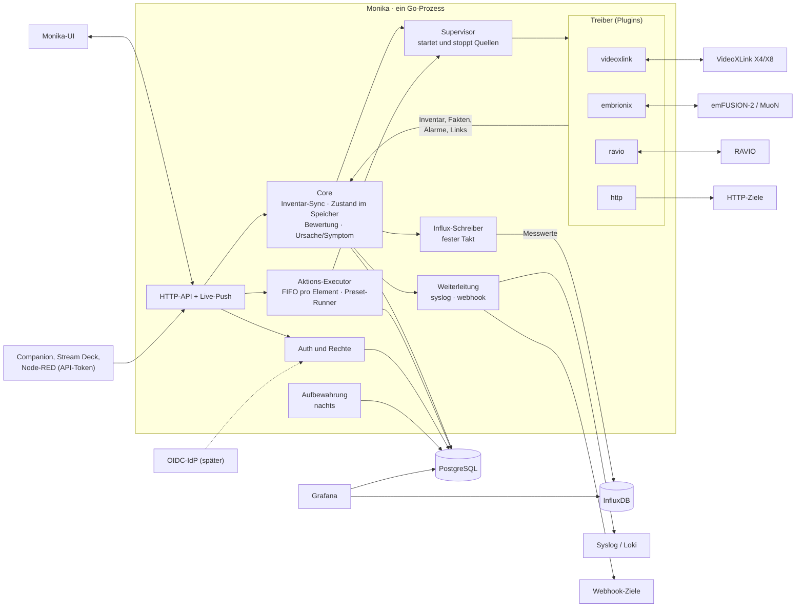
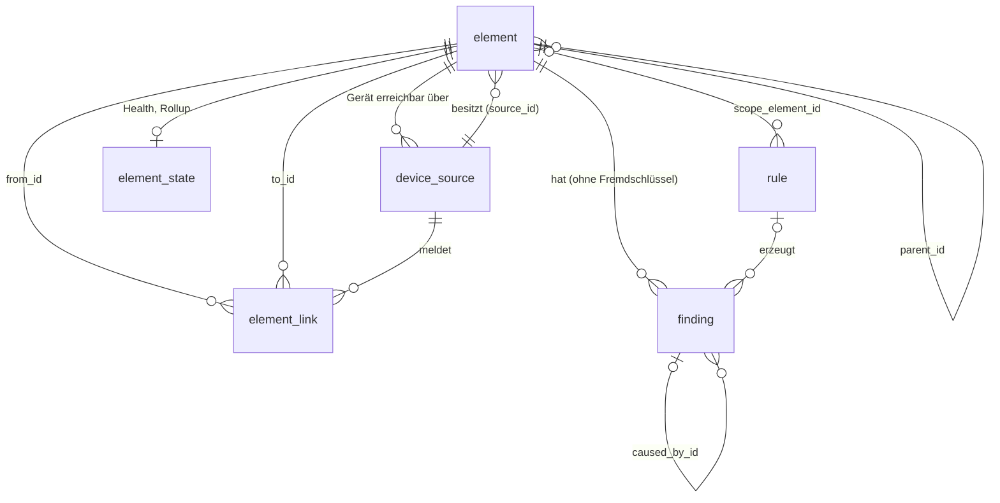
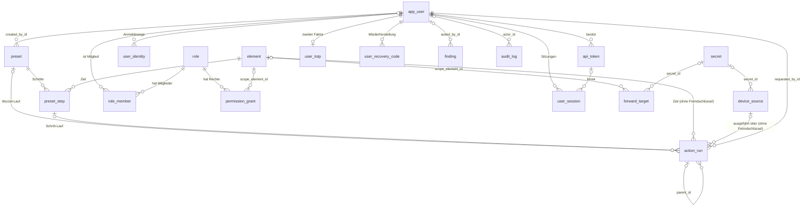

# Monika – Architektur

**Stand:** 2026-10-11 · **Status:** verbindlich für alle folgenden Arbeiten
**Schema-Referenz:** [`schema/monika.dbml`](../schema/monika.dbml) (PostgreSQL). Dieses Dokument erklärt das *Warum* und die Regeln; das DBML ist die exakte Definition der Tabellen.

---

## Inhalt

1. [Zweck und Abgrenzung](#1-zweck-und-abgrenzung)
2. [Grundprinzipien](#2-grundprinzipien)
3. [Technologie und Systemaufbau](#3-technologie-und-systemaufbau)
4. [Treiber (Plugins)](#4-treiber-plugins)
5. [Das Element-Modell](#5-das-element-modell)
6. [Links: Beziehungen zwischen Elementen](#6-links-beziehungen-zwischen-elementen)
7. [Remote-Geräte und Perspektiven](#7-remote-geräte-und-perspektiven)
8. [Zustand und Bewertung](#8-zustand-und-bewertung)
9. [Aktionen und Einstellungen](#9-aktionen-und-einstellungen)
10. [Presets](#10-presets)
11. [Sende-Ziele](#11-sende-ziele)
12. [Benutzer, Rollen und Rechte](#12-benutzer-rollen-und-rechte)
13. [Weiterleitung](#13-weiterleitung)
14. [Datenhaltung](#14-datenhaltung)
15. [Datenbank](#15-datenbank)
16. [Referenzbeispiel: VideoXLink X8 im REMI-Betrieb](#16-referenzbeispiel-videoxlink-x8-im-remi-betrieb)
17. [Offene Punkte](#17-offene-punkte)
18. [Glossar](#18-glossar)

---

## 1. Zweck und Abgrenzung

Monika ist ein **universeller, einfacher Konfigurator und Monitor für Broadcast-Geräte**. Sie zeigt den echten Zustand von Geräten, Streams und I/O unterschiedlicher Hersteller in einem einheitlichen Modell und erlaubt es, auf diesen Geräten Aktionen auszuführen.

Die erste Treiber-Generation:

1. **VideoXLink X4/X8** (Hauptgrund des Projekts; Library `goxlinkclient` vorhanden)
2. **Embrionix / Riedel** emFUSION-2 und MuoN
3. **DirectOut RAVIO**
4. **HTTP** für generische Aktionen

Jeder Treiber bekommt vor seinem Code einen eigenen Vertrag: sein `drivers/<name>/README.md` (unterstützte Modelle und Firmware, Elementbaum, Schema der `external_id`, Zuordnung der Fakten, Aktionen, Konfiguration und Secret, siehe `DRIVERS.md`).

### Umfang von Version 1

Version 1 entsteht in zwei Phasen; die Grenze zwischen ihnen ist die HTTP-API (`api/openapi.yaml`).

| Phase | Inhalt | Beschreibung |
|---|---|---|
| **1 · Backend** | Core, Dienste, Treiber, API, Betrieb | dieser Dokumentensatz; die Treiber je mit eigenem README-Vertrag vor ihrem Code |
| **2 · UI** | Seiten, Abläufe, Bedienkonzept, Technologie | eine eigene Beschreibung, die vor dem ersten Code der UI abgestimmt wird (gleiche Regel: erst Vertrag, dann Code) |

Die Beschreibung von Phase 1 ist vollständig; die von Phase 2 entsteht nach dem Backend.

### Was Monika ist

- Ein normalisiertes **Live-Bild** der Geräte mit Struktur (Bäume, Gruppen, Perspektiven).
- Eine **Bewertung** dieses Bildes gegen vom User definierte Regeln, inklusive Unterscheidung von **Ursache und Symptom** über die Topologie.
- Ein Werkzeug für **einmalige Aktionen**: Befehle, Einstellungen, Presets.

### Was Monika nicht ist

| Nicht-Ziel | Begründung / wohin stattdessen |
|---|---|
| **Kreuzschiene** | Streams werden nicht miteinander verschaltet. Dafür gibt es fertige Lösungen. |
| **Soll-Ist-Abgleich der Konfiguration** | Das Gerät ist immer die Wahrheit, auch weil über Hersteller-Software geändert werden kann. |
| **Mischpult-Controller / Live-Regler** | Aktionen sind einmalige Befehle mit „Übernehmen“, keine Regler mit Live-Wirkung (keine Fader, keine Farbwert-Slider). |
| **Prometheus-Nachbau** | Keine Zeitreihen-Abfragen (`rate()`, `avg_over_time()`), keine Arithmetik in Regeln → **Grafana auf InfluxDB**. |
| **Alerting-Plattform** | Kein Routing, keine Eskalation, keine Bereitschaftspläne → Befunde werden per **Syslog/Webhook** weitergegeben. |
| **Standort- oder Produktionsverwaltung** | Standorte und Produktionen sind **Gruppen**. |

**Abgrenzungsregel für neue Features:** *Was ohne Wissen über Struktur und Topologie funktioniert, gehört nicht in Monika.*

---

## 2. Grundprinzipien

1. **Das Gerät ist immer die Wahrheit.** Monika speichert keine Soll-Konfiguration und gleicht nichts ab. Ob eine Aktion gewirkt hat, zeigt der beobachtete Gerätezustand.
2. **Kein Kreuzschienen-Tool.** Signalbeziehungen (`feeds`) werden beobachtet, nie geschaltet.
3. **Treiber melden Fakten, der Core bewertet.** Kein Treiber entscheidet, was „OK“ ist (Ausnahme: was das Gerät selbst als Alarm oder Gut-/Schlecht-Zustand meldet, z. B. `system.psu_ok`).
4. **Komposition statt Hierarchie.** Es gibt keine Gerätetypen wie „Gateway“ oder „Router“. Ein Gerät ist ein Baum aus generischen Elementen.
5. **Jedes Element hat genau einen Besitzer** (eine Quelle oder den User). Dasselbe reale Ding darf aus mehreren Perspektiven auftauchen; die Perspektiven sind über `represents` verbunden.
6. **Klare Besitzverhältnisse pro Spalte.** Treiber schreiben Treiber-Spalten, der User schreibt User-Spalten. Ein Re-Discovery überschreibt nie Labels, Notizen oder Gruppen.
7. **Spaltenregel:** Was übergreifend abgefragt wird, bekommt eine Spalte. Was nur angezeigt wird, kommt ins JSONB.
8. **Inventar, Zustand und Historie werden getrennt** (selten / ständig / wächst endlos).
9. **Vokabular lebt in Go.** `kind`, `transport`, Fakt-Schlüssel und Aktionsnamen sind kontrollierte Listen im Code, in der Datenbank `text`. Neue Werte brauchen keine Migration.
10. **Unbekannt ist nicht Fehler.** Liefert eine Quelle keine Daten, ist der Zustand ihrer Elemente `unknown`, nie ein eingefrorenes Grün und nie ein falsches Rot. Wo Monika nichts prüft, zeigt sie auch kein Grün: Ein Element, an dem keine Regel gilt, ist *ungeprüft* und hat keine Health.

---

## 3. Technologie und Systemaufbau

| Bereich | Entscheidung |
|---|---|
| Sprache | **Go** |
| Architektur | **Monolith**: ein Prozess, ein Deployment |
| Erweiterbarkeit | **Plugin-getrieben nach dem Telegraf-Modell**: Treiber implementieren die Interfaces des Cores und werden **zur Compile-Zeit** eingebunden |
| Hauptdatenbank | **PostgreSQL ≥ 18** (wegen nativem `uuidv7()`) |
| Historie | **InfluxDB** |
| Auswertung der Historie | **Grafana** (bestehend), liest InfluxDB und löst Namen über das Schema `reporting` in PostgreSQL auf |
| IDs | **UUIDv7**, Typ `uuid` (nie `text`), im Normalfall in Go erzeugt (`uuid.NewV7()`) |
| Anmeldung | lokal; **OIDC** ist vorbereitet und kommt später |
| Geheimnisse | **verschlüsselter Secret-Store in PostgreSQL** (AES-256-GCM); Master-Key aus der Umgebung bzw. `.env` |
| Bootstrap | Master-Key, DB-Verbindung, öffentliche URL, InfluxDB, Aufbewahrung, initialer Admin aus der Umgebung bzw. `.env` (Abschnitt 14) |
| Hauptadressat | die **Monika-UI**; Push nach außen nur per Syslog und Webhook |

### Komponenten



### Datenfluss: Beobachten

```
Treiber ──Inventar, Fakten, Alarme, Links──▶ Core
                                              ├─ 1. Inventar synchronisieren   → element, element_link (nur eigene Quelle), audit_log
                                              ├─ 2. Fakten übernehmen          → Speicher des Core
                                              │                                → InfluxDB (fester Takt)
                                              ├─ 3. Befunde erzeugen/beenden   Regeln · Gerätealarme · System → finding
                                              ├─ 4. Ursache vs. Symptom        über feeds / uses / parent
                                              ├─ 5. Health und Rollup          Element, Gerät, Gruppe → element_state (nur bei Änderung)
                                              └─ 6. Push                       UI (live), Weiterleitung (gefiltert)
```

Der Core hält Inventar, Fakten und Link-Graph **im Speicher** und bewertet dort, in einer einzigen Schleife, die den Zustand besitzt (Vertrag: [`contracts/core.md`](contracts/core.md)). **Aktuelle Fakten liegen nur im Speicher**; nach einem Neustart liefern die Treiber den vollständigen Stand neu, bis dahin sind die Elemente `unknown`. PostgreSQL dient der Persistenz (Inventar, Health, Historie von Befunden und Läufen), nicht der Bewertungslogik.

### Datenfluss: Handeln

```
UI / API ──▶ Rechteprüfung ──▶ action_run (pending)
                                   │  FIFO pro Element
                                   ▼
                               Treiber (über die Quelle, die das Element besitzt)
                                   │
                    ┌──────────────┼───────────────┐
                    ▼              ▼               ▼
                 rejected        failed         accepted
                                                   │  Prüfbedingung gegen Fakten
                                          ┌────────┴────────┐
                                          ▼                 ▼
                                      confirmed        unconfirmed
```

---

## 4. Treiber (Plugins)

Pro Hersteller bzw. Gerätetyp gibt es einen Treiber. Treiber laufen im Monika-Prozess und implementieren die Treiber-Interfaces des Cores.

### Einbindung (Telegraf-Modell)

- Jeder Treiber liegt in einem eigenen Paket (`monika/drivers/<name>`) und registriert sich in `init()` beim Core (Name, Fabrikfunktion, Konfigurationsschema, Aktionsdefinitionen, Fakt-Katalog).
- **Treibername = Paketname**, nur `[a-z0-9]` (z. B. `videoxlink`, `embrionix`, `ravio`, `http`). Der Name steht als Text in `device_source.driver`, `rule.match_driver` und `preset_step.driver` und wird deshalb nie umbenannt.
- Ein Sammelpaket (`monika/drivers/all`) importiert alle Treiber per Blank-Import; `main` importiert das Sammelpaket. Ein neuer Treiber = ein neues Paket plus eine Import-Zeile.
- Ergebnis ist **ein Binary**, typsicher, ohne Laden zur Laufzeit.
- **Abhängigkeitsrichtung:** Treiber importieren ausschließlich das öffentliche Paket `sdk/` (Interfaces, Vokabular, Registry) und ihre Gerätelibrary, nie `internal/`. Die Ordnerstruktur steht im `README.md` im Projektstamm.
- Optional: Build-Tags pro Treiber für schlanke Builds.
- **Treiber sind dünne Adapter.** Gerätelibraries (z. B. `goxlinkclient`) bleiben eigenständige Repositories ohne Abhängigkeit zu Monika; der Treiber übersetzt nur zwischen Library und Monika-Interfaces.
- **Vertrag:** Typen, Interfaces und Abläufe des SDK stehen in [`contracts/sdk.md`](contracts/sdk.md), die Namen in [`contracts/vocabulary.md`](contracts/vocabulary.md); wie man einen Treiber schreibt, zeigt [`DRIVERS.md`](DRIVERS.md).
- **Fehlerisolation:** Jede Treiber-Goroutine läuft hinter einer `recover()`-Grenze. Ein Panic beendet nur diese Quelle: Ihre Elemente werden `unknown`, der Supervisor startet sie nach einer Wartezeit neu, und hält der Ausfall an, entsteht `source.unreachable` mit Fehlermeldung (Abschnitt 8). Monika stürzt nicht ab.

Verworfen: Go `plugin` (`.so`; fragil bei Versionen und Abhängigkeiten), separate Prozesse per gRPC (widerspricht dem Monolithen; Isolation wird über `recover()` erreicht), WASM (für netzwerklastige Treiber nicht ausgereift).

### Pflichten eines Treibers

| Bereich | Pflicht |
|---|---|
| **Discovery** | Meldet den Elementbaum des Geräts aus Sicht seiner Quelle: `kind`, `transport`, `direction`, `name`, `attributes`, Position. Dazu die Identität des Geräts, wie die Quelle sie sieht (Hersteller, Modell, Seriennummer, Firmware). |
| **Identität** | Jedes Element hat eine **stabile `external_id`**, eindeutig innerhalb der Quelle (Slot-/Index-Pfad oder geräteeigene ID, nie eine laufende Nummer aus der Discovery-Reihenfolge). Wo vorhanden, zusätzlich eine global eindeutige `global_ref` mit Namensraum (`xlink:X8A9001-E1`, `nmos:<uuid>`); für das Gerät selbst die `global_ref` des Zugangs-Elements (`xlink:X8A9001`). Jeder Namensraum gehört einem Treiber; andere verwenden ihn nur als Ziel von Links. Das Zugangs-Element der Quelle (siehe Abschnitt 5) wird ohne `external_id` angesprochen. |
| **Fakten** | Meldet Zustandswerte als flache Map mit Punkt-Schlüsseln aus dem Go-Vokabular, mit dem Typ aus dem Fakt-Katalog. Keine Bewertung. Ein Fakt wird gemeldet, solange das Element ihn grundsätzlich hat; „kein Signal“ ist `false`, nicht ein fehlender Fakt. Fakten, die das ganze Gerät betreffen, gehören an das Zugangs-Element. |
| **Fakt-Katalog** | Deklariert jeden Rohwert mit Typ (`bool`, `int`, `float`, `string`), Art (`status`, `gauge`, `counter`) und Beschreibung; die Einheit steht als Endung im Namen. Kern- und bekannte Fakten bringt das Vokabular mit. Nicht deklarierte Schlüssel und Werte mit falschem Typ verwirft der Core. |
| **Vollständiger Stand** | Meldet beim Verbinden und bei jedem Wiederverbinden den **vollständigen** aktuellen Stand aller seiner Elemente, nicht nur Änderungen. |
| **Lebenszeichen** | Gibt regelmäßig Lebenszeichen (jede erfolgreiche Abfrage, Keepalive eines Event-Streams) und nennt pro Quelle den erwarteten Abstand (bei Sende-Zielen ohne Health-Check `0`). Bleiben sie aus, gilt die Quelle als nicht erreichbar. |
| **Alarme** | Reicht vom Gerät selbst gemeldete Alarme weiter. |
| **Links** | Meldet `feeds`, `uses` und `represents`. Ein Link über Gerätegrenzen wird von der Seite gemeldet, die ihn konfiguriert (bei XLink: der Decoder). |
| **Fähigkeiten** | Meldet pro Element die unterstützten Befehle (`actions`), die dort zusätzlich kritischen Befehle (`critical_actions`) und die schreibbaren Einstellungen (`settings`) mit Typ, Grenzen und ggf. `critical` bzw. `write_only`. |
| **Ausführung** | Führt Befehle und `set` aus und liefert die Antwort des Geräts (inkl. abgelehnter Felder). |
| **Aktionsdefinitionen** | Bringt pro Befehl in Go mit: Parameter-Schema, Prüfbedingung mit Timeout, Kennzeichen `critical`. Ausnahme Sende-Ziele: Das Parameter-Schema steht pro Element (siehe Abschnitt 11). |
| **Konfigurationsschema** | Bringt ein JSON-Schema für seine `device_source.config` mit; die UI erzeugt daraus das Formular. |

### Verbote

- Ein Treiber fasst **nur Elemente und Links seiner eigenen Quelle** an.
- Ein Treiber bietet **keine Aktion an, die `feeds`-Links erzeugt oder ändert** (z. B. XLink `DecoderSender`). `uses`-Links dürfen geändert werden (z. B. Uplink-Interface eines Decoders).
- Ein Treiber bewertet nicht. Er meldet `state.signal_present: false`, nicht „Fehler“.
- Ein Treiber meldet nie Elemente mit den reservierten `kind`-Werten `device`, `group` und `access` und nie den reservierten Fakt `present`.
- Ein Treiber verändert nie seine eigene Konfiguration (`device_source.config`); sie gehört dem User.
- Ein Treiber bietet **nie** eine Einstellung an, die die Management-Adresse ändert, und nie geheime Werte (Passwörter, Schlüssel). Nach dem Setzen der Adresse wäre die Quelle unerreichbar; Parameter eines Laufs stehen im Klartext in `action_run.params`. Monika bietet dafür auch später keinen Weg: Management-Adresse und Zugangsdaten ändert der Betreiber am Gerät und in der Quelle. Bietet ein Treiber es trotzdem an, verstößt er gegen den Vertrag.
- Zugangsdaten stehen nie in `config`, sondern werden über `secret_id` aus dem Secret-Store bezogen. Der Core entschlüsselt und übergibt dem Treiber den Klartext.

### Vokabular in drei Stufen

Das vollständige Vokabular (Arten, Transporte, Fakten mit Typ und Einheit, Measurements, Aktionen, Namensräume, reservierte Namen) steht in [`contracts/vocabulary.md`](contracts/vocabulary.md). Für Fakten und Aktionen gilt dasselbe Muster:

| Stufe | Fakten | Aktionen | Verwendung |
|---|---|---|---|
| **Kern** (einheitliche Bedeutung) | Measurement `state`: `state.running`, `state.signal_present`, `state.connected`, `state.reachable`, `state.current_direction` | `start`, `stop`, `reboot`, `set`, `trigger` | generische UI, Sammelaktionen, Gruppenregeln über Hersteller und Transporte |
| **Bekannt** (Domänen) | `system.*`, `sdi.*`, `video.*`, `audio.*`, `ptp.*`, `stream.*`, `sfp.*`, … z. B. `ptp.offset_ns`, `sfp.rx_power_dbm`, `sdi.crc_errors` | `reset_counters` | Regeln und Dashboards über Hersteller hinweg |
| **Roh** (Treibername als Präfix) | `videoxlink.p2p`, `videoxlink.needs_reboot`, `http.status_code` | `videoxlink.reset_video_buffer`, `videoxlink.flush_audio` | Detailseite und Regeln; nie in Zeitreihen |

Ein Rohwert wird zum bekannten Wert, sobald ein zweiter Treiber denselben Wert liefert. **Jeder Schlüssel hat einen festen Typ und eine feste Einheit**: Kern- und bekannte Fakten im Vokabular, Rohwerte im Fakt-Katalog des Treibers. Damit prüft der Core Regeln beim Speichern gegen den Typ.

**Fakten und Zeitreihen sprechen dasselbe Vokabular:** Der Fakt-Schlüssel ist `<measurement>.<feld>` mit der Einheit im Feldnamen (`ptp.offset_ns`); derselbe Name steht in Regeln, UI und InfluxDB. Ein Messpunkt, den es mehrfach gibt (Lüfter, Temperaturen, Pfade nach ST 2022-7), ist ein eigenes Element, kein Tag. Rohe Fakten gehen nie nach InfluxDB; was historisiert werden soll, kommt ins Vokabular.

`present` ist ein **reservierter Fakt**: Ihn setzt kein Treiber, sondern der Core blendet bei der Bewertung die Spalte `element.present` ein. So lässt sich das Verschwinden eines Elements per Regel überwachen (Abschnitt 8).

**Zähler und zeitliche Ableitungen** berechnet der Treiber, nicht die Regel. Das SDK stellt dafür einen Zähler-Helfer bereit: Er bekommt Rohwerte und liefert die Rate pro Sekunde, erkennt Resets (Aktion, Reboot) und Überläufe (bei angegebener Breite) und liefert nach dem Start erst ab dem zweiten Wert eine Rate. Die Rate eines Zählers heißt `<feld>_per_s` (z. B. `sdi.crc_errors_per_s`) und ist **pro Sekunde** angegeben, damit ihre Bedeutung nicht vom Abfragetakt abhängt. Geräte, die nur eine Rate liefern, melden nur sie. Jeder Fakt hat einen von vier Typen: `bool`, `int` (`int64`), `float` (`float64`), `string`.

---

## 5. Das Element-Modell

Alles, was Monika kennt, ist ein **Element**: Geräte, Ports, Units, Streams, Interfaces, Peers, Trigger und Gruppen. Status, Labels, Regeln, Rechte und Aktionen hängen dadurch an einer einzigen Tabelle.

### Vier Klassen

| Klasse | `kind` | `device_id` | `parent_id` | `source_id` | `external_id` |
|---|---|---|---|---|---|
| **Gerät** | `device` | = eigene `id` | NULL | NULL | NULL |
| **Gruppe** | `group` | NULL | NULL | NULL | NULL |
| **Zugang** | `access` | gesetzt | = `device_id` | gesetzt | NULL |
| **Treiber-Element** | alle anderen | gesetzt | gesetzt | gesetzt | gesetzt |

Erzwungen durch `element_class_check`. Das Gerät gehört keiner Quelle, weil es mehrere Quellen haben kann (z. B. XLink-API und IPMI). Treiber-Elemente hängen mindestens am Zugangs-Element ihrer Quelle. `device_id` zeigt immer auf ein Element mit `kind = device`; das sichert die Anwendung, nicht die Datenbank.

### `kind`-Vokabular

`device`, `group`, `access`, `module`, `port`, `network_interface`, `clock`, `sender`, `receiver`, `peer`, `path`, `tunnel`, `processing`, `sensor`, `trigger` (Bedeutung und Abgrenzung: [`contracts/vocabulary.md`](contracts/vocabulary.md))

- **`device`, `group` und `access` sind reserviert:** Diese Elemente legt nur der Core an, Treiber melden sie nie. Alle anderen Elemente entstehen nur durch die Discovery.

- **`kind` beschreibt die Rolle, `transport` den Weg** (`sdi`, `madi`, `analog`, `aes3`, `st2110-20`, `st2110-30`, `st2110-40`, `aes67`, `xlink`, `srt`, `ndi`, …). Ein Gateway ist kein Typ, sondern ein Gerät mit `port`/`sdi` und `sender`/`st2110-20`.
- **`direction`** (`in`, `out`, `bidir`) ist die *Fähigkeit* eines Anschlusses. Die *aktuelle* Richtung eines bidirektionalen Ports ist ein Fakt.
- **Units sind keine Ports.** Ein Encoder hängt unter dem Zugang seiner Quelle (nicht unter einem Port). Kann er seinen Eingang wählen, *nutzt* er den Port über einen `uses`-Link, der sich ändern darf; ist der Eingang fest verdrahtet, *speist* der Port ihn (`feeds`, Abschnitt 6).

### Gerät und Quellen

- **Ein Gerät ist ein Element mit `kind = device`.** Geräte legt immer der User an; ihr Name ist das `label`. Kein Treiber schreibt in das Gerät-Element, es trägt keine Fakten, nur Health und Rollup.
- `device_source` beschreibt, **wie** ein Gerät erreicht wird: Treiber, Adresse, Konfiguration, Verweis auf ein Secret (`secret_id`). Ein Gerät kann mehrere Quellen haben, höchstens eine pro Treiber.
- **Die Identität des Geräts steht pro Quelle** in `device_source` (`vendor`, `model`, `serial`, `firmware`): so, wie diese Quelle das Gerät sieht. Zwei Quellen beschreiben oft Verschiedenes (XLink das Produkt X8, IPMI die Server-Hardware darunter); die UI zeigt alle.
- Jede Quelle besitzt ihre eigenen Elemente und Links. Ein Re-Discovery fasst nur diese an. Eine zweite Quelle liefert also keine Fakten zu Elementen der ersten, sondern eigene Elemente im selben Gerät (z. B. IPMI: Lüfter, Netzteile, BMC-Schnittstelle). Sehen zwei Quellen dasselbe reale Ding, entstehen zwei Elemente, verbunden über `represents`.

**Das Zugangs-Element (`kind = access`)** ist die Wurzel einer Quelle im Gerät:

- Der Core legt es an, wenn eine Quelle angelegt wird; es lebt so lange wie die Quelle und verschwindet nie (`present` bleibt `true`, `last_seen_at` zeigt die letzte vollständige Discovery).
- Es hat keine `external_id`; Treiber sprechen es mit leerer ID an. Pro Quelle gibt es genau eines.
- **Alle Treiber-Elemente der Quelle hängen darunter.** Was über `parent_id` wirkt, wirkt damit pro Quelle: `monitored = false` am Zugang legt die Quelle still, ein Recht am Zugang gilt für die ganze Quelle, ein Fehler am Zugang ist Ursache für die Befunde ihrer Elemente.
- Hier hängen Fakten, die das ganze Gerät betreffen (`system.temperature_c`, `system.licenses_used`, `videoxlink.needs_reboot`), Aktionen für das ganze Gerät (`reboot`) und die Befunde `source.unreachable` und `source.discovery_failed`.
- Seine `global_ref` ist die globale ID des Geräts aus Sicht dieser Quelle (`xlink:X8A9001`), falls der Treiber eine meldet. Darüber verweisen andere Geräte auf dieses (Abschnitt 7).
- Sein Name ist standardmäßig der Treibername (z. B. „XLink-API“). Die UI zeigt das Gerät als Teilbaum pro Quelle; der Zugang ist deren Kopf mit Fakten, Aktionen und Befunden.

### Lebenszyklus

- **Treiber-Elemente werden nicht gelöscht, sondern verschwinden:** `present = false`. Kommt dasselbe Element mit derselben `external_id` zurück, sind Label, Notizen und Gruppen wieder da.
- **Geräte, Gruppen und Quellen werden gelöscht**, hart und mit allem, was an ihnen hängt. Ein Gerät, das nie eingepflegt wurde, hinterlässt so keinen Rest. Löschen
  - entfernt beim Gerät seine Quellen und Elemente, bei einer Quelle ihre Elemente und Links,
  - entfernt alle Mitgliedschaften in beide Richtungen (Mitglieder einer Gruppe, das Objekt bzw. seine Elemente als Mitglied anderer Gruppen),
  - löscht Konfiguration, die nur diesem Objekt oder seinen Elementen galt: Regeln, Rechte und Weiterleitungen mit diesem Geltungsbereich (mit Eintrag in `audit_log`),
  - zieht vorher die aktiven Befunde zurück (Grund `deleted`, Abschnitt 8).
- **Die Historie bleibt lesbar:** Befunde, Läufe und Audit verweisen ohne Fremdschlüssel auf Elemente und tragen beim Entstehen einen Namens-Snapshot ihres Ziels (`element_path`: Label, sonst Name, vom Gerät bis zum Element, getrennt durch „ / “, ohne Zugang, z. B. „L1 / D1“; dieselbe Regel gilt für `reporting.element.path`). Die UI zeigt den aktuellen Namen, solange das Element existiert, sonst den Snapshot mit dem Hinweis „gelöscht“. InfluxDB-Daten eines gelöschten Geräts zeigt Grafana mit ihrer ID.
- **Solange ein Preset-Schritt auf das Objekt zielt** (beim Gerät und bei der Quelle: auf eines ihrer Elemente), wird das Löschen abgelehnt; die UI nennt die Presets.
- Löschen und Anlegen von Geräten und Gruppen erfordert `inventory_edit` global, Quellen anlegen, ändern und löschen `source_edit` (Abschnitt 12). Was dabei mitgelöscht wird, braucht keine zusätzlichen Rechte.
- Eine Quelle lässt sich außerdem deaktivieren (`enabled = false`): Ihr Treiber läuft nicht, ihre Elemente gelten als nicht überwacht.
- **Abschluss jeder Discovery:** Der Core vergleicht jeden Snapshot im Speicher mit dem vorigen. Hat sich die Struktur geändert, setzt ein Statement pro Quelle `last_seen_at` aller gemeldeten Elemente und `present = false` für alle übrigen (außer dem Zugangs-Element). Ohne Strukturänderung schreibt er nur `last_seen_at`, höchstens alle 5 min; es ist damit auf 5 min genau.
- **Audit der Discovery:** Die Discovery schreibt mit `actor_id = NULL` in `audit_log`: `create` für ein zum ersten Mal gesehenes Element, `appear` für ein zurückgekehrtes, `disappear` für ein verschwundenes; Links mit `create` und `delete`. Änderungen an Attributen werden nicht protokolliert.
- **Wiederverwendete IDs:** Manche Geräte vergeben gelöschte IDs neu (XLink-Units). Ein neues Element erbt dann Labels, Regeln, Mitgliedschaften, Rechte und Preset-Schritte des alten. Faustregel: **Labels, Regeln, Rechte und Preset-Ziele gehören an stabile Dinge** (Ports, Geräte, vor allem Gruppen).

### Besitz der Spalten

| Wer | Spalten |
|---|---|
| Treiber | `kind`, `transport`, `direction`, `name`, `attributes`, `position`, `external_id`, `global_ref`, `actions`, `critical_actions`, `settings`, `params`; in `device_source`: `vendor`, `model`, `serial`, `firmware` |
| Core | `present`, `first_seen_at`, `last_seen_at`, `device_id`, `source_id`, `parent_id` (aus der Discovery) |
| User | `label`, `notes`, `monitored`; in `device_source`: `address`, `config`, `secret_id`, `enabled` |

**`monitored` vererbt sich entlang `parent_id`:** Ein Element gilt als überwacht, wenn es selbst und alle seine Vorfahren überwacht sind und seine Quelle aktiviert ist. Ist das Gerät stillgelegt, sind es alle seine Elemente; ist der Zugang stillgelegt, alle Elemente dieser Quelle. Die einzelnen Flags bleiben erhalten. Gruppen vererben nicht; an einer Gruppe hat `monitored` keine Wirkung.

| Eine Quelle ruhen lassen | Treiber läuft | Fakten in UI und InfluxDB | Bewertung |
|---|---|---|---|
| Quelle deaktivieren (`enabled = false`) | nein | nein | nein |
| Zugang nicht überwachen (`monitored = false`) | ja | ja | nein |

### Gruppen

- Gruppen sind Elemente (`kind = group`) und werden vom User angelegt.
- Hierarchie und Mitgliedschaft laufen **ausschließlich über `element_link` vom Typ `member`**, nie über `parent_id`. Damit sind sie n:m und beliebig verschachtelt.
- **Position und Label hängen an der Mitgliedschaft**, nicht am Element: Gerät B / Input 1 ist *in dieser Stagebox* Kanal 5.
- `member`-Links dürfen keine Zyklen bilden (Prüfung in der Anwendung per rekursiver Abfrage). Prüfung und Insert laufen in einer Transaktion unter einem Advisory Lock (`pg_advisory_xact_lock`), damit zwei parallele Änderungen nicht gemeinsam einen Zyklus erzeugen.
- Mitgliedschaften ändern erfordert `inventory_edit` an der Gruppe **und** am Element (Abschnitt 12).
- Health einer Gruppe = schlimmster Zustand der Elemente in ihrem Geltungsbereich, jedes genau einmal gezählt, plus Rollup mit Zählern (Abschnitt 8). **Keine Redundanzlogik:** Jeder Ausfall ist ein Fehler, auch wenn die Produktion weiterläuft.
- Standorte und Produktionen werden als Gruppen modelliert.

Beispiel: eine Stagebox mit 8 Eingängen aus zwei Geräten mit je 4 Eingängen.

```
Bühne (Gruppe)
└─ Stagebox links (Gruppe)
   ├─ #1 "Gesang"    → Gerät A / Input 1
   ├─ ...
   ├─ #5 "Keys L"    → Gerät B / Input 1
   └─ #8 "Bass DI"   → Gerät B / Input 4
```

---

## 6. Links: Beziehungen zwischen Elementen

Die physische Struktur steckt in `parent_id`. Alle anderen Beziehungen sind **Links** in `element_link`.

| Typ | Bedeutung | Gemeldet von | Wirkung bei Problemen |
|---|---|---|---|
| `feeds` | fester Signalfluss: A speist B (fest verdrahteter SDI-In → Sender, Remote-E1 → D1, D2 → SDI-Out) | Treiber | Problem an A → B betroffen |
| `uses` | Bindung, die das Gerät per Einstellung wählen lässt, auch ein wählbarer Signaleingang (Encoder → gewählter SDI-Port, Stream → Interface, Decoder → Peer) | Treiber | Problem an B → A betroffen |
| `member` | Gruppenmitgliedschaft (Gruppe → Mitglied) | User | keine; Gruppen aggregieren |
| `represents` | Perspektive: A ist Stellvertreter von B (Stellvertreter-Unit → Original-Unit, Peer → Zugang des Remote-Geräts) | Treiber | keine |

Regeln:

- **Unaufgelöste Links:** Ist ein Endpunkt noch nicht in Monika, steht seine `global_ref` in `from_ref`/`to_ref`. Der Core löst den Link auf, sobald das Element bekannt ist.
- **`represents` adressiert das Original immer über seine `global_ref`**, nie über eine `external_id` einer fremden Quelle.
- **Treiber-Links** werden bei Wegfall gelöscht (nicht weich markiert). Ihre Historie steht in `audit_log` (Einträge der Discovery mit `actor_id = NULL`).
- `member`-Links haben keine Quelle, alle anderen genau eine (`element_link_owner_check`).
- **Kreuzschienen-Grenze:** Aktionen dürfen `uses`-Links verändern, niemals `feeds`-Links.
- **`feeds` oder `uses`?** Ist der Signalfluss fest (verdrahtet bzw. vom Gerät nicht wählbar), ist er `feeds`. Lässt das Gerät per Einstellung wählen, woher ein Element sein Signal nimmt, ist es `uses`; sonst wäre das Umschalten durch die Kreuzschienen-Grenze verboten. Für Ursache und Symptom und für die Anzeige ist beides gleich: Ein Problem am Port trifft den Encoder.

---

## 7. Remote-Geräte und Perspektiven

Bei XLink-Remote-Produktionen hängen entfernte Geräte an mehreren lokalen Geräten (Remote 1 schickt Kanal 1 an Lokal 1 und Kanal 2 an Lokal 2). Monika soll die Remote-Geräte nicht abfragen müssen (Management-Traffic), aber die Kernabhängigkeit sehen: Hat das lokale Gerät die Gegenstelle gefunden, ist sie verbunden, welche Kanäle laufen darüber?

**Lösung: Das lokale Gerät beschreibt seine Sicht auf die Gegenstelle, nicht die Gegenstelle selbst.**

```
L1  X8A1001
└─ XLink-API                access
   ├─ Peer X8A9001          peer             state.connected, stream.rtt_ms, videoxlink.p2p
   │  └─ X8A9001-E1         sender · xlink   Stellvertreter: state.running, state.signal_present
   ├─ D1                    receiver · xlink   ◀──feeds── Peer X8A9001 / E1
   │                                           ──uses───▶ Peer X8A9001
   │                                           ──feeds──▶ SDI 5
   └─ Peer X8A9002 …
```

- Unter dem Peer hängen **nur die Remote-Units, die mit diesem lokalen Gerät verbunden sind** (Hin- und Rückwege), keine Health-Daten des Remote-Geräts.
- Die Stellvertreter kommen aus der **lokalen Link-Konfiguration** (`Decoder.Sender`, `Encoder.Receiver`). Ist die Gegenstelle weg, bleiben Peer und Stellvertreter im Baum; der Peer meldet `state.connected: false`, die Stellvertreter, was das lokale Gerät über sie weiß.
- **Der Peer repräsentiert das Remote-Gerät:** Er meldet `represents` auf die `global_ref` des Remote-Geräts (`xlink:X8A9001`). Ist das Remote-Gerät nicht in Monika, bleibt der Link unaufgelöst; der Peer zeigt die Verbindung trotzdem (`state.connected`, `stream.rtt_ms`, `videoxlink.p2p`).
- Jede lokale Verbindung hat ihren eigenen Peer (L1↔R1 und L2↔R1 sind zwei Verbindungen mit eigener RTT).
- **Wird das Remote-Gerät zusätzlich in Monika angelegt**, ist es ein normales Gerät mit eigener Quelle. Sobald diese ihren ersten Snapshot liefert, löst der Core die Links auf: Peer → Zugang des Remote-Geräts, Stellvertreter-Unit → Original-Unit. Die UI zeigt dann am Remote-Gerät, wer es sieht („L1 · verbunden · RTT 12 ms“, „L2 · nicht verbunden“). Diskrepanzen (Gerät ist erreichbar, Sicht von L2 sagt „nicht verbunden“) deuten auf die Strecke.
- **`global_ref` steht nur am Element im eigenen Baum**, nie an Stellvertretern.
- Aktionen an Stellvertretern laufen über die Quelle des lokalen Geräts (XLink kann Remote-Units über das lokale System steuern). **Das Recht folgt dem Weg:** Geprüft wird das Recht am Stellvertreter, nicht am Remote-Gerät. Wer Remote-Units nicht bedienen soll, bekommt das Recht nicht am ganzen lokalen Gerät.

---

## 8. Zustand und Bewertung

### Fakten

Die Fakten eines Elements sind eine **flache Map** aller aktuellen Werte mit Punkt-Schlüsseln, z. B. `{"state.running": true, "state.signal_present": true, "video.frame_rate": 50, "video.scan": "i"}`. Sie liegen **nur im Speicher des Core** und werden im festen Takt nach InfluxDB geschrieben (Abschnitt 14), nicht in PostgreSQL. Gerätegemeldete Alarme werden direkt zu Befunden.

- **Das Alter eines Werts sagt nichts über seine Gültigkeit.** Viele Treiber melden nur Änderungen; ein Encoder, der seit 8 Stunden läuft, hat ein 8 Stunden altes `state.running: true`. Solange die Quelle **Live** ist, gilt jeder zuletzt gemeldete Wert.
- **Live** ist eine Quelle nach `Connected` und einem vollständigen Snapshot, solange ihre Lebenszeichen aktuell sind. Ist sie nicht Live (Start, Verbindungsaufbau, Abbruch, Fehler, hängender Treiber), bleiben ihre Fakten als „zuletzt gemeldet“ im Speicher, werden aber nicht bewertet und nicht nach InfluxDB geschrieben. Der nächste Snapshot ersetzt sie.
- Jeder Fakt hat den festen Typ aus dem Fakt-Katalog (Abschnitt 4).
- `present` ist ein reservierter Fakt aus der Spalte `element.present` (Abschnitt 4).

### Regeln

Alle Regeln kommen vom User. Es gibt keine mitgelieferten Standardregeln.

**Eine Regel beschreibt den Sollzustand**, nicht den Fehler:

```
fact <op> value          [when when_fact <when_op> when_value]
```

| Bestandteil | Inhalt |
|---|---|
| `fact` | Fakt-Schlüssel, z. B. `state.running`, `video.frame_rate`, `system.temperature_c` |
| `op` | `eq`, `ne` (bool, Zahl, String) · `lt`, `lte`, `gt`, `gte` (Zahl) · `in`, `not_in` (Liste) |
| `value` | JSONB: `true`, `50`, `"i"`, `[50, 59.94]` |
| `when` | optionale Vorbedingung im selben Format |
| `hold_seconds` | Verletzung muss so lange anliegen, bevor ein Befund entsteht |
| `clear_hold_seconds` | Sollzustand muss so lange ununterbrochen anliegen, bevor der Befund endet (gegen Flattern) |
| `clear_value` | Hysterese, nur numerisch |
| `severity` | `info`, `warning`, `error` |
| Geltungsbereich | `scope_element_id` (siehe unten) und/oder Filter `match_kind`, `match_transport`, `match_driver`; alles NULL = global |

**Geltungsbereich** – eine Auflösung für Regeln, Rechte, Weiterleitung, Verlauf und Watch:

| `scope_element_id` | umfasst |
|---|---|
| NULL | alles |
| Element (auch Gerät, Zugang) | das Element und alle Nachfahren über `parent_id` |
| Gruppe | die Gruppe, alle Mitglieder rekursiv und von jedem Mitglied alle Nachfahren |

Auswertung:

- **Eine Regel gilt an einem Element**, wenn Geltungsbereich und Filter passen, das Element überwacht ist und `fact` dort existiert; bei `when` muss auch `when_fact` existieren. Nur so funktionieren Gruppen- und globale Regeln.
- **`when` ist eine Vorbedingung:** `fact op value when w` heißt „wenn `w`, dann `fact op value`“. Ist `w` nicht erfüllt, ist die Regel **erfüllt** (der gestoppte Encoder muss kein Signal haben); ein Befund endet dann als behoben.
- **Pro Element, Fakt und Richtung gewinnt die spezifischste Stufe.** Die Richtung folgt aus `op`: Obergrenze (`lt`, `lte`), Untergrenze (`gt`, `gte`), Gleichheit (`eq`, `ne`, `in`, `not_in`). So ersetzt eine eigene Obergrenze am Gerät nur die globale Obergrenze, die Untergrenze bleibt. Die Stufe wird in dieser Reihenfolge bestimmt:
  1. Geltungsbereich: das Element selbst, dann seine Vorfahren (der nähere zuerst, das Gerät zuletzt), dann Gruppen, dann global. Unter Gruppen gewinnt die mit dem kürzeren Weg zum Element (Schritte über Mitgliedschaften und Eltern zusammen).
  2. Bei gleichem Geltungsbereich: mehr Filter (`match_*`) = spezifischer.
  3. **Alle Regeln der gewinnenden Stufe gelten**, z. B. Stufen `lte 75` (`warning`) und `lte 85` (`error`) oder gleich spezifische Regeln aus zwei unabhängigen Gruppen.
- Der Geltungsbereich geht immer vor den Filtern: Eine globale Regel mit Filtern schlägt nie eine Gruppenregel. Die Präzedenz wird vor `when` bestimmt. Die UI zeigt pro Element, Fakt und Richtung, welche Regeln gelten und welche sie überschreiben.
- **Ein numerisches `eq` ist Gleichheit**, nicht Ober- und Untergrenze: Global `sdi.crc_errors eq 0` und am Element `sdi.crc_errors lte 100` gelten beide. Wer überschreiben will, nimmt dieselbe Richtung; die UI zeigt, was zusätzlich gilt.
- Nicht überwachte Elemente (effektives `monitored = false`, Abschnitt 5) sind von allen Regeln und von Gerätealarmen ausgenommen.
- Operator und Werttyp werden in Go beim Speichern gegen den Fakt-Katalog geprüft.
- **Haltezeiten:** `hold_seconds` gilt beim Entstehen, `clear_hold_seconds` beim Enden; beide nur im Speicher, nach einem Neustart beginnen sie neu. Wechsel, die schneller sind als `hold_seconds`, bleiben bewusst unsichtbar; wer sie erkennen will, braucht einen Zähler am Gerät und eine Regel auf dessen Rate.

Beispiele:

| Bereich | Regel | Bedeutung |
|---|---|---|
| Gruppe „Kamera 3 REMI“ | `state.signal_present eq true` | alles in der Gruppe, was Signal melden kann, soll Signal haben |
| Peer-Element | `state.connected eq true` | Kernabhängigkeit einer Remote-Strecke |
| `match_driver = videoxlink` | `system.temperature_c lte 80`, Hysterese `75` | Temperatur aller X8 |
| Ein bestimmtes X8 | `system.temperature_c lte 85` | überschreibt die globale Regel für dieses Gerät |
| Encoder E1 | `state.signal_present eq true` **when** `state.running eq true` | Signal nur prüfen, wenn die Unit läuft |
| Gruppe „Stagebox links“ | `present eq true` | ein Element der Gruppe ist verschwunden (z. B. SFP gezogen) |

**Zähler** lassen sich auf zwei Arten überwachen:

| Muster | Regel | Bedeutung | Voraussetzung |
|---|---|---|---|
| **Gehalten** | `sdi.crc_errors eq 0` | Jeder Fehler erzeugt einen Befund, der bleibt, bis jemand den Zähler am Gerät zurücksetzt | Gerät bietet eine Reset-Aktion |
| **Aktuell** | `sdi.crc_errors_per_s eq 0`, mit `hold_seconds` | Befund, solange Fehler auftreten; endet, wenn keine mehr kommen | Treiber liefert die Rate (Zähler-Helfer, Abschnitt 4) oder das Gerät liefert nur sie |

Regeln vergleichen nie Werte über die Zeit (kein „hat sich erhöht“); das leistet die Rate.

### Befunde

Ein Element ist nicht einfach „rot“, sondern hat **Befunde** (`finding`). Herkünfte:

| `origin` | Entsteht durch | `code` |
|---|---|---|
| `rule` | verletzte Regel des Users | `rule.violated` |
| `device` | vom Gerät gemeldeten Alarm (automatisch) | Alarmcode des Geräts |
| `system` | Monika selbst | `source.unreachable`, `source.discovery_failed` (am Zugangs-Element, Schwere `error`) |

- Höchstens **ein aktiver Befund pro Element, Code und Regel** (Teilindex `finding_active_uq`).
- **Quittieren** ändert nicht die Health, nur Anzeige und Meldung.
- **Ist eine Quelle nicht Live**, sind alle anderen Elemente dieser Quelle sofort `unknown`; Elemente anderer Quellen bleiben unberührt.
- **`source.unreachable`** entsteht am Zugangs-Element, wenn seit dem letzten Lebenszeichen das Dreifache des erwarteten Abstands vergangen ist, ohne dass die Quelle wieder Live ist (Grund in `details`: keine Lebenszeichen, Verbindung verloren, Fehler oder Panic, Treiber reagiert nicht). Beim Start zählt die Zeit ab dem Start der Quelle. Er endet als behoben, sobald die Quelle wieder Live ist. Ein kurzer Reconnect macht die Elemente kurz `unknown`, erzeugt aber keinen Befund.
- **Erwarteter Abstand `0`** (Sende-Ziel ohne Health-Check, Abschnitt 11): keine Überwachung der Lebenszeichen. Endet `Run` mit Fehler oder hängt der Treiber, entsteht `source.unreachable` sofort.
- **`source.discovery_failed`** entsteht, wenn der Core einen Snapshot nicht speichern kann (Datenbank, Konflikt der `global_ref`). Der Core behält den Snapshot und wiederholt mit steigender Wartezeit; bis zum Erfolg ist die Quelle nicht Live. Das Gerät ist erreichbar, das Problem liegt bei Monika.
- Eine **deaktivierte** Quelle erzeugt keinen Befund; ihre Elemente gelten als nicht überwacht (Abschnitt 5).

**Ende eines Befunds:** Ein Regel-Befund ist aktiv, solange die Regel am Element verletzt ist.

- **Behoben:** Die Regel ist erfüllt (auch durch unerfülltes `when`), bei `clear_hold_seconds` so lange ununterbrochen. Ereignis `finding.cleared`. Befunde aus Gerätealarmen sind behoben, sobald der Alarm fehlt.
- **Zurückgezogen:** Die Regel gilt am Element nicht mehr: Sie wurde gelöscht, deaktiviert oder so geändert, dass sie dort nicht mehr gilt; das Element ist nicht mehr überwacht oder verschwunden; ein vollständiger Snapshot enthält den Fakt nicht mehr; die Quelle ist deaktiviert; Gerät oder Quelle sind gelöscht. Ereignis `finding.withdrawn`. Zurückziehen wirkt sofort, ohne Haltezeit.
- Der Grund steht in `details.cleared_reason`:

| Ende | Gründe |
|---|---|
| behoben (`finding.cleared`) | `resolved` |
| zurückgezogen (`finding.withdrawn`) | `rule_deleted`, `rule_disabled`, `rule_changed`, `unmonitored`, `element_missing`, `fact_missing`, `source_disabled`, `deleted` |

- **Verschwundene Elemente:** Mit dem Element entfallen seine Fakten, ihre Regeln gelten nicht mehr (`element_missing`); dasselbe gilt für Gerätealarme. Der reservierte Fakt `present` bleibt: Befunde aus Regeln auf `present` bleiben aktiv, ohne Ausnahme in der Regel.
- Ist eine Quelle nur **nicht Live**, bleiben ihre Befunde aktiv; ohne Bewertung endet nichts. Sie werden neu bewertet, sobald sie wieder Live ist.
- Wird eine Regel gelöscht, bleiben ihre Befunde mit Regel-Snapshot in `details` erhalten (`rule_id` → NULL). Da ihre aktiven Befunde vorher zurückgezogen werden, kollidiert das nicht mit `finding_active_uq`.

### Ursache und Symptom

Ein aktiver Befund ist **Symptom**, wenn flussaufwärts (auch über mehrere Schritte) ein aktiver Befund mit `warning` oder `error` liegt; `caused_by_id` zeigt dann auf die **Wurzel**, einen Befund, der selbst kein Symptom ist. Die Zuordnung ist eine Ableitung, kein Zustand vom Entstehen: Entsteht oder endet ein Befund oder ändern sich Links, ordnet der Core alle davon flussabwärts erreichbaren aktiven Befunde neu zu. Die Reihenfolge, in der Meldungen ankommen, spielt damit keine Rolle.

- Mehrere Wurzeln: Die schwerere gewinnt, bei gleicher Schwere die ältere. Kreise (`feeds` im Kreis) sind abgefangen; dort ist der älteste Befund die Wurzel.
- Endet eine Ursache, werden ihre Symptome einer anderen Wurzel zugeordnet oder selbst zur Ursache.
- `caused_by_id` wird bei jeder Neuzuordnung geschrieben und friert mit dem Ende des Befunds ein. Neuzuordnungen gehen an die UI, nicht an die Weiterleitung; `finding.raised` trägt die Zuordnung zum Zeitpunkt des Entstehens.

| Beziehung | Problem breitet sich aus … |
|---|---|
| `feeds` A → B | von A nach B |
| `uses` A → B | von B nach A |
| `parent` | vom Elternelement zu den Kindern |
| `member`, `represents` | gar nicht |

Ergebnis im REMI-Fall: „Peer X8A9001 getrennt“ ist **eine** Ursache; betroffen sind D1 und SDI 5, dazu der Stellvertreter X8A9001-E1 (über `parent`), sofern dort eine Regel gilt. Mit dem Zugangs-Element als Wurzel der Quelle ist `source.unreachable` Ursache aller Befunde ihrer Elemente.

### Health

**Health eines Elements:**

1. **Keine Health** (neutral) hat ein Element, das nicht überwacht ist (auch wegen deaktivierter Quelle) oder verschwunden ist (`present = false`). Die UI zeigt es als „nicht überwacht“ bzw. „verschwunden“.
2. **`unknown`**, wenn seine Quelle nicht Live ist. Andere aktive Befunde zählen dann nicht, denn ob sie noch stimmen, weiß niemand. Ausnahme: Das Zugangs-Element selbst zeigt seine Befunde `source.unreachable` bzw. `source.discovery_failed`, ist also rot.
3. Sonst der **schlimmste aktive Befund** mit `warning` oder `error`; `info` färbt nicht.
4. Ohne solchen Befund `ok`, aber nur, wenn das Element **geprüft** ist: Am Element gilt mindestens eine Regel, oder es ist ein Zugang mit erwartetem Abstand der Lebenszeichen > 0 (die Lebendigkeit der Quelle ist eine Prüfung). Sonst ist es **ungeprüft** und hat keine Health.

Ein frisch entdecktes Gerät ohne Regeln ist damit `ok` über seinen Zugang („erreichbar“), seine übrigen Elemente sind ungeprüft.

`unknown` folgt aus der Lebendigkeit der Quelle, nicht aus der Schwere eines Befunds; `severity` bleibt `info`, `warning`, `error`.

**Health von Gerät und Gruppe** fasst die **verschiedenen Elemente in ihrem Geltungsbereich** zusammen (`View.InScope`, ohne die Gerät- und Gruppen-Elemente selbst; jedes Element zählt genau einmal, auch wenn eine Gruppe ein Gerät und zusätzlich einen seiner Ports enthält), in der Rangfolge **`error` > `warning` > `unknown` > `ok`**:

- Elemente ohne Health (nicht überwacht, verschwunden, ungeprüft) zählen nicht mit, außer ein verschwundenes Element hat einen aktiven Befund (z. B. aus `present eq true`).
- Ein stillgelegtes Gerät hat selbst keine Health; seine Elemente sind nicht überwacht und zählen auch in Gruppen nicht mit.
- Ist die Menge leer (Gerät ohne Quelle, leere Gruppe, alles stillgelegt oder ungeprüft), hat Gerät bzw. Gruppe **keine Health**. `unknown` entsteht nur aus einer Quelle, die liefern soll und nicht liefert.
- **Rollup** mit Zählern: `{"ok": 12, "warning": 1, "error": 0, "unknown": 3, "unchecked": 40, "unmonitored": 2, "missing": 1}`. `unchecked`, `unmonitored` und `missing` sind informativ und fließen nicht in die Health ein.

---

## 9. Aktionen und Einstellungen

### Grundsätze

- **Aktionen sind einmalige Befehle** mit „Übernehmen“, nie Regler mit Live-Wirkung.
- **Alles, was der Treiber an Konfiguration anbietet, ist ausführbar bzw. änderbar.**
- **Erfolg = beobachteter Gerätezustand**, nicht die Antwort auf den Befehl. *Angenommen ≠ bestätigt.*
- Eine Aktion läuft **immer über die Quelle, die das Element besitzt**.
- Läufe an einem Element werden vom Core **nacheinander abgearbeitet (FIFO)**; ein weiterer Lauf wartet als `pending`.

### Befehle

Unterstützte Befehle stehen pro Element in `element.actions` (z. B. `{start, stop, reboot, videoxlink.reset_video_buffer}`). Ob ein Befehl *gerade* sinnvoll ist (Start nur, wenn gestoppt), leitet die UI aus den Fakten ab.

### Einstellungen: schreibbare Fakten

- Die generische Aktion **`set`** ändert Einstellungen: `set {"codec.bitrate_mbps": 20, "codec.format": "HEVC"}`.
- **Der Schlüssel einer Einstellung ist derselbe wie der des Fakts**, der ihren aktuellen Wert zeigt.
- Grenzen stehen in `element.settings`:

```json
{
  "codec.bitrate_mbps":              { "type": "float", "min": 1, "max": 100 },
  "codec.format":                    { "type": "enum",  "values": ["H264", "HEVC", "VC5"] },
  "videoxlink.video2110_interface":  { "type": "enum",  "values": ["eth6", "eth7"] },
  "ptp.domain":                      { "type": "int",   "min": 0, "max": 127, "critical": true }
}
```

- **Prüfung automatisch:** Jeder gesetzte Schlüssel muss danach `eq` dem Wert sein.
- **Nicht lesbare Einstellungen** (das Gerät meldet den Wert nicht zurück) tragen `"write_only": true`: keine Prüfung, `accepted` ist der Endzustand. Ein Fakt mit diesem Schlüssel existiert nicht. Geheime Werte sind nie Einstellungen (Abschnitt 4, Verbote).
- **Einzeln oder gemeinsam:** Die Detailseite setzt einzelne Parameter (`set` mit einem Schlüssel); Presets setzen mehrere.
- Lehnt das Gerät ab, enthält `response` die abgelehnten Felder (XLink: `DeviceError.Fields`), damit die UI das Feld markieren kann.
- Rundet ein Gerät einen Wert, endet der Lauf als `unconfirmed`.

### Lebenszyklus eines Laufs

| Status | Bedeutung |
|---|---|
| `pending` | angelegt, wartet (ggf. in der Warteschlange des Elements) |
| `sent` | an den Treiber übergeben |
| `rejected` | Gerät hat abgelehnt |
| `failed` | Gerät nicht erreicht / Transportfehler / Ziel nicht vorhanden |
| `accepted` | angenommen; Endzustand, wenn es keine Prüfbedingung gibt |
| `confirmed` | Prüfbedingung im Gerätezustand erfüllt |
| `unconfirmed` | Timeout: angenommen, aber keine Wirkung beobachtet (z. B. XLink-Decoder ohne freie Lizenz) |
| `cancelled` | abgebrochen (durch User oder Preset) |

Die Prüfbedingung kommt aus der Aktionsdefinition (z. B. `start` → `state.running eq true` in 10 s) bzw. bei `set` aus den gesetzten Werten. Sie wird als Snapshot in `action_run.verify` gespeichert.

### Sammelaktionen

Ein Element, das die Aktion selbst unterstützt, bekommt sie selbst. Geräte und Gruppen unterstützen keine Aktionen; eine Aktion auf sie wird auf alle Elemente ihres Geltungsbereichs (Abschnitt 8) verteilt, die sie unterstützen. Bei `set` muss ein Element **alle** gesetzten Schlüssel haben, sonst wird es übersprungen; es gibt keine halb gesetzten Elemente. Es entsteht ein übergeordneter Lauf mit einem Kind-Lauf pro Element; der übergeordnete Lauf fasst zusammen („7 von 8 bestätigt, 1 übersprungen: fehlender Schlüssel `codec.format`“).

- **Verschwundene Mitglieder**, die die Aktion unterstützen würden, bekommen einen Kind-Lauf, der sofort mit `failed` („Element nicht vorhanden“) endet. Mitglieder, die die Aktion nie unterstützt haben, werden übersprungen; die Zusammenfassung nennt sie.
- **Nicht überwachte Mitglieder** handeln normal; `monitored` betrifft nur die Bewertung.
- **Status des übergeordneten Laufs:** Er endet, wenn alle Kinder beendet sind, mit dem schlechtesten Status seiner Kinder: `failed` > `rejected` > `unconfirmed` > `accepted` > `confirmed`. `cancelled` zählt nicht mit. Wurde der übergeordnete Lauf selbst abgebrochen, endet er als `cancelled`; die Kinder behalten ihren Status.
- **Aktionen für das ganze Gerät** (`reboot` …) liegen an den Zugangs-Elementen. Die UI bietet sie am Gerät pro Quelle an („Neustart über XLink-API“).
- **Gerät oder Gruppe als Ziel:** Zwei unabhängige Angaben bestimmen, was gemeint ist. Ein gespeicherter Schritt bedeutet damit immer dasselbe, unabhängig von den aktuellen Mitgliedern:

| Angabe | Bedeutung |
|---|---|
| `device_level = true` | an die Zugangs-Elemente, also an das Gerät selbst; `driver` ist Pflicht, sonst würde ein Gerät über jede seiner Quellen neu gestartet (`422 driver_required`) |
| `device_level = false` | an alle übrigen Elemente, die die Aktion unterstützen (z. B. alle Module neu starten) |
| `driver` | Filter auf Quellen dieses Treibers, in beiden Fällen (z. B. nur die XLink-Encoder einer gemischten Gruppe starten) |

  Geräte ohne passende Quelle werden übersprungen.

### Kritische Aktionen

- **Kritisch ist, was bei einem Fehlgriff viel kaputt macht und lange zur Behebung braucht** (Reboot, PTP-Domain: falsch gesetzt, verliert die ganze Anlage den Takt), im Gegensatz zu schnell behebbaren Fehlgriffen (Stream neu starten, Bitrate).
- Der **Treiber** legt fest, was kritisch ist:
  - Kennzeichen an der Aktionsdefinition (pro Treiber und Befehl),
  - `element.critical_actions`: Befehle, die an diesem Element zusätzlich kritisch sind (z. B. ein einzelner Aufruf eines Sende-Ziels),
  - `"critical": true` an einem Schlüssel in `element.settings`; ein `set` ist kritisch, sobald ein gesetzter Schlüssel kritisch ist.
- Ein Befehl ist kritisch, wenn die Aktionsdefinition **oder** das Element es sagt. Ein Element kann einen Befehl nur zusätzlich kritisch machen, nie entschärfen.
- `action_run.critical` friert ein, ob ein Lauf kritisch war.
- Rechte: siehe [Abschnitt 12](#12-benutzer-rollen-und-rechte).

### Audit

`action_run` ist zugleich das Audit-Log aller Aktionen: wer, was, wann, über welche Quelle, mit welchem Ergebnis.

---

## 10. Presets

Die meisten Geräte haben keine eigenen Presets. Produktionen brauchen aber z. B. andere Bandbreiten. Presets gehören deshalb zu Monika.

- **Ein Preset ist eine gespeicherte Befehlsfolge, kein Sollzustand.** Monika merkt sich, *was getan werden soll*, nicht *wie das Gerät aussehen soll*. Nach dem Ausführen wird nichts abgeglichen; ob alles stimmt, stellt der Operator fest. Soll ein Wert dauerhaft überwacht werden, legt der User ausdrücklich eine Regel an.
- Ein Preset besteht aus **Schritten in Stufen**:
  - Schritte derselben Stufe laufen **parallel**, Stufen **nacheinander**.
  - Jede Stufe wartet, bis alle Läufe der vorigen einen Endzustand erreicht haben.
  - **`delay_ms` pro Schritt:** Wartezeit ab Beginn der Stufe (ermöglicht Pausen zwischen Stufen und gestaffelte Starts innerhalb einer Stufe).
  - **`continue_on_error`:** Ohne dieses Kennzeichen bricht ein fehlgeschlagener Schritt das Preset ab.
- Ziel eines Schritts ist ein Element, Gerät oder eine Gruppe (Verteilung wie bei Sammelaktionen, mit `device_level` und `driver`, Abschnitt 9).
- Ausführung: Preset-Lauf → Schritt-Läufe → Element-Läufe, alles in `action_run` über `parent_id`.
- **Ziele werden beim Start eingefroren:** Der Preset-Runner löst beim Start alle Schritte in Element-Listen auf, prüft gegen genau diese die Rechte (inkl. `critical`) und arbeitet danach nur sie ab. Fehlt ein Recht, startet das Preset nicht. Wer während des Laufs in eine Zielgruppe kommt, wird nicht bedient.
- **Schutz der Ziele:** Geräte, Quellen und Gruppen, auf die ein Schritt zielt (bei Geräten und Quellen auch auf eines ihrer Elemente), lassen sich nicht löschen; die UI nennt die Presets. `ON DELETE RESTRICT` bleibt als Sicherheitsnetz in der Datenbank.
- **Abbrechen:** Der Preset-Runner startet keine weiteren Stufen und bricht laufende Wartezeiten ab; offene Läufe enden als `cancelled`, der Wurzellauf ebenso.
- Ist ein Ziel nur `present = false`, schlägt der Schritt beim Ausführen mit klarer Meldung fehl.

```
Preset „Produktion XY – 25 Mbit“
  Stufe 1                  Gruppe „REMI Encoder“   stop
  Stufe 2                  Gruppe „REMI Encoder“   set {"codec.bitrate_mbps": 25, "codec.format": "HEVC"}
                           L1 / D2                 set {"videoxlink.video2110_interface": "eth7"}
  Stufe 3  delay 5000 ms   Gruppe „REMI Encoder“   start
```

---

## 11. Sende-Ziele

**Sende-Ziele** sind Systeme, an die Monika sendet, deren Zustand sie aber nicht lesen kann: HTTP-Endpunkte (Webhooks, Tally, Companion), später OSC oder TCP. Generische Aktionen sind damit **kein eigenes Konzept**, sondern Treiber für Sende-Ziele. Ihre Treiber folgen diesen Regeln:

- **Jeder konfigurierte Aufruf ist ein Element** (`kind = trigger`) mit der einzigen Aktion `trigger`. Damit funktionieren Labels, Gruppen, Presets, Rechte und Audit ohne Sonderfall.
- **Parameter gehören zum Aufruf**, nicht zum Element: `trigger {"state": "program"}`. Die Konfiguration enthält nur Vorlagen und Standardwerte (`default`).
- **Das Parameter-Schema** (Typ, Grenzen, Standard) steht in der Spalte `element.params`, pro Aktion im selben Format wie `settings`, zusätzlich mit `default`; die UI baut daraus das Formular, der Treiber prüft die Werte selbst. `attributes` bleibt rein zur Anzeige.
- **Keine Einstellungen, kein `set`.** Die Konfiguration ändert nur der User; der Treiber verändert sie nie.
- **Fakten sind nur Beobachtungen über Aufrufe**, nie vermutete Zustände des Ziels: `call.ok`, `call.called_at`, `call.duration_ms` und protokollspezifische Details wie `http.status_code` (roh). Eine Regel `call.ok eq true` funktioniert damit für jedes Sende-Ziel.
- **Ergebnis eines Laufs:** Ziel hat angenommen → `accepted`, abgelehnt → `rejected`, nicht erreicht → `failed`. Eine Prüfbedingung gibt es nicht, `accepted` ist der Endzustand.
- **Kritische Aufrufe** kennzeichnet der User pro Aufruf in der Konfiguration; der Treiber meldet sie in `critical_actions`.
- **Erreichbarkeit** optional über einen Health-Check der Quelle; er zählt als Lebenszeichen, und sein Intervall ist der erwartete Abstand der Quelle. Ein Sende-Ziel ohne Health-Check (Abstand `0`) hat keine Werte, die veralten können: Es wird nicht wegen Stille unerreichbar, sein Zugang ist aber ungeprüft. Grün wird ein Aufruf erst mit einer Regel wie `call.ok eq true`.
- **Nur Sende-Aufrufe.** Monika liest keinen Zustand vom Zielsystem. Wer den echten Zustand braucht, braucht einen Treiber, der ihn liest.
- Geheimnisse nur über den Secret-Store (`secret_id` der Quelle).

### Beispiel: der HTTP-Treiber

Konfiguration pro Aufruf:

```json
{
  "id": "tally",
  "name": "Tally Kamera",
  "method": "POST",
  "path": "/api/tally",
  "body": "{\"camera\": {{camera}}, \"state\": {{state}}}",
  "critical": false,
  "params": {
    "camera": { "type": "int",  "min": 1, "max": 16, "default": 3 },
    "state":  { "type": "enum", "values": ["off", "preview", "program"], "default": "off" }
  }
}
```

| Regel | |
|---|---|
| `id` | = `external_id`, vom User vergeben und stabil (kein Array-Index) |
| `body`, `path` | Vorlagen |
| Platzhalter | ohne Anführungszeichen; eingesetzt als JSON-Wert im Body bzw. URL-encodiert in Pfad und Query |
| `params` | Parameter-Schema mit Standardwerten; landet in `element.params` unter `trigger` |
| `trigger {…}` | Werte nur für diesen Aufruf, gegen das Schema geprüft; fehlende Werte aus `default` |
| Ergebnis | 2xx → `accepted` · 4xx/5xx → `rejected` (Status, Body in `response`) · Timeout/keine Verbindung → `failed` |
| Fakten pro Aufruf | `call.ok`, `call.called_at`, `call.duration_ms`, `http.status_code` |
| Health-Check | optional pro Quelle (`path`, `interval_s`); `interval_s` ist der erwartete Abstand der Lebenszeichen, ohne Health-Check `0` |

Später möglich: weitere Sende-Treiber nach demselben Muster (`osc`, `tcp`).

---

## 12. Benutzer, Rollen und Rechte

### Identität und Berechtigung sind getrennt

- **Identität** („Wer bist du?“): lokal mit Passwort oder später per **OIDC**. Externe Anmeldewege stehen in `user_identity` (Issuer + `sub`); kommt ein IdP dazu, entstehen nur neue Zeilen.
- **Berechtigung** („Was darfst du in Monika?“): immer in Monikas Datenbank, weil sie sich auf Monikas Objekte bezieht (Fremdschlüssel auf `element`, Audit auf `app_user`).
- Rollen können über `external_ref` an einen Wert im Groups-Claim des IdP gekoppelt werden; die Mitgliedschaft wird dann beim Login synchronisiert (`role_member.origin = 'idp'`).

### Rollen und Rechte

- Rechte werden an **Rollen** vergeben, nie direkt an Benutzer.
- **Nur Erlauben, kein Verbieten.** Rechte aus mehreren Rollen addieren sich.
- **Geltungsbereich** (`scope_element_id`), ohne Filter:

  Es gilt dieselbe Auflösung wie bei Regeln (Abschnitt 8): NULL = alles; ein Element (auch Gerät, Zugang) mit allen Nachfahren; eine Gruppe mit allen Mitgliedern rekursiv und deren Nachfahren. „Alle Encoder“ wird über eine Gruppe abgebildet, nicht über Filter.
- **Sichtbarkeit:** Vorfahren sichtbarer Elemente sieht der Benutzer als Gerüst (Name und Struktur, kein Zustand), damit der Baum vollständig bleibt; Links nur, wenn beide Enden sichtbar sind; eine Ursache außerhalb seiner Sicht als „nicht sichtbar“ (`contracts/api.md`).
- **Externe Werkzeuge** (Rolle `monika_reporting`, z. B. Grafana) sehen über das Schema `reporting` alles, ohne Monikas Rechte. Zugang dazu bekommt nur, wer in Monika auch global `view` hätte (`OPERATIONS.md`).
- **Mitgliedschaften ändern** erfordert `inventory_edit` an der Gruppe **und** am aufgenommenen bzw. entfernten Element. Sonst könnte jemand mit Rechten an einer Gruppe fremde Elemente hineinziehen und dann bedienen.
- **Geräte und Gruppen anlegen und löschen** erfordert `inventory_edit` global. Was beim Löschen mitgelöscht wird (Quellen, Elemente, Mitgliedschaften, Regeln, Rechte, Weiterleitungen mit diesem Geltungsbereich), braucht keine zusätzlichen Rechte.
- **Quellen** anlegen, ändern (Treiber, Adresse, Konfiguration, Secret, aktiviert) und löschen erfordert `source_edit`, und zwar global. Ein Geltungsbereich am Gerät würde nicht schützen: Secrets werden geteilt, und wer die Adresse einer Quelle mit Secret ändern darf, kann die Zugangsdaten an einen eigenen Host schicken lassen. Dasselbe gilt für die Konfiguration von Sende-Zielen (Pfad, Body, kritische Aufrufe). Wer `source_edit` hat, gilt als vertrauenswürdig für alle Secrets und für Aufrufe ins Netz.

| Recht | Bereich | Bedeutung |
|---|---|---|
| `view` | Scope | sehen |
| `acknowledge` | Scope | Befunde quittieren |
| `operate` | Scope | Befehle (`start`, `stop`, `trigger`, …) |
| `configure` | Scope | Einstellungen (`set`) |
| `critical` | Scope | **Zusatzrecht** für kritische Befehle und Einstellungen |
| `inventory_edit` | Scope | Labels, Notizen, `monitored`, Mitgliedschaften; global: Geräte und Gruppen anlegen und löschen |
| `source_edit` | global | Quellen anlegen, ändern, löschen, Secrets zuweisen |
| `rule_edit` | Scope | Regeln |
| `preset_run` | global | Presets ausführen (plus Rechte an allen Zielen) |
| `preset_edit` | global | Presets bearbeiten |
| `admin` | global | Benutzer, Rollen, Rechte, Weiterleitungen |

**Kritische Aktionen** brauchen das Grundrecht **und** `critical` im selben Bereich:

| Aktion | benötigte Rechte |
|---|---|
| Stream stoppen | `operate` |
| Reboot | `operate` + `critical` |
| Bitrate ändern | `configure` |
| PTP-Domain ändern | `configure` + `critical` |

### Maschinen

Externe Systeme (Companion, Stream Deck, Node-RED) nutzen **Dienstkonten** (`app_user.is_service`) mit **API-Tokens** (`api_token`, gespeichert als SHA-256-Hash, Klartext nur einmal bei Erstellung sichtbar). Rechte und Audit funktionieren wie bei Menschen.

### Audit

- **Benutzer werden nie gelöscht**, nur deaktiviert. Alle Audit-Verweise bleiben gültig.
- `action_run` protokolliert Aktionen, `audit_log` alle anderen Änderungen (Regeln, Presets, Geräte, Gruppen, Quellen, Rollen, Rechte, Weiterleitungen, Anmeldungen), mit Vorher/Nachher und geschwärzten Geheimnissen.
- Was beim Löschen mitgelöscht wird, bekommt eigene Einträge. Änderungen durch die Discovery (Links, erscheinende und verschwindende Elemente) stehen mit `actor_id = NULL` im `audit_log`; die Folgen eines Löschens durch den User (die mitgelöschten Quellen und Elemente eines Geräts) stehen nur im Eintrag des Löschens.

---

## 13. Weiterleitung

- **Die Monika-UI ist der Hauptadressat.** Push nach außen ist für den Fall gedacht, dass niemand hinschaut.
- Arten: **`syslog`** (in den zentralen Syslog-Stack; Monika-Ereignisse liegen dann in Loki neben den Gerätelogs) und **`webhook`** (Body-Vorlage wie bei Sende-Zielen; deckt Slack, Teams und Mail über Node-RED ab).
- Ereignisse: `finding.raised`, `finding.cleared` (Problem behoben), `finding.withdrawn` (Befund zurückgezogen, Grund in `cleared_reason`), `finding.acked`, `action.finished`. Empfänger, die offene Alarme verfolgen, abonnieren `cleared` und `withdrawn`, damit sich jeder Alarm schließt.
- Filter: Ereignistyp, Mindest-Schweregrad, Geltungsbereich (Auflösung wie in Abschnitt 8).
- Neuzuordnungen von Ursache und Symptom werden nicht weitergeleitet; `finding.raised` trägt die Zuordnung beim Entstehen.
- **Ein Format für beide Arten:** ein JSON-Objekt mit `event`, `at`, `finding` (bzw. `run` bei `action.finished`, zusätzlich `acked_by` bei `finding.acked`) und `element` mit `path` und `url` (aus `MONIKA_PUBLIC_URL`, direkt in die UI). Empfänger erkennen Dubletten aus Wiederholungen an `event` und der ID von Befund bzw. Lauf.
- **Syslog:** RFC 5424, `APP-NAME` `monika`, `MSGID` = Ereignistyp, das JSON in `MSG` (Loki liest es mit `| json`), keine Structured Data; `udp`, `tcp` (Längenangabe nach RFC 6587) oder `tls`. Schwere: `finding.raised` nach `severity` (`error` 3, `warning` 4, `info` 6), `cleared`/`withdrawn` 5, `acked` 6, `action.finished` 4 bei `failed`/`rejected`, sonst 6.
- **Webhook:** ohne Vorlage ist der Body das JSON; mit Vorlage Platzhalter wie bei Sende-Zielen (`{{element.path}}`, `{{finding.severity}}`). Werte aus dem Secret des Ziels (`{{secret.<schlüssel>}}`) nur in `url` und `headers`, nie im Body.
- **Best effort:** wenige Wiederholungen im Speicher, danach `last_error`. Kein Routing, keine Eskalation, keine Outbox.

---

## 14. Datenhaltung

| Daten | Ort | Schreibverhalten |
|---|---|---|
| Inventar (Elemente, Quellen, Links) | PostgreSQL | bei Strukturänderungen; sonst nur `last_seen_at`, höchstens alle 5 min |
| Health, Rollup | PostgreSQL `element_state` | **nur bei Änderung** |
| Aktuelle Fakten, Lebenszeichen der Quellen | **nur Speicher des Core** | ständig |
| Befunde (aktiv und Historie) | PostgreSQL `finding` | bei Statuswechsel |
| Regeln, Presets, Rechte, Weiterleitungen | PostgreSQL | bei Änderung durch den User |
| Läufe und Audit | PostgreSQL `action_run`, `audit_log` | pro Ereignis |
| Fakten und Health als Zeitreihe | **InfluxDB** | fester Takt |
| Arbeitszustand der Bewertung | Speicher des Core | ständig |

### InfluxDB

Vertrag: [`contracts/influx.md`](contracts/influx.md).

- Monika schreibt die aktuellen Werte aller Elemente **im festen Takt** (Standard 1 s), unabhängig davon, wann der Treiber sie gemeldet hat. So entstehen auch bei Treibern, die nur Änderungen melden, keine Lücken.
- **Nur Line Protocol über HTTP**, gzip-komprimiert und in Batches; damit ist die Version von InfluxDB egal.
- **Measurement und Feld sind der Fakt-Schlüssel** (`ptp.offset_ns` → Measurement `ptp`, Feld `offset_ns`), ein Punkt pro Element, Measurement und Takt; Zähler roh, Raten nur ohne Zähler (Abschnitt 4, `contracts/vocabulary.md`).
- Elemente, deren Quelle nicht Live ist, bekommen keine Fakten, nur ihre Health. Elemente ohne Health (nicht überwacht, verschwunden, ungeprüft) bekommen keine Health.
- Tags: `element_id`, `device_id`, `source_id`, `driver`, `kind`, `transport`. Messpunkte und Pfade sind Elemente, keine Tags.
- **Nie Labels als Tags**: Labels ändern sich, eine Umbenennung würde Zeitreihen zerreißen. Namen lösen externe Werkzeuge über das Schema `reporting` auf.
- Ist InfluxDB nicht erreichbar, puffert Monika 1 min im Speicher und verwirft danach die ältesten Takte. Das Monitoring läuft weiter.
- Die Aufbewahrung stellt der Betreiber in InfluxDB ein, nicht Monika.
- Monika schreibt ihre eigenen Kennzahlen (Schleife, Quellen, Abonnenten, Puffer) in das Measurement `monika`. Betrieb, Backup und Updates: [`OPERATIONS.md`](OPERATIONS.md).

### Schnittstelle für externe Werkzeuge

Grafana, Reporting und Skripte lesen PostgreSQL nur über das Schema **`reporting`**: lesende Views `reporting.element` (`id`, `kind`, `device_id`, `source_id`, `path`, `label`) und `reporting.finding` (Befunde mit Pfad), zugänglich über die Rolle `monika_reporting`. Intern darf sich das Schema ändern, solange die Views gleich bleiben.

### Aufbewahrung

Ein Dienst löscht einmal pro Nacht in Batches, was älter ist als eingestellt (`0` = nie):

| Daten | Standard | Regel |
|---|---|---|
| Befunde | 180 Tage | nur beendete (`cleared_at`); aktive nie |
| Läufe | 180 Tage | nur abgeschlossene Bäume, über die Wurzel; laufende nie |
| Audit | 730 Tage | |
| Sitzungen, Wiederherstellungscodes | 30 Tage | abgelaufene und widerrufene Sitzungen, benutzte Codes |

### PostgreSQL-Konventionen

- IDs: `uuid` mit UUIDv7 (zeitlich sortiert, gut für B-Tree-Inserts). Go erzeugt IDs vor dem Insert, damit ganze Discovery-Bäume in einem Batch geschrieben werden können.
- Enums nur für kleine, stabile Mengen (`link_type`, `health`, `severity`, `rule_op`, `action_status`, `finding_origin`, `permission`, `session_kind`, `forward_kind`, `port_direction`).
- Herstellerspezifisches in JSONB (`attributes`, `config`, `settings`, `params`).
- Zugangsdaten nie in JSONB, sondern verschlüsselt im Secret-Store.

### Secret-Store

Muster wie bei Grafana (`secret_key`) oder n8n (`N8N_ENCRYPTION_KEY`): Zugangsdaten liegen **verschlüsselt in PostgreSQL**, der Schlüssel liegt **außerhalb der Datenbank**.

- **Benannte Secrets** in der Tabelle `secret`, z. B. `xlink-admin`. Viele Quellen verweisen per Fremdschlüssel (`secret_id`) auf dasselbe Secret; ein Passwortwechsel betrifft alle sofort.
- **Gleiche Datenbank wie Monika.** Die Sicherheit kommt aus der Verschlüsselung, nicht aus der Trennung; nur in derselben Datenbank funktionieren die Fremdschlüssel.
- **Master-Key:** 32 zufällige Bytes, Base64, aus `MONIKA_MASTER_KEY` (Umgebung oder `.env`). Erzeugen mit `openssl rand -base64 32`. Ein zufälliger Schlüssel, kein Passwort, daher keine Schlüsselableitung nötig.
- **Verfahren:** AES-256-GCM aus der Go-Standardbibliothek. Pro Verschlüsselung eine zufällige 12-Byte-Nonce. Die `id` des Secrets ist Associated Data, damit verschlüsselte Werte nicht zwischen Zeilen vertauscht werden können.
- **Verschlüsselt und entschlüsselt wird nur in Go.** Kein `pgcrypto` mit Schlüssel im SQL (der Schlüssel würde in Logs und Statistiken landen).
- **Klartext ist JSON**, z. B. `{"username": "admin", "password": "…"}` oder `{"token": "…"}`. Das Format legt der jeweilige Treiber fest.
- **Schlüsselrotation:** Jede Zeile trägt die `key_id` des verwendeten Master-Keys, einen Fingerabdruck des Schlüssels (die ersten 8 Byte eines SHA-256); er ergibt sich aus dem Schlüssel und braucht keine Konfiguration. Für eine Rotation wird zusätzlich der alte Schlüssel angegeben (`MONIKA_MASTER_KEY_PREVIOUS`); beim Start verschlüsselt Monika alle Zeilen mit altem Schlüssel neu, Secrets und TOTP-Geheimnisse gleichermaßen.
- **Startprüfung:** Kann Monika vorhandene Secrets mit dem angegebenen Schlüssel nicht entschlüsseln, startet sie nicht. So entstehen keine gemischt verschlüsselten Bestände.
- **Schlüssel verloren = Secrets verloren.** Die Zugangsdaten müssen dann neu eingegeben werden. Der Master-Key wird getrennt vom Datenbank-Backup gesichert; ein Datenbank-Backup allein ist für Angreifer wertlos.
- **Nur schreiben, nie lesen:** Die UI zeigt Name und Beschreibung, nie den Wert. Ein Secret kann nur ersetzt werden. Werte werden nie geloggt oder ins Audit geschrieben (`audit_log` vermerkt nur, *dass* sich ein Secret geändert hat).
- **Rechte:** Secrets anlegen, ersetzen und löschen erfordert `admin`. Ein Secret einer Quelle zuweisen erfordert `source_edit` (nur Auswahl per Name, Abschnitt 12).
- **Ersetzen** startet alle Quellen, die das Secret verwenden, mit dem neuen Wert neu.
- Ein Secret, das noch verwendet wird, kann nicht gelöscht werden (`ON DELETE RESTRICT`).

### Bootstrap aus der Umgebung

Beim Start liest Monika aus Umgebungsvariablen bzw. einer `.env`-Datei (`./.env` oder `MONIKA_ENV_FILE`; Variablen haben Vorrang; `.env` gehört nicht ins Git und hat Rechte `600`). Unbekannte `MONIKA_*`-Variablen und ungültige Werte brechen den Start ab. Vertrag: [`contracts/bootstrap.md`](contracts/bootstrap.md).

| Variable | Standard | Zweck |
|---|---|---|
| `MONIKA_ENV_FILE` | `./.env` | Pfad der `.env`-Datei; fehlt die Datei, ist das kein Fehler |
| `MONIKA_MASTER_KEY` | **Pflicht** | Schlüssel des Secret-Stores |
| `MONIKA_MASTER_KEY_PREVIOUS` | – | nur während einer Rotation |
| `MONIKA_DATABASE_URL` | **Pflicht** | PostgreSQL-Verbindung |
| `MONIKA_PUBLIC_URL` | **Pflicht** | öffentliche Adresse, z. B. `https://monika.example`: `Origin`-Prüfung, `Secure`-Cookie bei `https`, Links in Weiterleitungen |
| `MONIKA_LISTEN` | `:8080` | Adresse des HTTP-Servers |
| `MONIKA_TRUSTED_PROXIES` | – | Netze (CIDR), deren `X-Forwarded-For` gilt |
| `MONIKA_SESSION_IDLE`, `MONIKA_SESSION_MAX` | `12h`, `168h` | Lebensdauer von Sitzungen |
| `MONIKA_SCHEDULER_CONCURRENCY` | `32` | gleichzeitige Abfragen aller Treiber |
| `MONIKA_LOG_LEVEL`, `MONIKA_LOG_FORMAT` | `info`, `json` | Logging (`text` für die Entwicklung) |
| `MONIKA_INFLUX_URL`, `MONIKA_INFLUX_TOKEN`, `MONIKA_INFLUX_BUCKET`, `MONIKA_INFLUX_ORG` | – | InfluxDB; ohne URL schreibt Monika keine Zeitreihen |
| `MONIKA_INFLUX_INTERVAL` | `1s` | Takt der Zeitreihen |
| `MONIKA_RETENTION_FINDINGS`, `MONIKA_RETENTION_RUNS`, `MONIKA_RETENTION_AUDIT` | `180d`, `180d`, `730d` | Aufbewahrung |
| `MONIKA_ADMIN_USER`, `MONIKA_ADMIN_PASSWORD` | – | initialer Admin; wird nur angelegt, wenn noch kein Benutzer existiert |

**TLS** übernimmt ein Reverse-Proxy (Caddy, Traefik, nginx); Monika spricht nur HTTP. Ist `MONIKA_PUBLIC_URL` nicht `https`, warnt sie beim Start.

Alles Weitere (Zugangsdaten der Geräte, Tokens für Sende-Ziele und Webhooks, später das OIDC-Client-Secret) liegt im Secret-Store.

---

## 15. Datenbank

21 Tabellen in sieben Bereichen. Exakte Definition: `schema/monika.dbml`.

| Bereich | Tabellen |
|---|---|
| Inventar | `element`, `device_source`, `element_link` |
| Zustand | `element_state` |
| Bewertung | `rule`, `finding` |
| Aktionen | `preset`, `preset_step`, `action_run` |
| Benutzer und Rechte | `app_user`, `user_identity`, `user_session`, `user_totp`, `user_recovery_code`, `role`, `role_member`, `permission_grant`, `api_token`, `audit_log` |
| Weiterleitung | `forward_target` |
| Geheimnisse | `secret` |

### Inventar, Zustand und Bewertung



### Aktionen, Benutzer und Weiterleitung



Zusätzlich das Schema `reporting` mit lesenden Views (Abschnitt 14), handgeschrieben in `migrations/`, weil DBML keine Views kennt.

### Constraints

Diese Regeln stehen als `checks`, Ausdrucksindizes und `Ref`-Blöcke direkt in `monika.dbml` und werden mit `make db-generate` in die Init-Migration übernommen. Ausnahmen sind Indizes, die DBML nicht ausdrücken kann (Teilindex mit `WHERE`, `NULLS NOT DISTINCT`); sie stehen handgeschrieben in `migrations/`.

| Tabelle | Constraint | Zweck |
|---|---|---|
| `element` | `element_class_check` | Pflichtfelder je Klasse (Gerät, Gruppe, Zugang, Treiber-Element) |
| `element` | `element_critical_actions_check` | `critical_actions` ⊆ `actions` |
| `element` | `element_source_external_uq` (handgeschrieben, Teilindex mit `NULLS NOT DISTINCT`) | `external_id` eindeutig pro Quelle; genau ein Zugangs-Element pro Quelle |
| `element_link` | `element_link_endpoints_check` | jeder Endpunkt als ID oder Referenz |
| `element_link` | `element_link_owner_check` | `member` ohne Quelle, alle anderen mit Quelle |
| `element_link` | `element_link_uq` (Ausdrucksindex) | keine doppelten Links, auch unaufgelöst |
| `rule` | `rule_when_check` | `when` vollständig oder gar nicht |
| `rule` | `rule_hold_check` | `hold_seconds >= 0`, `clear_hold_seconds >= 0` |
| `finding` | `finding_active_uq` (handgeschrieben, Teilindex) | ein aktiver Befund pro Element, Code und Regel; `COALESCE(rule_id, …)`, damit auch Geräte- und Systembefunde ohne Regel nicht doppelt aktiv sein können |
| `preset_step` | `preset_step_check` | `stage >= 1`, `delay_ms >= 0` |
| `action_run` | `action_run_target_check` | Ziel-Element Pflicht außer am Preset-Wurzel-Lauf |
| `permission_grant` | `permission_grant_global_check` | `preset_run`, `preset_edit`, `source_edit`, `admin` nur global |
| `permission_grant` | `permission_grant_uq` (Ausdrucksindex) | keine doppelten Rechte |

### Lösch-Verhalten

| Fremdschlüssel | Verhalten |
|---|---|
| `element.device_id`, `parent_id`, `source_id`; `device_source.device_id` | `CASCADE`: Ein Gerät löscht seine Quellen und Elemente, eine Quelle ihre Elemente |
| `element_link.from_id`, `to_id`, `source_id`; `element_state.element_id` | `CASCADE` |
| `rule.scope_element_id`, `forward_target.scope_element_id` | `CASCADE` (die Anwendung schreibt sie vorher ins Audit) |
| `finding.rule_id` | `SET NULL` (Historie bleibt) |
| `finding.caused_by_id` | `SET NULL` (eine durch Aufbewahrung gelöschte Ursache blockiert kein jüngeres Symptom) |
| `action_run.parent_id` | `CASCADE` (Aufbewahrung löscht ganze Bäume über die Wurzel) |
| `preset_step.preset_id` | `CASCADE` |
| `preset_step.element_id` | `RESTRICT` (Sicherheitsnetz; das Löschen von Geräten und Gruppen prüft Presets vorher) |
| `action_run.preset_id`, `preset_step_id` | `SET NULL` |
| `role_member.role_id`, `permission_grant.role_id` | `CASCADE` |
| `permission_grant.scope_element_id` | `CASCADE` (die Anwendung schreibt sie vorher ins Audit) |
| `device_source.secret_id`, `forward_target.secret_id` | `RESTRICT` (verwendete Secrets sind nicht löschbar) |
| Verweise auf `app_user` | Benutzer werden nie gelöscht |
| `finding.element_id`, `action_run.element_id`, `action_run.source_id`, `audit_log.object_id` | **kein Fremdschlüssel**: Historie überlebt das Löschen; lesbar über `element_path` bzw. `before`/`after` |

---

## 16. Referenzbeispiel: VideoXLink X8 im REMI-Betrieb

Quelle der Daten: `goxlinkclient` (JSON-RPC des Web-Frontends; `System`-Snapshot bei jeder Änderung, `Stats` etwa alle 2 s).

```
X8A1111                   device                (Name = Label des Users)
└─ XLink-API              access                VideoXLink X8 R2 · FW 1.8.4 · xlink:X8A1111 · system.temperature_c, videoxlink.needs_reboot · reboot
   ├─ SDI 1–8             port · sdi · bidir
   ├─ eth0–eth7           network_interface        (eth6/7 2110-fähig)
   ├─ PTP                 clock
   ├─ E1                  sender · xlink        ──uses──▶  SDI 3
   │                                            ──feeds─▶  xlink:X8A2222-D2   (anderes Gerät)
   ├─ D2                  receiver · xlink      ──feeds─▶  SDI 5
   │  ├─ Video 2110       sender · st2110-20    ──uses──▶  eth6
   │  └─ Audio 2110       sender · st2110-30    ──uses──▶  eth6
   ├─ srtE1               sender · srt
   ├─ NdiD1               receiver · ndi
   ├─ L2S1                tunnel                ──uses──▶  eth2
   └─ Peer X8A9001        peer                  state.connected, stream.rtt_ms, videoxlink.p2p   ──represents─▶  xlink:X8A9001
      └─ X8A9001-E1       sender · xlink        Stellvertreter        ──represents─▶  xlink:X8A9001-E1
```

| Thema | Umsetzung |
|---|---|
| Fakten | `state.running`, `state.signal_present`, `video.*`, `codec.bitrate_mbps` an den Units, `state.connected`, `stream.rtt_ms` am Peer; Werte für das ganze Gerät (`system.temperature_c`, `system.licenses_used`, `videoxlink.needs_reboot`) am Zugangs-Element |
| Identität | Modell und Firmware aus Sicht der XLink-Quelle (`device_source`); `global_ref` des Geräts am Zugang (`xlink:<UnitID>`) |
| Gerätealarme | SRT-`Error` |
| Abgeleitete Alarme | über Regeln (PTP-Sync, Temperaturen, Lizenzen, `videoxlink.needs_reboot`) |
| Befehle | `start`, `stop`, `videoxlink.reset_stats`, `videoxlink.reset_video_buffer`, `videoxlink.flush_audio` |
| Einstellungen | Bitrate, Codec, 2110-Interface und -Adressen, … |
| Ausgeschlossen | `DecoderSender` (ändert `feeds`) |
| Kritisch (Beispiel) | Reboot, Änderungen an PTP und Referenztakt; Management-Adresse und Zugangsdaten werden nie angeboten |
| Fallstrick | Start vor Verbindungsaufbau oder ohne Decoder-Lizenz wird angenommen, wirkt aber nicht → `unconfirmed` |

---

## 17. Offene Punkte

Diese Punkte sind **nicht entschieden** und dürfen nicht als festgelegt angenommen werden.

| Thema | Stand |
|---|---|
| Hochverfügbarkeit | **nicht Teil von Version 1.** Version 1 hält beim Start ein Advisory Lock in PostgreSQL und bricht ab, wenn eine zweite Instanz läuft. Aktiv/passiv über dasselbe Lock ist später ohne Umbau möglich; offen ist dann das Verhalten von Läufen bei einer Übernahme |
| Frontend | Phase 2 von Version 1 (Abschnitt 1): Technologie, Seiten, Bedienkonzept, mit eigener Beschreibung vor dem Code (Live-Push ist entschieden: SSE, `contracts/api.md`) |
| OIDC | vorbereitet (`user_identity`, `role.external_ref`), kommt später |
| Spätere Erweiterungen | `osc`-/`tcp`-Treiber; Prüfbedingung, die auf ein anderes Element zeigt; Prüfung der `external_id` gegen ein Muster pro `kind` |

---

## 18. Glossar

| Begriff | Bedeutung |
|---|---|
| **Element** | Alles, was Monika kennt: Gerät, Port, Unit, Stream, Peer, Trigger, Gruppe |
| **Quelle** (`device_source`) | ein Zugangsweg zu einem Gerät über einen Treiber; trägt die Identität des Geräts aus ihrer Sicht |
| **Zugangs-Element** (`kind = access`) | Wurzel einer Quelle im Gerät; alle Treiber-Elemente der Quelle hängen darunter; trägt Fakten und Aktionen für das ganze Gerät und die Befunde `source.unreachable` und `source.discovery_failed`; in der UI Kopf des Teilbaums der Quelle |
| **Lebenszeichen** | regelmäßiges Signal einer Quelle, dass sie liefert; bleibt es aus, ist die Quelle nicht erreichbar |
| **Live** | Zustand einer Quelle nach `Connected` und vollständigem Snapshot, solange die Lebenszeichen aktuell sind; nur dann werden ihre Fakten bewertet |
| **Ungeprüft** | Element ohne geltende Regel (und kein Zugang mit Lebenszeichen); hat keine Health |
| **Geltungsbereich** | Menge von Elementen, für die eine Regel, ein Recht oder eine Weiterleitung gilt: Element mit Nachfahren oder Gruppe mit Mitgliedern und deren Nachfahren |
| **Fakt-Katalog** | Liste der rohen Fakt-Schlüssel eines Treibers mit Typ, Art und Beschreibung |
| **Vokabular** | kontrollierte Namen für Arten, Transporte, Fakten und Aktionen (`contracts/vocabulary.md`); Fakten heißen `<measurement>.<feld>` |
| **Measurement** | Domäne des Vokabulars (`state`, `ptp`, `sdi` …); zugleich Measurement in InfluxDB |
| **Sende-Ziel** | System, an das Monika sendet, dessen Zustand sie aber nicht liest (z. B. HTTP-Endpunkt) |
| **Treiber** | Plugin für einen Hersteller/Gerätetyp; meldet Inventar und Fakten, führt Aktionen aus |
| **Fakt** | ein aktueller Wert eines Elements, Schlüssel `<measurement>.<feld>`, z. B. `state.running: true` |
| **Regel** | Sollzustand über einen Fakt, vom User definiert |
| **Befund** | aktive oder vergangene Abweichung an einem Element (aus Regel, Gerät oder System); endet als behoben oder zurückgezogen |
| **Ursache / Symptom** | Befund ohne bzw. mit `caused_by_id` |
| **Stellvertreter** | Element, das ein anderes aus der Sicht eines Geräts darstellt (`represents`) |
| **Peer** | Sicht eines lokalen XLink-Geräts auf eine Gegenstelle |
| **Lauf** (`action_run`) | eine Ausführung einer Aktion, eines Schritts oder eines Presets |
| **Preset** | gespeicherte Befehlsfolge in Stufen, kein Sollzustand |
| **Kritisch** | Aktion oder Einstellung, deren Fehlgriff viel kaputt macht und lange zur Behebung braucht |
| **Rolle** | Benutzergruppe, an die Rechte vergeben werden |
| **Secret** | benannter, verschlüsselt gespeicherter geheimer Wert; Quellen verweisen per `secret_id` darauf |
| **Master-Key** | Schlüssel des Secret-Stores; liegt nur in der Umgebung bzw. `.env` |
