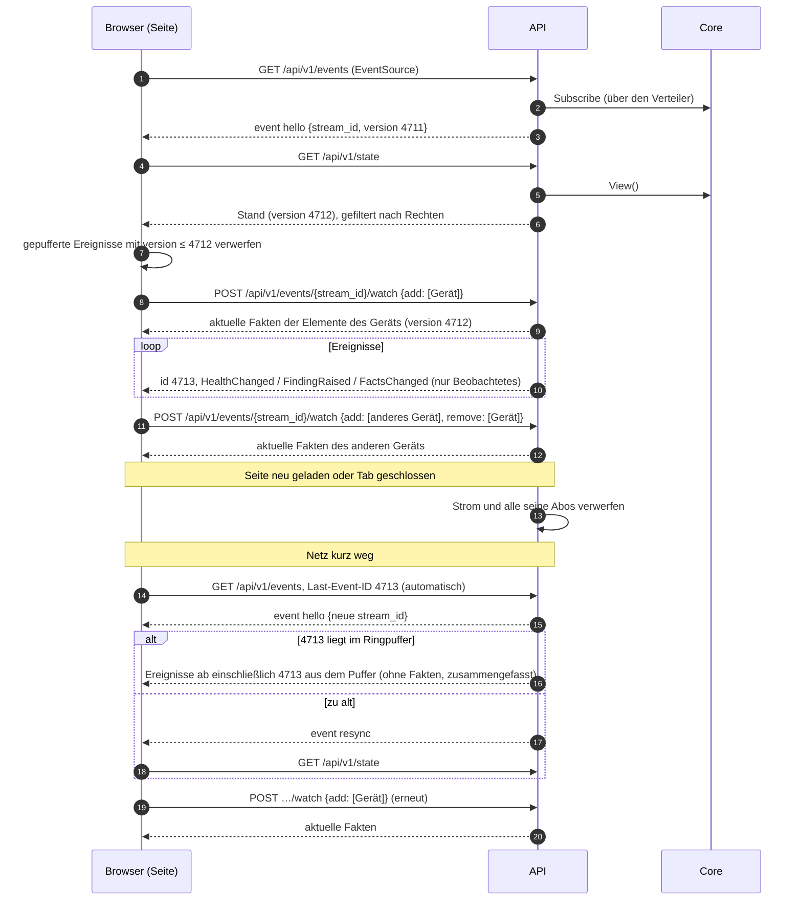

# Vertrag: HTTP-API

**Status:** abgestimmt am 2026-10-09, nach dem Architektur-Audit überarbeitet am 2026-10-10, vor der Umsetzung ergänzt am 2026-10-12 (R9, Konflikte, Verteiler). **Spezifikation:** [`api/openapi.yaml`](../../api/openapi.yaml) (OpenAPI 3.0.3). **Hintergrund:** [`auth.md`](auth.md), [`services.md`](services.md) (Zusammenspiel mit der API), [`core.md`](core.md) (`View`, Ereignisse, Abonnenten).

Die API ist eine dünne Schicht: Anmeldung prüfen, Rechte prüfen, Fachpaket aufrufen, Fehler übersetzen. Sie schreibt nie selbst in einen Store.

## Konventionen

| # | Thema | Festlegung |
|---|---|---|
| R1 | Format der Spezifikation | OpenAPI **3.0.3** (wegen der Werkzeuge für die Code-Erzeugung) |
| R2 | Spezifikation und Code | Code wird erzeugt (`oapi-codegen`, strict server): `make api-gen` erzeugt Typen und Server-Interface, die Handler implementieren es. `make api-check` prüft die Spezifikation. oapi-codegen ist als `tool` in `go.mod` eingetragen (`go tool oapi-codegen`, Version fest, ohne Docker); Router ist der `ServeMux` der Standardbibliothek (`std-http-server`). `/events` liefert ein eigenes Antwortobjekt, das selbst in den Strom schreibt. Freie JSON-Felder (Attribute, Einstellungen, Konfiguration, Details, Regelwerte) tragen `x-go-type: json.RawMessage` und gehen unverändert durch; Fakten sind `map[string]any`; Zahlen ohne Ganzzahl-Typ haben `format: double` |
| R3 | Pfad und Version | alles unter `/api/v1/`; inkompatible Änderungen bedeuten `/api/v2/` |
| R4 | Fehler | RFC 9457 Problem Details (`application/problem+json`) mit stabilem `code`, z. B. `device_in_use`, `invalid_target`, `not_found`. `type` ist `about:blank`, `title` der Text des Status; unterschieden wird über `code`. Fachliche Fehler übersetzt eine Tabelle in `internal/api/problem.go`; unbekannte Fehler sind `500 internal` ohne Details und werden geloggt |
| R5 | Verlauf | Cursor-Paginierung über UUIDv7: `?before=<id>&limit=100` (höchstens 500); Filter siehe unten, sie bleiben beim Weiterblättern gleich |
| R6 | Stand und Live-Push | `GET /state` ohne Fakten; Fakten pro Element bzw. per Abo; Ereignisse per SSE (siehe unten) |
| R7 | Sichtbarkeit | Ohne `view` fehlen Objekte in Listen; einzelne Objekte antworten mit 404, nicht 403. Ausnahme Gerüst, siehe unten |
| R8 | Formate | IDs als UUID-Strings; Zeitpunkte RFC 3339 in UTC (`2026-10-09T12:00:00.123Z`); Dauern als Ganzzahl mit Einheit im Namen (`hold_seconds`, `delay_ms`); Feldnamen `snake_case` |
| R9 | Prüfung der Anfragen | Eine Middleware prüft jede Anfrage gegen die eingebettete Spezifikation (kin-openapi): Pflichtfelder, Typen, Enums, `minLength`, Grenzen. Was nicht passt, bekommt `400` mit `code = invalid_request`, ohne dass es pro Endpunkt in der Spezifikation steht; die Beschreibung nennt Ort und Grund, nie den Wert (er kann ein Passwort sein). Das Format `uuid` prüft der erzeugte Code beim Lesen von Parametern und Body, mit derselben Antwort. Fachliche Prüfungen (Regel, Ziele, Konfiguration) bleiben bei den Fachpaketen und antworten mit `422` |

Weitere Regeln:

- **Reihenfolge jeder Anfrage:** Operation nach der Spezifikation finden (`404 not_found`, `405 method_not_allowed`), anmelden außer bei `security: []` (`401 unauthenticated`; erst `Authorization: Bearer`, ohne Rückfall auf das Cookie, sonst das Cookie `monika_session`; das Verfahren muss im `security` der Operation stehen, `logout` etwa nur mit Sitzung), `read_only` prüfen, `Origin` prüfen, dann gegen die Spezifikation prüfen (R9). Wer nicht angemeldet ist, erfährt so nichts über die Prüfung. Ohne Anmeldung erreichbar sind nur `login`, `loginTOTP`, `enrollTOTP`, `confirmTOTP`, `kioskLogin` und `/healthz`; ein Test prüft das für jede Operation der Spezifikation.
- **Ändernde Anfragen** (`POST`, `PUT`, `PATCH`, `DELETE`) prüfen den `Origin`-Header (`auth.md`, A4): Ist er gesetzt, muss er die Herkunft von `MONIKA_PUBLIC_URL` sein; fehlt er, ist das nur ohne Sitzung erlaubt (API-Token, Werkzeuge). Sonst `403 origin_mismatch`. Ein `Principal` mit `read_only` bekommt `403` mit `code = read_only`; ausgenommen sind `logout` und `watch`, die nichts am Zustand ändern.
- **Sitzungs-Cookie:** `monika_session`, `Path=/`, `HttpOnly`, `SameSite=Strict`, `Expires` = Ablauf der Sitzung, `Secure`, wenn `MONIKA_PUBLIC_URL` https ist. `logout` löscht es (`Max-Age=0`).
- **Adresse des Clients** (Begrenzung der Fehlversuche, Audit, Sitzungen): die Gegenstelle; ist sie ein vertrauenswürdiger Proxy (`MONIKA_TRUSTED_PROXIES`), der letzte Eintrag in `X-Forwarded-For`, der nicht selbst einer ist. Weiter links steht, was der Client behauptet.
- **Befehle** (Inventar, Regeln, Quittieren): erst Sichtbarkeit (`404`), dann Recht (`403`), dann `Core.Do`; das Ergebnis (Element, Quelle, Link, Regel) liest der Handler aus der View nach dem Befehl. Rechte: `inventory_edit` global für Geräte und Gruppen anlegen und löschen, am Element für die Benutzerfelder, an Gruppe **und** Mitglied für Mitgliedschaften; `source_edit` global für Quellen; `rule_edit` am Geltungsbereich (global bei Regeln ohne), beim Ändern am alten **und** neuen; `acknowledge` am Element des Befunds. Eine Regel ist sichtbar, wenn ihr Geltungsbereich es ist; globale sieht jeder.
- **Aktionen** (`POST /runs`): Die API löst das Ziel mit `Executor.Targets` auf und prüft an **jedem** Ziel `operate` bzw. bei `set` `configure`, dazu `critical`, wo der Lauf kritisch wäre (Entscheidung A vom 2026-10-12, wie beim Preset-Start). Eine Sammelaktion bekommt genau die geprüften Ziele (`Request.Targets`); was zwischen Prüfung und Anlegen in den Geltungsbereich kommt, läuft nicht ungeprüft mit. Abbrechen darf, wer den Lauf ausgelöst hat, sonst `operate` am Ziel bzw. beim Wurzel-Lauf eines Presets `preset_run`. Sichtbar sind Läufe wie in `/state`; beendete Läufe liest `GET /runs/{id}` aus dem Verlauf.
- **Globale Rechte** (Verwaltung, Presets lesen und bearbeiten) prüft die API ohne Geltungsbereich und damit auch, wenn der Core noch keine View veröffentlicht hat.
- **Weiterleitung und Secrets:** `admin`; Secrets auflisten auch mit `source_edit` (zum Zuweisen an Quellen). Secret im Body einer Vorlage: `422 secret_in_body`; unbekanntes Secret an einem Ziel: `422 invalid_secret`. Ersetzen geht über `Core.Do(ReplaceSecret)`. Werte von Secrets gehen nie zurück.
- **Presets:** lesen mit `preset_run` oder `preset_edit`, ändern mit `preset_edit`, starten mit `preset_run`. `403 missing_rights` nennt **alle** fehlenden Rechte (`preset.MissingRightsError`); fehlt `preset_run` selbst, steht es als Eintrag ohne `step_id` darin.
- **`*_in_use`** (`409`) nennt die Presets nur, wenn der Benutzer `preset_run` oder `preset_edit` hat; sonst ist `presets` leer.
- **Anlegen** liefert `201` mit dem angelegten Objekt; IDs vergibt der Server.
- **Rechte fehlen** bei sichtbarem Objekt: `403` mit `code = forbidden`.
- **Konflikte beim Anlegen:** Quelle mit einem Treiber, den das Gerät schon hat: `409 source_exists`; Element schon Mitglied der Gruppe: `409 member_exists`; Zyklus zwischen Gruppen: `409 member_cycle`; unbekanntes Secret an einer Quelle: `422 invalid_secret`; Konfiguration passt nicht zum Schema des Treibers: `422 invalid_config`.

## Sichtbarkeit

Sichtbar ist, was im Geltungsbereich eines `view`-Rechts liegt (`View.InScope`). Damit die UI den Baum aufbauen kann und nichts Falsches zeigt, gilt zusätzlich:

| Fall | Regel |
|---|---|
| **Vorfahren** sichtbarer Elemente (z. B. Gerät und Zugang eines sichtbaren Encoders) | als **Gerüst** sichtbar, im eigenen Feld `skeleton` von `/state` und `elements_changed` (Schema `SkeletonElement`): nur `id`, `kind`, `name`, `label`, `parent_id`, `device_id`; keine Fakten, Health, Befunde, Aktionen, Einstellungen, Quellen |
| **Links** | nur, wenn beide Enden sichtbar sind (nicht als Gerüst); sonst fehlen sie. Ein unaufgelöstes Ende (nur `global_ref`) ist kein Objekt und zählt nicht |
| **Quellen** (Zustand in `/state`) | sichtbar, wenn ihr Zugangs-Element sichtbar ist |
| **Läufe** | sichtbar, wenn ihr Ziel sichtbar ist; Wurzel-Läufe von Presets (ohne Ziel) mit `preset_run` oder `preset_edit` |
| **Ursache außerhalb der Sicht** | ein sichtbarer Befund behält `caused_by_id`; der Befund dahinter erscheint nicht, die UI zeigt „Ursache nicht sichtbar“ |
| **Verlauf gelöschter Elemente** | nur mit `view` global (siehe Filter im Verlauf) |

Ein Gerüst-Element ist kein sichtbares Objekt im Sinne von R7: Einzelabfragen darauf antworten mit 404, Aktionen und Regeln daran sind nicht möglich.

## Filter im Verlauf

| Verlauf | Endpunkt | Filter |
|---|---|---|
| alle | | `from`, `to` (Zeitraum), `before`, `limit` |
| Befunde | `GET /findings/history` | `element` (+ `recursive=true`: Geltungsbereich wie `View.InScope`), `code`, `severity`, `origin`, `rule`, `state` (`active`, `cleared`, `withdrawn`) |
| Läufe | `GET /runs/history` | `element` (+ `recursive`), `status`, `action`, `preset`, `requested_by` |

| Audit | `GET /audit` | `object_type`, `object_id`, `actor` (`monika` für Einträge ohne Akteur), `verb` |

Die Sichtbarkeit filtert die Datenbank, damit jede Seite voll ist und das Blättern stimmt: Die API gibt die IDs der sichtbaren Elemente als Array mit (`element_id = ANY(…)`); mit `view` global entfällt der Filter. Gerüst-Elemente zählen nicht als sichtbar.

Einträge zu gelöschten Elementen bleiben im Verlauf; sie tragen `element_path` (Name beim Entstehen) und `element_deleted = true`. Weil sich ihr Geltungsbereich nicht mehr auflösen lässt, sieht sie nur, wer `view` global hat. Mit `recursive` findet der Filter nur Elemente, die noch existieren.

## Stand, Ereignisse und Abos

- `GET /state` liefert, was der Benutzer sehen darf: Inventar und Links, Health und Rollups, aktive Befunde, laufende Läufe, Zustand der Quellen, jeweils mit der `version` der `View`. **Keine Fakten.**
- `GET /elements/{id}/facts` liefert die Fakten eines Elements mit `version`.
- `GET /elements/{id}/rules` liefert `View.EffectiveRules`. Eine geltende Regel ist `satisfied`, solange sie keinen aktiven Befund am Element hat; das ist das Urteil des Evaluators mit Haltezeit und Hysterese. Die Art des Geltungsbereichs (`element`, `ancestor`, `device`, `group`, `global`) steht immer da, seine ID nur, wenn er sichtbar ist.
- `GET /drivers` liefert pro Treiber den Fakt-Katalog: das Vokabular und die rohen Fakten des Treibers, zu jedem Zähler seine Rate (`…_per_s`). Rohe Fakten sind nie `historized`.
- `GET /events` ist der Ereignisstrom (SSE). Jedes Ereignis trägt als `id` die `Version`, zu der es den Stand seines Objekts beschreibt; nach einem Abbruch schickt der Browser sie als `Last-Event-ID`. Ist sie zu alt, kommt `resync`, und der Browser lädt `/state` neu.
- **Erst Strom, dann Stand.** Der Browser öffnet zuerst `/events` und bekommt `hello{stream_id, version}`, lädt danach `/state` und wendet von den inzwischen empfangenen Ereignissen nur die mit `version` > Version des Stands an. So geht zwischen Stand und Strom nichts verloren; es ist dieselbe Regel wie für alle Abonnenten des Core (erst anmelden, dann die `View` lesen). Ebenso bei `watch`: Ereignisse mit `version` ≤ der Version der Antwort werden verworfen.
- **Ereignisse sind idempotent.** Jedes Ereignis beschreibt den Stand eines Objekts zu einer Version, nicht eine Änderung daran; zweimal angewendet ergibt dasselbe. Eine Verarbeitung im Core kann mehrere Ereignisse mit derselben Version erzeugen; deshalb liefert die Wiederaufnahme alle Ereignisse **ab einschließlich** der Version aus `Last-Event-ID`.
- **Fakten nur per Abo:** `FactsChanged` kommt nur für beobachtete Elemente. Beobachtet werden Geltungsbereiche (Element, Gerät, Gruppe; aufgelöst wie `View.InScope`), gebunden an den Strom, nicht an die Sitzung.
- `GET /healthz` antwortet ohne Anmeldung `200` bzw. `503`, wenn die Datenbank nicht erreichbar ist; für Docker-Healthcheck und externe Überwachung. Die API liest nur `View.DB` (höchstens 5 s alt, `core.md`) und greift selbst nicht auf die Datenbank zu.

### Verteiler

Die API hält **ein** Abo am Core und verteilt an alle Browser-Ströme; das entlastet die Schleife. Die UI braucht den aktuellen Stand, nicht jeden Zwischenschritt:

- **Sofort schreiben, zusammenfassen nur bei Rückstau.** Ist die Verbindung frei, geht ein Ereignis sofort raus. Während ein Schreiben läuft (langsamer Browser, Netz hakt), sammelt der Verteiler die folgenden Ereignisse nach Schlüssel; es gilt der neueste Stand. Danach geht das Gesammelte in einem Rutsch raus.

| Ereignis | Schlüssel |
|---|---|
| `health_changed`, `elements_changed` | Element |
| `facts_changed` | Element und Fakt |
| `finding_raised`, `finding_ended`, `finding_acked`, `finding_cause_changed` | Befund |
| `run_changed` | Lauf |
| `source_status_changed` | Quelle |

- Ein langsamer Browser bekommt so weniger, aber immer den aktuellen Stand; was offen ist, ist durch die sichtbaren Objekte begrenzt. Getrennt wird nur, wenn ein Schreiben länger als 30 s hängt (tote Verbindung).
- **Ringpuffer für Netzaussetzer:** die letzten 100 Ereignisse **ohne** `facts_changed` (der Puffer gilt für alle Ströme; Fakten kommen nach dem Neuverbinden ohnehin über `watch`). Liegt `Last-Event-ID` im Puffer, bekommt der neue Strom alle Ereignisse ab einschließlich dieser Version daraus, zusammengefasst nach Schlüssel und gefiltert nach den Rechten des Benutzers. Sonst `resync`.
- Wie oft neu gezeichnet wird, regelt die UI selbst (ein Neuzeichnen pro Frame).

- Ein Strom beobachtet höchstens 1 000 Elemente; darüber `422` mit `code = watch_limit`.
- Wird der Verteiler vom Core abgehängt (C6), bekommen alle Ströme `resync`.
- **Nutzdaten aus der aktuellen View:** Der Verteiler baut die Nutzdaten eines Ereignisses (Elemente, Health, Fakten) aus der View, die er beim Empfang liest; sie ist mindestens so neu wie das Ereignis. Weil Ereignisse einen Stand beschreiben, schadet ein neuerer Stand nicht. Für `links` und `removed_links` vergleicht er die Links des zuletzt verteilten Graphen mit denen des aktuellen, denn `ElementsChanged` meldet nur `LinksChanged`.
- **Rechte ändern sich:** Jeder Strom filtert nach den Rechten seines Benutzers. Ändert sich `auth.AuthzVersion` (Rollen, Rechte oder Mitglieder geändert), bekommen alle Ströme `resync` und laden den Stand nach den neuen Rechten. Rechte ändern sich selten; das ist einfacher und sicherer als eine Neuberechnung pro Strom.
- **Anmeldung erneut prüfen:** Alle 60 s prüft jeder Strom seine Sitzung bzw. sein Token (`auth.CheckSession`, `auth.CheckToken`). Gilt sie nicht mehr (abgemeldet, widerrufen, abgelaufen, Benutzer deaktiviert, Leerlauf), endet der Strom. Die Prüfung zählt nicht als Aktivität: Ein offener Tab allein hält eine Sitzung nicht über den Leerlauf hinaus am Leben; `watch` und alle anderen Anfragen zählen.
- **Keepalive:** Ist 30 s nichts gesendet worden, schickt der Strom einen SSE-Kommentar (`: ping`). Das hält Proxys offen und erkennt tote Verbindungen; jedes Schreiben hat eine Deadline von 30 s (`http.ResponseController`), danach wird getrennt.
- Ereignistypen im Strom: `hello`, `resync`, `elements_changed`, `facts_changed`, `health_changed`, `finding_raised`, `finding_ended`, `finding_acked`, `finding_cause_changed`, `run_changed`, `source_status_changed`.
