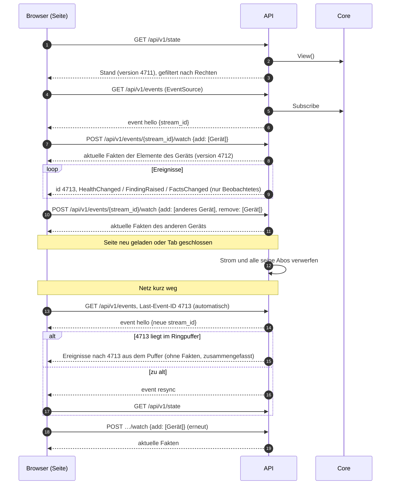

# Vertrag: HTTP-API

**Status:** abgestimmt am 2026-10-09, nach dem Architektur-Audit überarbeitet am 2026-10-10. **Spezifikation:** [`api.yaml`](api.yaml) (OpenAPI 3.0.3). **Hintergrund:** [`auth.md`](auth.md), [`services.md`](services.md) (Zusammenspiel mit der API), [`core.md`](core.md) (`View`, Ereignisse, Abonnenten).

Die API ist eine dünne Schicht: Anmeldung prüfen, Rechte prüfen, Fachpaket aufrufen, Fehler übersetzen. Sie schreibt nie selbst in einen Store.

## Konventionen

| # | Thema | Festlegung |
|---|---|---|
| R1 | Format der Spezifikation | OpenAPI **3.0.3** (wegen der Werkzeuge für die Code-Erzeugung) |
| R2 | Spezifikation und Code | Code wird erzeugt (`oapi-codegen`, strict server): `make api-gen` erzeugt Typen und Server-Interface, die Handler implementieren es. `make api-check` prüft die Spezifikation |
| R3 | Pfad und Version | alles unter `/api/v1/`; inkompatible Änderungen bedeuten `/api/v2/` |
| R4 | Fehler | RFC 9457 Problem Details (`application/problem+json`) mit stabilem `code`, z. B. `device_in_use`, `invalid_target`, `not_found` |
| R5 | Verlauf | Cursor-Paginierung über UUIDv7: `?before=<id>&limit=100` (höchstens 500); Filter siehe unten, sie bleiben beim Weiterblättern gleich |
| R6 | Stand und Live-Push | `GET /state` ohne Fakten; Fakten pro Element bzw. per Abo; Ereignisse per SSE (siehe unten) |
| R7 | Sichtbarkeit | Ohne `view` fehlen Objekte in Listen; einzelne Objekte antworten mit 404, nicht 403 |
| R8 | Formate | IDs als UUID-Strings; Zeitpunkte RFC 3339 in UTC (`2026-10-09T12:00:00.123Z`); Dauern als Ganzzahl mit Einheit im Namen (`hold_seconds`, `delay_ms`); Feldnamen `snake_case` |

Weitere Regeln:

- **Ändernde Anfragen** (`POST`, `PUT`, `PATCH`, `DELETE`) mit Sitzung prüfen den `Origin`-Header (`auth.md`, A4). Ein `Principal` mit `read_only` bekommt `403` mit `code = read_only`.
- **Anlegen** liefert `201` mit dem angelegten Objekt; IDs vergibt der Server.
- **Rechte fehlen** bei sichtbarem Objekt: `403` mit `code = forbidden`.

## Filter im Verlauf

| Verlauf | Endpunkt | Filter |
|---|---|---|
| alle | | `from`, `to` (Zeitraum), `before`, `limit` |
| Befunde | `GET /findings/history` | `element` (+ `recursive=true`: Geltungsbereich wie `View.InScope`), `code`, `severity`, `origin`, `rule`, `state` (`active`, `cleared`, `withdrawn`) |
| Läufe | `GET /runs/history` | `element` (+ `recursive`), `status`, `action`, `preset`, `requested_by` |

Einträge zu gelöschten Elementen bleiben im Verlauf; sie tragen `element_path` (Name beim Entstehen) und `element_deleted = true`. Weil sich ihr Geltungsbereich nicht mehr auflösen lässt, sieht sie nur, wer `view` global hat. Mit `recursive` findet der Filter nur Elemente, die noch existieren.
| Audit | `GET /audit` | `object_type`, `object_id`, `actor` (`monika` für Einträge ohne Akteur), `verb` |

## Stand, Ereignisse und Abos

- `GET /state` liefert, was der Benutzer sehen darf: Inventar und Links, Health und Rollups, aktive Befunde, laufende Läufe, Zustand der Quellen, jeweils mit der `version` der `View`. **Keine Fakten.**
- `GET /elements/{id}/facts` liefert die Fakten eines Elements mit `version`.
- `GET /events` ist der Ereignisstrom (SSE). Jedes Ereignis trägt als `id` die `Version`, zu der es den Stand seines Objekts beschreibt; nach einem Abbruch schickt der Browser sie als `Last-Event-ID`. Ist sie zu alt, kommt `resync`, und der Browser lädt `/state` neu.
- **Fakten nur per Abo:** `FactsChanged` kommt nur für beobachtete Elemente. Beobachtet werden Geltungsbereiche (Element, Gerät, Gruppe; aufgelöst wie `View.InScope`), gebunden an den Strom, nicht an die Sitzung.
- `GET /healthz` antwortet ohne Anmeldung `200` bzw. `503`, wenn die Datenbank nicht erreichbar ist (`View.DB`); für Docker-Healthcheck und externe Überwachung.

### Verteiler

Die API hält **ein** Abo am Core und verteilt an alle Browser-Ströme; das entlastet die Schleife. Die UI braucht den aktuellen Stand, nicht jeden Zwischenschritt:

- **Sofort schreiben, zusammenfassen nur bei Rückstau.** Ist die Verbindung frei, geht ein Ereignis sofort raus. Während ein Schreiben läuft (langsamer Browser, Netz hakt), sammelt der Verteiler die folgenden Ereignisse nach Schlüssel; es gilt der neueste Stand. Danach geht das Gesammelte in einem Rutsch raus.

| Ereignis | Schlüssel |
|---|---|
| `health_changed`, `elements_changed` | Element |
| `facts_changed` | Element und Fakt |
| `finding_raised`, `finding_ended`, `finding_acked`, `finding_cause_changed` | Befund |
| `run_changed` | Lauf |
| `source_status_changed` | Quelle |

- Ein langsamer Browser bekommt so weniger, aber immer den aktuellen Stand; was offen ist, ist durch die sichtbaren Objekte begrenzt. Getrennt wird nur, wenn ein Schreiben länger als 30 s hängt (tote Verbindung).
- **Ringpuffer für Netzaussetzer:** die letzten 100 Ereignisse **ohne** `facts_changed` (der Puffer gilt für alle Ströme; Fakten kommen nach dem Neuverbinden ohnehin über `watch`). Liegt `Last-Event-ID` im Puffer, bekommt der neue Strom die späteren Ereignisse daraus, zusammengefasst nach Schlüssel und gefiltert nach den Rechten des Benutzers. Sonst `resync`.
- Wie oft neu gezeichnet wird, regelt die UI selbst (ein Neuzeichnen pro Frame).

- Ein Strom beobachtet höchstens 1 000 Elemente; darüber `422` mit `code = watch_limit`.
- Wird der Verteiler vom Core abgehängt (C6), bekommen alle Ströme `resync`.
- Ereignistypen im Strom: `hello`, `resync`, `elements_changed`, `facts_changed`, `health_changed`, `finding_raised`, `finding_ended`, `finding_acked`, `finding_cause_changed`, `run_changed`, `source_status_changed`.
