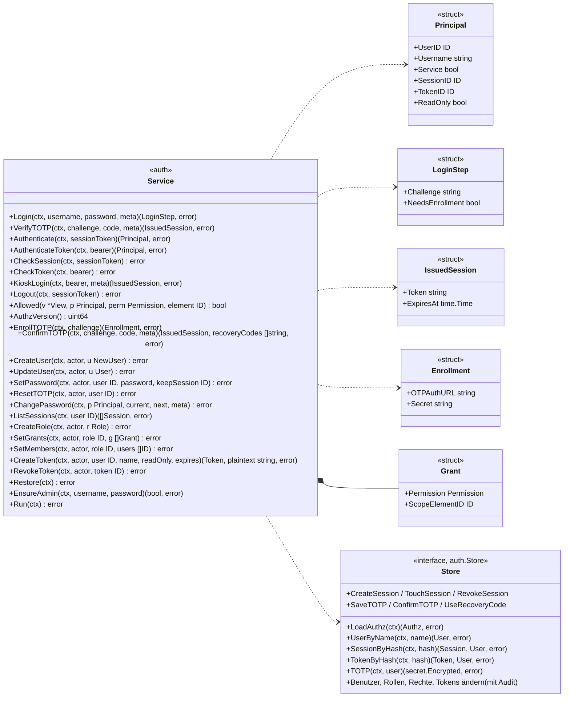
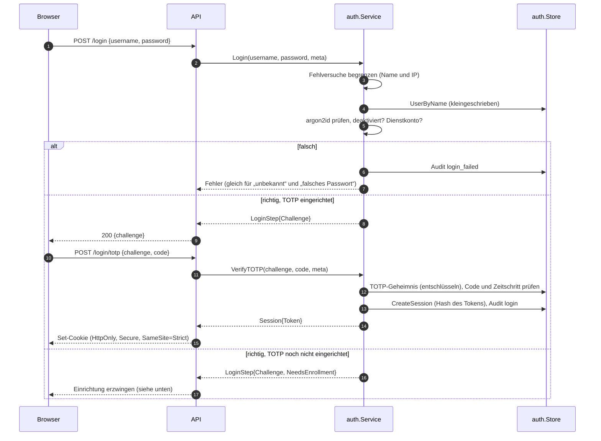
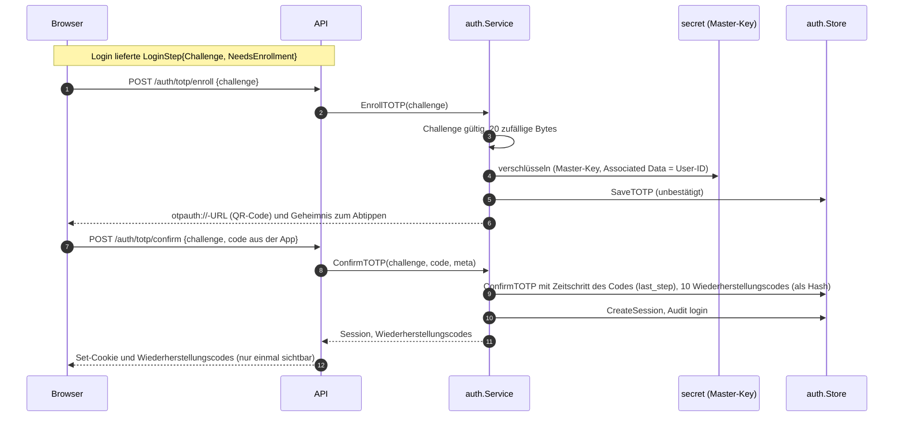
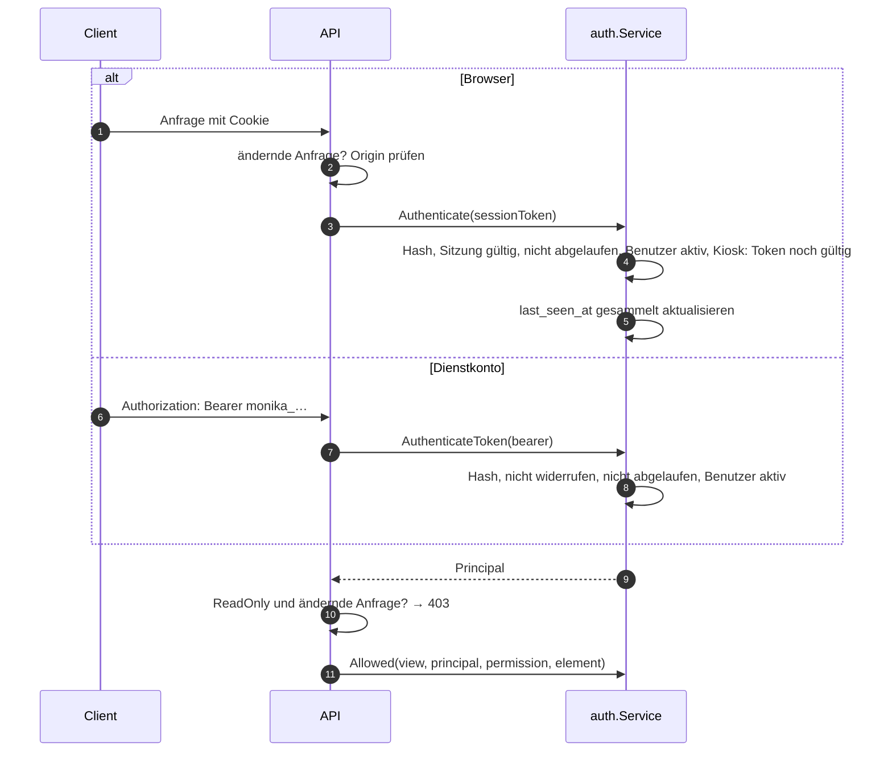
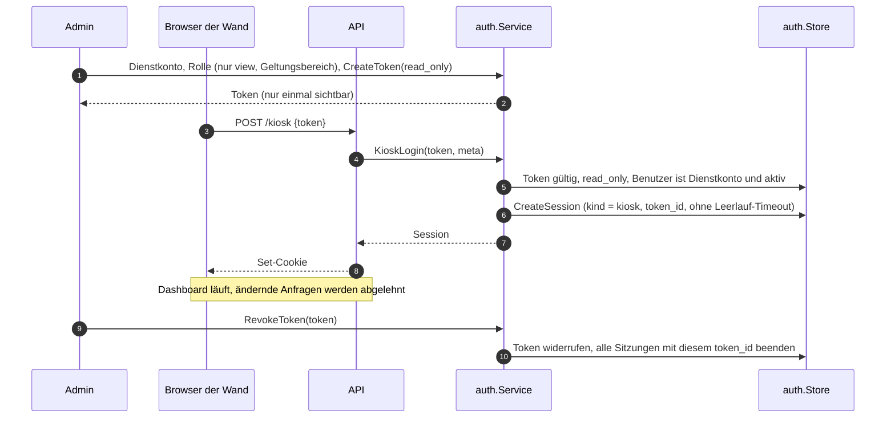

# Vertrag: Anmeldung und Rechte

**Status:** abgestimmt am 2026-10-09, überarbeitet am 2026-10-10 (Architektur-Audit) und 2026-10-11 (TOTP-Einrichtung über die Challenge, Gerüst). **Paket:** `internal/auth`. **Hintergrund:** `docs/ARCHITECTURE.md`, Abschnitt 12; [`services.md`](services.md) (Zusammenspiel mit der API).

`auth` beantwortet zwei getrennte Fragen: **Wer bist du?** (Anmeldung, Sitzung, Token) und **Was darfst du?** (Rollen, Rechte, Geltungsbereich). Benutzer, Rollen, Rechte, Tokens und Sitzungen ändert nur `auth`; die API ruft es auf.

## Bereits entschieden

| # | Entscheidung |
|---|---|
| P1 | API als JSON über HTTP, Vertrag als OpenAPI 3.0.3 (`api/openapi.yaml`, eigener Vertrag; Version siehe [`api.md`](api.md), R1) |
| P2 | Live-Push per Server-Sent Events; die Event-ID ist `View.Version` |
| P3 | Sitzungen der UI auf dem Server (Tabelle), Token im `HttpOnly`-Cookie; lokale Anmeldung mit **TOTP** als zweitem Faktor |
| P4 | Dienstkonten melden sich mit API-Token an: `Authorization: Bearer …` |

## Typen und Interfaces

- **`Principal`** ist der angemeldete Benutzer einer Anfrage. Die API gibt seine `UserID` als `actor` an jedes Fachpaket weiter. Ist `ReadOnly` gesetzt (Token bzw. Kiosk-Sitzung mit `read_only`), lehnt die API jede ändernde Anfrage ab, unabhängig von den Rechten der Rollen.
- **`IssuedSession`** ist eine neue Sitzung für das Cookie mit dem Klartext des Tokens; `Session` heißt die gespeicherte Sitzung (nur Hash).
- **Fehler:** `ErrInvalidCredentials` (gleich für unbekannten Namen, falsches Passwort, deaktivierten Benutzer und Dienstkonto), `ThrottledError` mit Wartezeit (`errors.Is(err, ErrThrottled)`), `ErrInvalidChallenge`, `ErrInvalidCode`, `ErrUnauthenticated`. Bei unbekanntem Namen vergleicht `Login` trotzdem gegen einen Hash, damit die Antwortzeit nichts verrät.
- **Falsche Codes** (TOTP und Wiederherstellung) zählen bei der Begrenzung der Fehlversuche mit; erst eine vollständige Anmeldung setzt sie zurück. Sonst ließe sich mit bekanntem Passwort der Code über viele Challenges durchprobieren.
- **`Run`** schreibt jede Minute `last_seen_at` und `last_used_at` gesammelt und räumt abgelaufene Challenges auf; beim Stopp ein letztes Mal.
- **`Allowed`** mit `element = uuid.Nil` fragt ein globales Recht ab; ein Recht mit Geltungsbereich gilt dann nicht. `Restore` lädt Rollen und Rechte beim Start, jede Änderung an Rollen, Rechten oder Mitgliedern lädt sie neu.
- **`CheckSession`, `CheckToken`** prüfen wie `Authenticate` bzw. `AuthenticateToken`, zählen aber nicht als Aktivität bzw. Verwendung. Offene Ereignisströme prüfen damit alle 60 s, ob ihre Anmeldung noch gilt (`api.md`); ein offener Tab allein verlängert den Leerlauf einer Sitzung nicht. Für Wände gibt es Kiosk-Sitzungen.
- **`AuthzVersion`** zählt jedes Neuladen von Rollen und Rechten. Offene Ereignisströme filtern nach den Rechten; ändert sich die Zahl, bekommen sie `resync` (`api.md`).
- **`ChangePassword`** ist das eigene Passwort: Es prüft das aktuelle; ein falsches zählt wie ein Fehlversuch bei der Anmeldung (Begrenzung, Audit `login_failed`). Danach wie `SetPassword` mit der eigenen Sitzung als `keepSession`.
- **`ListSessions`** liefert die gültigen Sitzungen mit der letzten Aktivität aus dem Speicher; durch Leerlauf abgelaufene fehlen.
- **`CreateToken`** liefert das Token mit seinen Metadaten (für die Antwort der API) und einmalig den Klartext; unbekannter Benutzer: `ErrNotFound`.
- **`User.TOTPEnabled`** (TOTP eingerichtet und bestätigt) setzt nur `ListUsers`, für die Verwaltung.
- **`Principal.DisplayName`** kommt mit der Anmeldung mit, für `GET /auth/me`.
- **`SetPassword`** beendet alle Sitzungen des Benutzers außer `keepSession` (die eigene, wenn er es selbst ändert).
- **`EnsureAdmin`** (M8) nutzt `Store.CreateInitialAdmin`: Benutzer, Rolle, Rechte und Mitgliedschaft in **einer** Transaktion und nur ohne vorhandene Benutzer, damit ein Abbruch keinen Admin ohne Rechte hinterlässt.
- **Rollen und Rechte hält `auth` im Speicher** (`LoadAuthz` beim Start, nach jeder Änderung neu). `Allowed` braucht deshalb keine Datenbank, nur die `View` für den Geltungsbereich.

## Anmeldung mit Passwort und TOTP

- Die **Challenge** zwischen Passwort und Code lebt nur im Speicher: 5 min gültig, höchstens 5 Versuche.
- Ein TOTP-Code gilt nur einmal: Der letzte verwendete Zeitschritt wird gespeichert.
- Statt des Codes ist ein **Wiederherstellungscode** möglich; jeder gilt einmal.

## TOTP einrichten

- Einrichten läuft über die Challenge aus `Login`, nicht über eine Sitzung: Wer TOTP noch nicht eingerichtet hat, hat noch keine. Die Bestätigung schließt die Anmeldung ab.
- Der Zeitschritt des bestätigenden Codes wird als `last_step` gespeichert; derselbe Code gilt danach nicht noch einmal.
- Nach einem Zurücksetzen durch einen Admin (`ResetTOTP`) liefert die nächste Anmeldung `NeedsEnrollment`, der Weg ist derselbe.

## Anfragen

## Dashboards (Kiosk)

Ein Dashboard, etwa eine Monitorwand, ist ein **Dienstkonto** mit einer Rolle, die nur `view` im gewünschten Geltungsbereich hat, und einem Token mit `read_only`. Weil ein Browser bei einem Seitenaufruf keinen `Authorization`-Header senden kann und ein Token in der URL in Logs und Verlauf landen würde, tauscht der Kiosk das Token einmal gegen eine Sitzung.

- Eine Kiosk-Sitzung hat **kein Leerlauf-Timeout** und gilt so lange wie ihr Token (Ablauf oder Widerruf beenden sie sofort).
- Nur Tokens mit `read_only` können Kiosk-Sitzungen erzeugen.
- Später möglich: Anmeldung per Code wie beim Fernseher (RFC 8628, Device Authorization Grant), damit niemand ein Token an der Wand eintippen muss; das Modell bleibt dasselbe.

## Rechte prüfen (`Allowed`)

- Rechte des Benutzers = Vereinigung der Rechte aller seiner Rollen (nur Erlauben, kein Verbieten).
- Ein Recht mit Geltungsbereich S gilt für Element E, wenn `View.InScope(S, E)` (`core.md`): S ist NULL; S ist E oder ein Vorfahre von E über `parent_id` (das Gerät ist der fernste); S ist eine Gruppe, die E oder einen Vorfahren von E rekursiv enthält. Dieselbe Auflösung gilt für Regeln, Weiterleitung, Verlauf und Watch.
- **Gerüst:** Vorfahren eines sichtbaren Elements sind nur mit Name und Struktur sichtbar, ohne Zustand und ohne Rechte daran (`api.md`, Sichtbarkeit). `Allowed` gibt für sie `false` zurück, solange kein Recht sie selbst umfasst.
- **Aktionen an Stellvertretern:** Geprüft wird das Recht am Stellvertreter, nicht am Original (das Recht folgt dem Weg, `docs/ARCHITECTURE.md` Abschnitt 7).
- **Kritische Aktionen:** `Allowed(base) && Allowed(critical)` für dasselbe Element; die beiden Rechte dürfen aus verschiedenen Rollen kommen.
- Globale Rechte (`preset_run`, `preset_edit`, `source_edit`, `admin`) haben immer Geltungsbereich NULL.
- **`source_edit`** braucht, wer Quellen anlegt, ändert (Treiber, Adresse, Konfiguration, Secret, aktiviert) oder löscht. Es ist global, weil Secrets geteilt werden: Wer eine Quelle mit Secret umlenken darf, kommt an die Zugangsdaten aller Quellen mit diesem Secret.

## Neue Tabellen

| Tabelle | Spalten | Zweck |
|---|---|---|
| `user_session` | `id`, `user_id`, `kind` (`user`, `kiosk`), `token_id` (nur Kiosk), `token_hash` (unique), `created_at`, `last_seen_at`, `expires_at`, `revoked_at`, `user_agent`, `remote_addr` | Sitzungen der UI und der Dashboards |
| `api_token` (neue Spalte) | `read_only` | Token darf nichts ändern; Voraussetzung für Kiosk-Sitzungen |
| `user_totp` | `user_id` (pk), `ciphertext`, `nonce`, `key_id`, `confirmed_at`, `last_step` | TOTP-Geheimnis, verschlüsselt mit dem Master-Key |
| `user_recovery_code` | `id`, `user_id`, `code_hash`, `used_at` | Wiederherstellungscodes |

## Entscheidungen

| # | Frage | Entscheidung |
|---|---|---|
| A1 | TOTP Pflicht? | Pflicht für alle interaktiven lokalen Benutzer, Einrichtung bei der ersten Anmeldung erzwungen; Dienstkonten und später OIDC ohne |
| A2 | Verschlüsselung und Rotation der TOTP-Geheimnisse | eigene Tabelle `user_totp` mit dem Master-Key; `VerifyAndRotate` prüft und rotiert alle verschlüsselten Bestände (Secrets und TOTP) über ein gemeinsames Interface |
| A3 | Lebensdauer einer Sitzung | Menschen: Leerlauf 12 h, höchstens 7 Tage (einstellbar). Dashboards: Kiosk-Sitzung über ein Token mit `read_only`, ohne Leerlauf-Timeout, gültig so lange wie das Token; Anmeldung per Code (RFC 8628) später |
| A4 | Schutz gegen CSRF | Cookie `SameSite=Strict` und Prüfung des `Origin`-Headers bei ändernden Anfragen |
| A5 | Schutz gegen Durchprobieren | pro Benutzername und IP nach 5 Fehlversuchen steigende Wartezeit bis 15 min; jeder Fehlversuch ins Audit |
| A6 | Passwörter | argon2id (m = 19 MiB, t = 2, p = 1), Mindestlänge 12 |
| A7 | Format der API-Tokens | `monika_` + 32 zufällige Bytes (base64url), gespeichert nur als SHA-256 |
| A8 | Wiederherstellungscodes | 10 Stück, je einmal gültig, nur einmal angezeigt; Admin kann TOTP zurücksetzen (Audit) |
| M1 | Schließen Rechte einander ein? | nein; jedes Recht steht für sich (`operate` ohne `view` sieht nichts); die UI kann Rollenvorlagen anbieten |
| M2 | Begrenzung der Fehlversuche (A5) | pro (Benutzername, IP) im Speicher; ab dem 5. Fehlversuch Wartezeit 30 s, jeweils verdoppelt bis höchstens 15 min; währenddessen wird das Passwort nicht geprüft (`ErrThrottled`, API 429); Erfolg setzt zurück, Einträge verfallen nach 1 h ohne Versuch |
| M3 | TOTP | RFC 6238: SHA-1, 6 Ziffern, 30 s, ±1 Zeitschritt; Issuer „Monika“, Label `Monika:<benutzername>` |
| M4 | Format der Wiederherstellungscodes | 10 Zeichen base32 als `xxxxx-xxxxx`, gespeichert als SHA-256; Groß-/Kleinschreibung und Bindestrich egal |
| M5 | Sitzungs-Token und Aktivität | 32 zufällige Bytes base64url, gespeichert als SHA-256; `last_seen_at`/`last_used_at` gesammelt im Speicher, jede Minute geschrieben; Leerlauf gegen den Wert im Speicher geprüft |
| M6 | Länge von Passwörtern | mindestens 12 Zeichen, höchstens 1 024 Bytes |
| M7 | Challenge | 32 zufällige Bytes, im Speicher, 5 min, höchstens 5 Versuche; danach neu anmelden |
| M8 | Initialer Admin | Benutzer aus `MONIKA_ADMIN_*` und Rolle „Administratoren“ mit allen Rechten global, nur ohne vorhandene Benutzer; TOTP bei der ersten Anmeldung (A1) |
