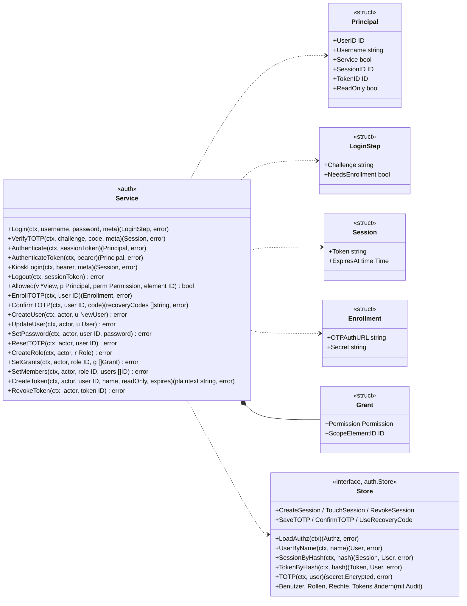
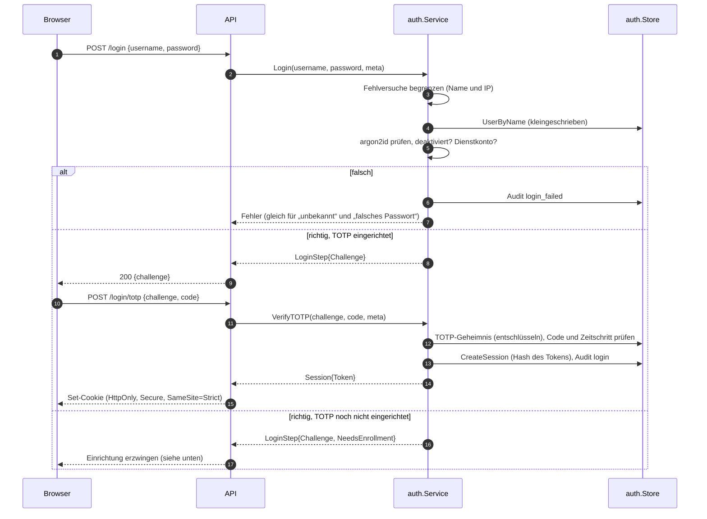
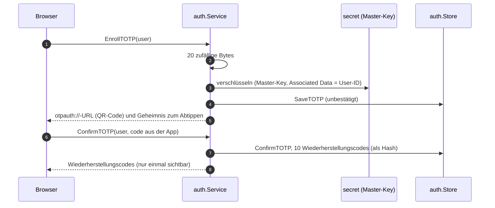
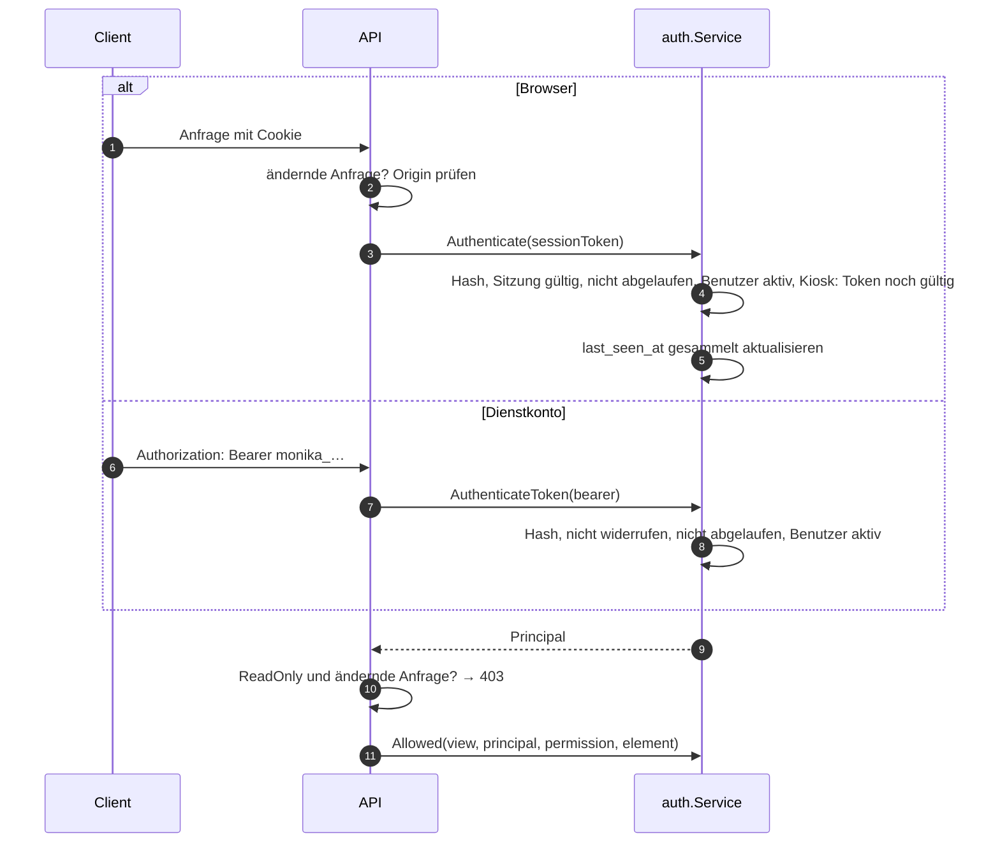
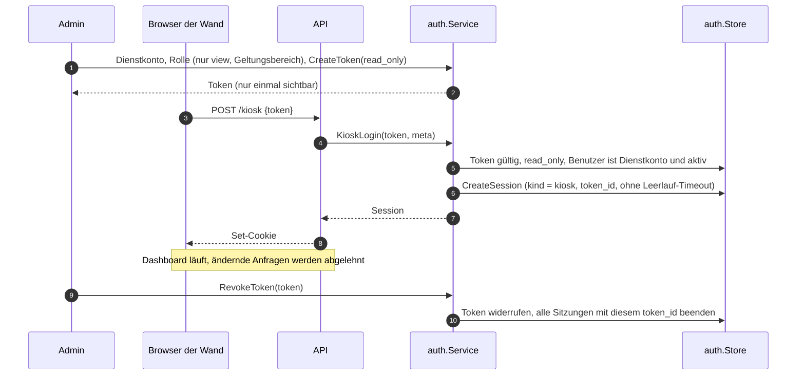

# Vertrag: Anmeldung und Rechte

**Status:** abgestimmt am 2026-10-09. **Paket:** `internal/auth`. **Hintergrund:** `docs/ARCHITECTURE.md`, Abschnitt 12; [`services.md`](services.md) (Zusammenspiel mit der API).

`auth` beantwortet zwei getrennte Fragen: **Wer bist du?** (Anmeldung, Sitzung, Token) und **Was darfst du?** (Rollen, Rechte, Geltungsbereich). Benutzer, Rollen, Rechte, Tokens und Sitzungen ändert nur `auth`; die API ruft es auf.

## Bereits entschieden

| # | Entscheidung |
|---|---|
| P1 | API als JSON über HTTP, Vertrag als OpenAPI 3.1 (`api.yaml`, eigener Vertrag) |
| P2 | Live-Push per Server-Sent Events; die Event-ID ist `View.Version` |
| P3 | Sitzungen der UI auf dem Server (Tabelle), Token im `HttpOnly`-Cookie; lokale Anmeldung mit **TOTP** als zweitem Faktor |
| P4 | Dienstkonten melden sich mit API-Token an: `Authorization: Bearer …` |

## Typen und Interfaces

- **`Principal`** ist der angemeldete Benutzer einer Anfrage. Die API gibt seine `UserID` als `actor` an jedes Fachpaket weiter. Ist `ReadOnly` gesetzt (Token bzw. Kiosk-Sitzung mit `read_only`), lehnt die API jede ändernde Anfrage ab, unabhängig von den Rechten der Rollen.
- **Rollen und Rechte hält `auth` im Speicher** (`LoadAuthz` beim Start, nach jeder Änderung neu). `Allowed` braucht deshalb keine Datenbank, nur die `View` für den Geltungsbereich.

## Anmeldung mit Passwort und TOTP

- Die **Challenge** zwischen Passwort und Code lebt nur im Speicher: 5 min gültig, höchstens 5 Versuche.
- Ein TOTP-Code gilt nur einmal: Der letzte verwendete Zeitschritt wird gespeichert.
- Statt des Codes ist ein **Wiederherstellungscode** möglich; jeder gilt einmal.

## TOTP einrichten

## Anfragen

## Dashboards (Kiosk)

Ein Dashboard, etwa eine Monitorwand, ist ein **Dienstkonto** mit einer Rolle, die nur `view` im gewünschten Geltungsbereich hat, und einem Token mit `read_only`. Weil ein Browser bei einem Seitenaufruf keinen `Authorization`-Header senden kann und ein Token in der URL in Logs und Verlauf landen würde, tauscht der Kiosk das Token einmal gegen eine Sitzung.

- Eine Kiosk-Sitzung hat **kein Leerlauf-Timeout** und gilt so lange wie ihr Token (Ablauf oder Widerruf beenden sie sofort).
- Nur Tokens mit `read_only` können Kiosk-Sitzungen erzeugen.
- Später möglich: Anmeldung per Code wie beim Fernseher (RFC 8628, Device Authorization Grant), damit niemand ein Token an der Wand eintippen muss; das Modell bleibt dasselbe.

## Rechte prüfen (`Allowed`)

- Rechte des Benutzers = Vereinigung der Rechte aller seiner Rollen (nur Erlauben, kein Verbieten).
- Ein Recht mit Geltungsbereich S gilt für Element E, wenn E im Bereich von S liegt (`docs/ARCHITECTURE.md` Abschnitt 12): S ist NULL; S ist E; S ist ein Vorfahre von E über `parent_id`; S ist das Gerät von E; S ist eine Gruppe, die E oder ein Gerät bzw. einen Vorfahren von E rekursiv enthält. Aufgelöst über die `View`.
- **Kritische Aktionen:** `Allowed(base) && Allowed(critical)` für dasselbe Element; die beiden Rechte dürfen aus verschiedenen Rollen kommen.
- Globale Rechte (`preset_run`, `preset_edit`, `admin`) haben immer Geltungsbereich NULL.

## Neue Tabellen

| Tabelle | Spalten | Zweck |
|---|---|---|
| `user_session` | `id`, `user_id`, `kind` (`user`, `kiosk`), `token_id` (nur Kiosk), `token_hash` (unique), `created_at`, `last_seen_at`, `expires_at`, `revoked_at`, `user_agent`, `remote_addr` | Sitzungen der UI und der Dashboards |
| `api_token` (neue Spalte) | `read_only` | Token darf nichts ändern; Voraussetzung für Kiosk-Sitzungen |
| `user_totp` | `user_id` (pk), `ciphertext`, `nonce`, `key_id`, `confirmed_at`, `last_step` | TOTP-Geheimnis, verschlüsselt mit dem Master-Key |
| `user_recovery_code` | `id`, `user_id`, `code_hash`, `used_at` | Wiederherstellungscodes |

## Entscheidungen

| # | Frage | Entscheidung |
|---|---|---|
| A1 | TOTP Pflicht? | Pflicht für alle interaktiven lokalen Benutzer, Einrichtung bei der ersten Anmeldung erzwungen; Dienstkonten und später OIDC ohne |
| A2 | Verschlüsselung und Rotation der TOTP-Geheimnisse | eigene Tabelle `user_totp` mit dem Master-Key; `VerifyAndRotate` prüft und rotiert alle verschlüsselten Bestände (Secrets und TOTP) über ein gemeinsames Interface |
| A3 | Lebensdauer einer Sitzung | Menschen: Leerlauf 12 h, höchstens 7 Tage (einstellbar). Dashboards: Kiosk-Sitzung über ein Token mit `read_only`, ohne Leerlauf-Timeout, gültig so lange wie das Token; Anmeldung per Code (RFC 8628) später |
| A4 | Schutz gegen CSRF | Cookie `SameSite=Strict` und Prüfung des `Origin`-Headers bei ändernden Anfragen |
| A5 | Schutz gegen Durchprobieren | pro Benutzername und IP nach 5 Fehlversuchen steigende Wartezeit bis 15 min; jeder Fehlversuch ins Audit |
| A6 | Passwörter | argon2id (m = 19 MiB, t = 2, p = 1), Mindestlänge 12 |
| A7 | Format der API-Tokens | `monika_` + 32 zufällige Bytes (base64url), gespeichert nur als SHA-256 |
| A8 | Wiederherstellungscodes | 10 Stück, je einmal gültig, nur einmal angezeigt; Admin kann TOTP zurücksetzen (Audit) |
