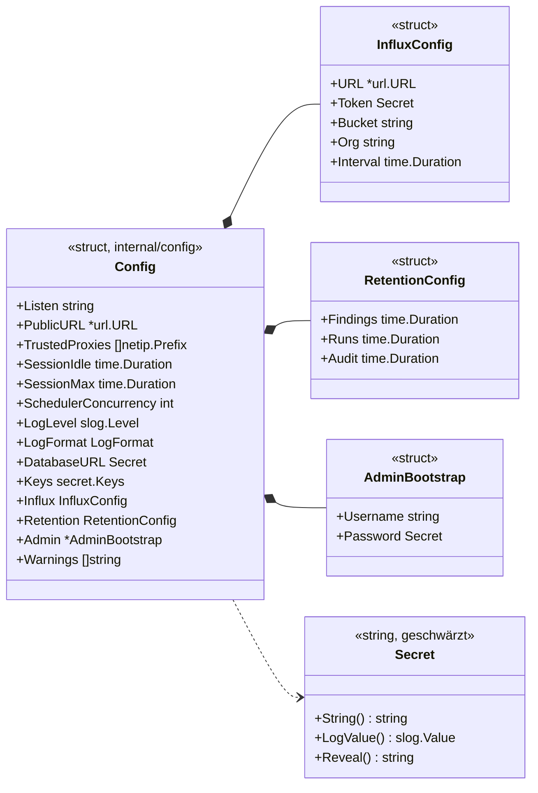
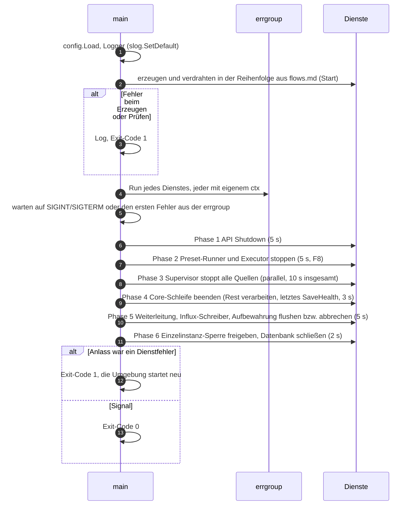

# Vertrag: Bootstrap und Konfiguration

**Status:** abgestimmt am 2026-10-11. **Pakete:** `cmd/monika`, `internal/config`. **Hintergrund:** `docs/ARCHITECTURE.md`, Abschnitt 14 (Bootstrap aus der Umgebung, Variablen); Start- und Stoppreihenfolge: [`flows.md`](flows.md).

`main` liest die Konfiguration, erzeugt alle Komponenten über ihre Konstruktoren, verdrahtet sie und überwacht ihre Laufzeit. Es gibt kein DI-Framework und keinen globalen Zustand außer der Treiber-Registry.

## Konfiguration

| Typ | Bedeutung |
|---|---|
| `config.Load(environ []string, envFile string) (Config, error)` | liest `.env` und Umgebung, prüft alles und liefert **alle** Fehler auf einmal (`errors.Join`), nicht nur den ersten |
| `Secret` | geheimer Text (Datenbank-URL mit Passwort, Influx-Token, Admin-Passwort): `String`, `GoString`, `LogValue` und `MarshalText` liefern `[redacted]`; den Klartext gibt nur `Reveal()` an genau der Stelle heraus, die ihn braucht |
| `InfluxConfig.URL` | leer = keine Zeitreihen; der Influx-Schreiber startet dann nicht |
| `Admin` | `nil`, wenn die Variablen fehlen; der Benutzername wird kleingeschrieben. Die Passwortregeln (A6) prüft `auth` beim Anlegen |
| `Keys` | `MONIKA_MASTER_KEY` und `MONIKA_MASTER_KEY_PREVIOUS` als `secret.Keys`, so wie `secret.NewService` sie braucht |
| `Warnings` | Hinweise, die den Start nicht verhindern (`.env` für andere lesbar, öffentliche URL ohne `https`); `main` loggt sie, sobald der Logger steht |
| `config.EnvFile(environ)` | Pfad der `.env`: `MONIKA_ENV_FILE`, sonst `./.env` |

Variablen, Standardwerte und Bedeutung stehen in `docs/ARCHITECTURE.md`, Abschnitt 14.

### Regeln

- **Quelle:** `./.env` im Arbeitsverzeichnis, abweichend über `MONIKA_ENV_FILE`. Fehlt die Datei, ist das kein Fehler. Variablen aus der Umgebung haben Vorrang.
- **Format der `.env`:** eine strikte Teilmenge, von einem eigenen kleinen Parser gelesen: `KEY=VALUE`, Kommentare mit `#`, optional in einfachen oder doppelten Anführungszeichen; keine Ersetzung von `${VAR}`, keine Mehrzeiler. Der Master-Key (Base64 mit `=`, `/`, `+`) wird so nie umgedeutet.
- **Unbekannte `MONIKA_*`-Variablen** brechen den Start ab: Ein Tippfehler würde sonst still den Standardwert nehmen.
- **Rechte der `.env`:** Ist die Datei für Gruppe oder andere lesbar, warnt Monika (in Containern liegt sie oft mit anderen Rechten gemountet).
- **Dauern** im Go-Format (`12h`, `1s`), zusätzlich `d` für Tage (`180d`). `0` bei der Aufbewahrung heißt „nie löschen“.
- **`MONIKA_PUBLIC_URL`** ist Pflicht. Ist sie nicht `https`, warnt Monika: Sitzungs-Cookies sind dann nicht `Secure`. TLS übernimmt ein Reverse-Proxy.

## Verdrahtung und Laufzeit

- **Phasen statt gemeinsamer Abbruch:** Das Signal bzw. ein Dienstfehler bricht nicht die Dienste ab, sondern stößt in `main` das Herunterfahren an. `main` beendet die Dienste Phase für Phase, indem es den `ctx` des jeweiligen Dienstes abbricht bzw. seine Stop-Methode ruft, und wartet auf jede Phase, bevor die nächste beginnt. So laufen keine Phasen gleichzeitig, und nachgelagerte Dienste (Weiterleitung, Influx) bekommen noch die letzten Ereignisse der vorgelagerten. Jede Phase hat eine Frist; danach geht `main` weiter und loggt, was nicht fertig wurde:

| Phase | Frist |
|---|---|
| 1 API | 5 s |
| 2 Preset-Runner und Executor | 5 s |
| 3 Quellen (alle parallel) | 10 s insgesamt |
| 4 Core | 3 s |
| 5 Weiterleitung, Influx-Schreiber, Aufbewahrung | 5 s |
| 6 Sperre und Datenbank | 2 s |
| **Summe** | **höchstens 30 s** |

Die Umgebung muss etwas länger warten (Docker: `stop_grace_period: 35s`, `docs/OPERATIONS.md`).
- **Die `errgroup`** dient nur dazu, einen Dienst zu bemerken, der mit Fehler zurückkehrt; sie bricht keine anderen Dienste ab.
- **Logger:** `slog` mit `MONIKA_LOG_FORMAT` (`json` oder `text`) und `MONIKA_LOG_LEVEL`; `slog.SetDefault`, damit auch `log`-Ausgaben fremder Libraries strukturiert landen (`sdk.md`, Logging). Beim Start eine Zeile mit Version und den wesentlichen, nicht geheimen Einstellungen.
- **Initialer Admin:** wird nur angelegt, wenn es noch keinen Benutzer gibt; das Passwort muss A6 erfüllen (`auth.md`), sonst startet Monika nicht. TOTP richtet er bei der ersten Anmeldung ein (A1). Gibt es schon Benutzer und die Variablen sind gesetzt, warnt Monika, dass sie entfernt werden können.
- **Kein Unterbefehl**, nur zwei Flags: `-version` und `-healthcheck` (fragt `GET /healthz` auf `MONIKA_LISTEN` ab und endet mit `0` oder `1`; für den Healthcheck im Container, der kein `curl` hat). Migrationen laufen beim Start; für die Entwicklung gibt es `make db-migrate`.
- **Exit-Codes:** `0` nach einem Signal, `1` bei jedem Fehler.

## Entscheidungen

| # | Frage | Entscheidung |
|---|---|---|
| K1 | Wie wird `.env` gelesen? | eigener kleiner Parser, strikte Teilmenge, keine Ersetzung |
| K2 | Unbekannte `MONIKA_*`-Variablen | Abbruch beim Start |
| K3 | Rechte der `.env` | Warnung, kein Abbruch |
| K4 | Lebenszyklus der Dienste | jeder Dienst mit eigenem `ctx`; Signal oder Dienstfehler (erkannt über die `errgroup`) stößt das Herunterfahren in sechs Phasen mit festen Fristen an (zusammen höchstens 30 s); bei Fehler Exit-Code 1 und Neustart durch die Umgebung |
| K5 | Woher kommt die `.env`? | `./.env` oder `MONIKA_ENV_FILE`; fehlt sie, kein Fehler; Umgebung hat Vorrang |
| K6 | TLS | nur über einen Reverse-Proxy; Warnung bei `MONIKA_PUBLIC_URL` ohne `https` |
| K7 | Flags | `-version` und `-healthcheck`, sonst keine (`docs/OPERATIONS.md`) |
