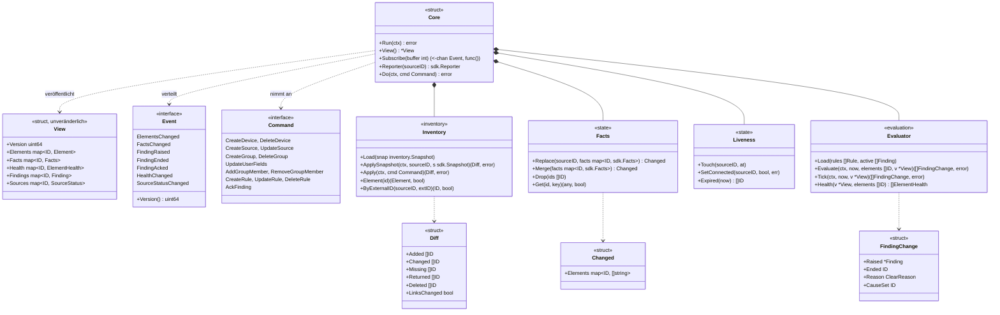
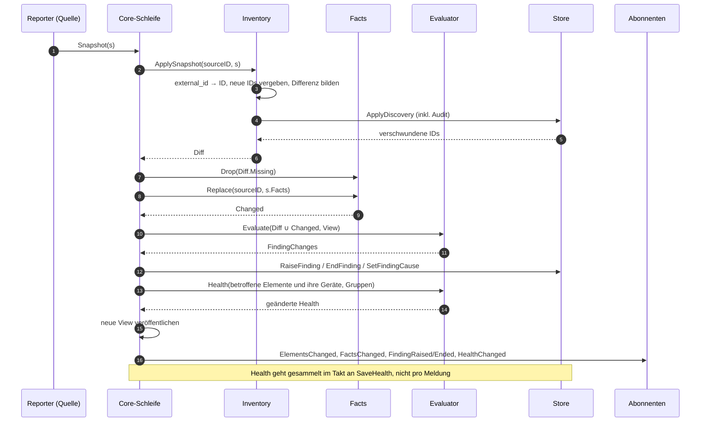
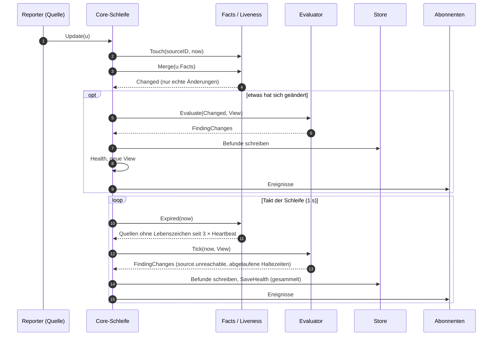
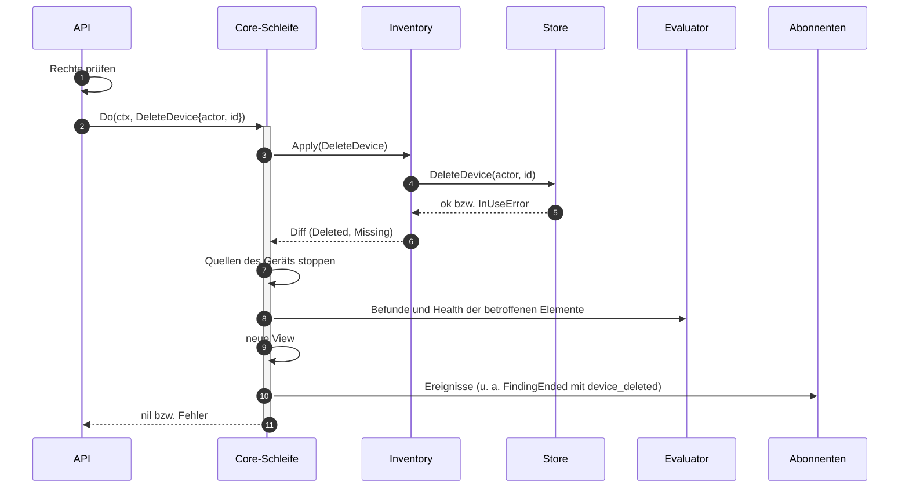
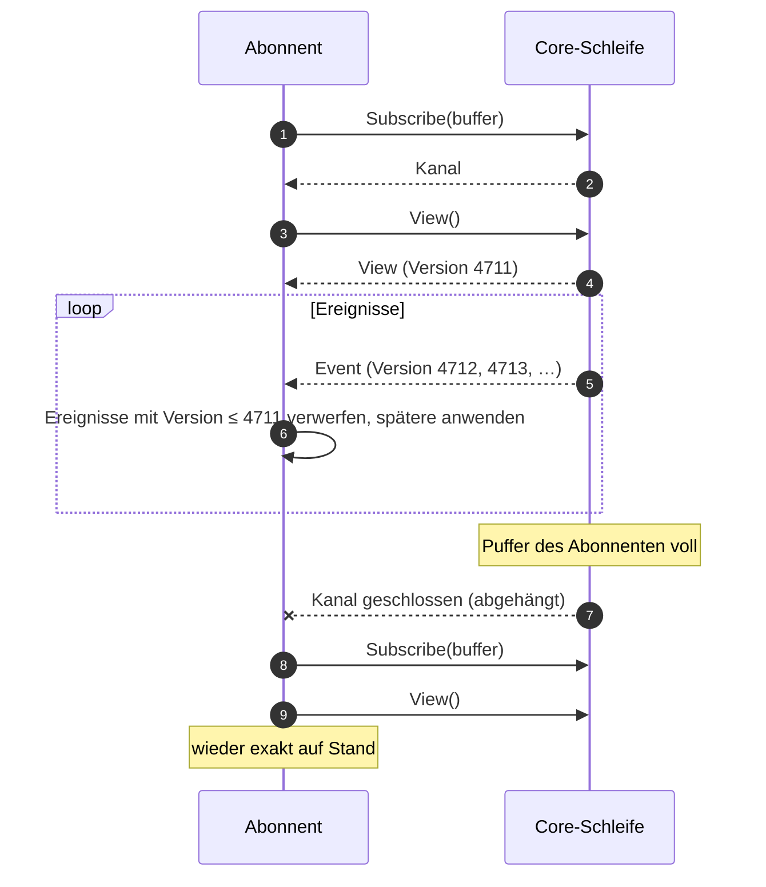
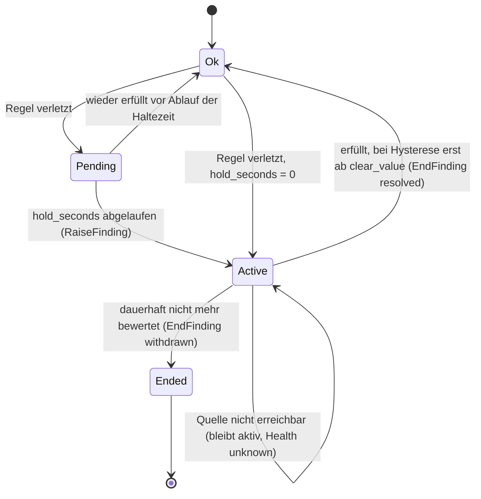

# Vertrag: Core-Komponenten

**Status:** abgestimmt am 2026-10-09. **Pakete:** `internal/core` mit `inventory/`, `state/`, `evaluation/`. **Hintergrund:** `docs/ARCHITECTURE.md`, Abschnitt 3 (Datenfluss), 5, 6, 8 und 14; Treiberseite: [`sdk.md`](sdk.md).

Der Core hält Inventar, Fakten, Regeln, aktive Befunde und Health im Speicher und bewertet dort. Er ist der einzige, der über die Store-Interfaces schreibt (siehe `CLAUDE.md`).

## Grundsätze

- **Eine Schleife besitzt den Zustand.** Alle Eingaben (Meldungen der Treiber, Befehle der API, Timer) laufen als Nachrichten in **eine** Goroutine, die sie nacheinander verarbeitet. Kein Zustand im Speicher wird von zwei Goroutinen gleichzeitig angefasst; es braucht keine Locks, und jede Verarbeitung sieht einen in sich stimmigen Stand.
- **Die Komponenten sind Logik, keine Dienste.** `inventory`, `state` und `evaluation` haben keine eigenen Goroutinen. Die Schleife ruft sie in fester Reihenfolge auf und reicht die Änderungen der einen an die nächste weiter.
- **Lesen ohne Schleife.** Nach jeder Verarbeitung veröffentlicht die Schleife eine unveränderliche Ansicht (`View`). API, Influx-Schreiber und Aktions-Executor lesen sie ohne Wartezeit.
- **Änderungen werden als Ereignisse verteilt.** Wer reagieren muss (UI-Push, Weiterleitung, Aktions-Executor), abonniert sie.
- **Erst die Datenbank, dann der Speicher.** Inventar und Befunde werden geschrieben, bevor der Speicher sie übernimmt. Scheitert das Schreiben, bleibt der Speicher unverändert.

## Typen und Interfaces

| Typ | Bedeutung |
|---|---|
| `Core.Reporter(sourceID)` | die Umsetzung von `sdk.Reporter` für eine Quelle: verpackt jede Meldung als Nachricht an die Schleife |
| `Core.Do(ctx, cmd)` | Befehl der API (bzw. des Aktions-Executors); wartet, bis die Schleife ihn verarbeitet hat, und liefert den Fehler. Die Rechteprüfung liegt **vor** `Do`, in der API |
| `View` | unveränderlich; jede Verarbeitung erzeugt eine neue (`Version` steigt). Wer sie hält, sieht einen stimmigen Stand, auch wenn die Schleife weiterläuft |
| `Diff` | was die Discovery bzw. ein Befehl am Inventar geändert hat; `Missing`/`Returned` sind Wechsel von `present` |
| `Changed` | pro Element die Schlüssel der Fakten, die sich wirklich geändert haben |
| `Evaluator.Tick` | regelmäßig: Haltezeiten (`hold_seconds`) laufen ab, Lebenszeichen fehlen |

## Ablauf: Meldungen eines Treibers

### Vollständiger Stand (`Snapshot`)

- `Replace` ersetzt alle Fakten der Quelle: Was im `Snapshot` fehlt, ist weg. `Update` dagegen ergänzt (`Merge`).
- Bewertet werden nur betroffene Elemente: geänderte Fakten, neue, verschwundene und zurückgekehrte Elemente, sowie Elemente, deren Links sich geändert haben (Ursache und Symptom).
- Schlägt `ApplyDiscovery` fehl, verwirft die Schleife den ganzen `Snapshot` und loggt; der nächste vollständige Stand des Treibers versucht es erneut.

### Änderung (`Update`) und Lebenszeichen

**Zusagen bei Last.** Läuft die Schleife hinterher, fasst der Reporter aufeinanderfolgende `Update`s einer Quelle zusammen. Wie er das tut, ist Sache der Implementierung; zugesagt ist:

- **Es gilt immer der neueste Wert** pro Element und Fakt, bei Alarmen die neueste Liste pro Element.
- **Zwischenwerte können entfallen.** Ein kurzer Wechsel (`signal_present` false und gleich wieder true) ist für die Bewertung dann womöglich nicht sichtbar. Regeln mit `hold_seconds` sollen so kurze Wechsel ohnehin nicht melden.
- **Die Reihenfolge bleibt erhalten:** Ein `Update` wird nie mit einem `Snapshot` zusammengefasst oder an ihm vorbei verarbeitet; `Connected` und `Disconnected` bleiben einzeln.
- **Treiber blockieren nicht**, auch wenn die Schleife hinterherhängt.

## Ablauf: Befehle der API

- Jeder Befehl ist eine Transaktion im Store **und** ein Schritt der Schleife. Die API sieht nach `Do` die neue `View`.
- Befehle, die Quellen betreffen (Gerät löschen, Quelle ändern, Secret ersetzen), lösen Start bzw. Stopp der Quelle aus (`sdk.md`, Stoppen).

## Abonnenten

Abonnenten (UI-Push pro Browserfenster, Weiterleitung, Aktions-Executor) bekommen Ereignisse über einen gepufferten Kanal. Die Schleife wartet nie auf einen Abonnenten und verwirft nie still ein Ereignis: Ist ein Puffer voll, **hängt sie den Abonnenten ab** und schließt seinen Kanal. Er merkt das, meldet sich neu an und liest die vollständige `View`.

- Erst anmelden, dann die `View` lesen; über `Version` geht dazwischen nichts verloren.
- **UI-Push:** Ein abgehängtes Browserfenster lädt den Stand neu.
- **Aktions-Executor:** prüft Bedingungen ohnehin gegen die `View`; nach dem Neuanmelden prüft er erneut.
- **Weiterleitung:** bekommt einen großen Puffer, weil jedes Ereignis zählt. Wird sie doch abgehängt, gehen die Ereignisse dazwischen verloren (best effort, `docs/ARCHITECTURE.md` Abschnitt 13); das wird geloggt.

## Lebenszyklus eines Regel-Befunds

- `Pending` existiert nur im Speicher. Nach einem Neustart beginnen Haltezeiten neu.
- Befunde aus Gerätealarmen entstehen ohne Haltezeit, sobald der Alarm in der Liste steht, und enden (behoben), sobald er fehlt.

## Entscheidungen

| # | Frage | Entscheidung |
|---|---|---|
| C1 | Nebenläufigkeit | eine Schleife besitzt den gesamten Zustand; Komponenten sind Logik ohne eigene Goroutinen |
| C2 | Lesen | unveränderliche `View` nach jeder Verarbeitung, ohne Locks lesbar |
| C3 | Schreiben in die Datenbank | Inventar und Befunde sofort und synchron in der Schleife; Health gesammelt im Takt |
| C4 | Rückstau bei Last | Reporter fasst `Update`s zusammen (neuester Wert gilt, Zwischenwerte können entfallen, Reihenfolge bleibt); das Verfahren ist Sache der Implementierung |
| C5 | Takt der Schleife | 1 s für Lebenszeichen, Haltezeiten und `SaveHealth`; InfluxDB über einen eigenen Schreiber aus der `View` |
| C6 | Langsame Abonnenten | werden abgehängt, melden sich neu an und lesen die `View` (über `Version` lückenlos); Weiterleitung mit großem Puffer |
| C7 | Größe der `View` | strukturell geteilt: unveränderte Teile werden übernommen, nicht kopiert |
