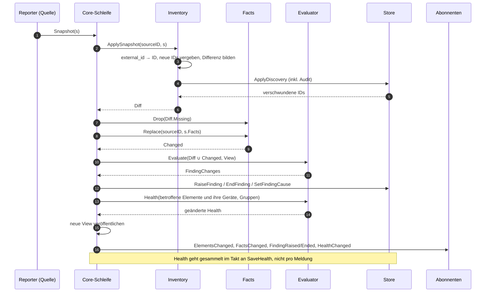
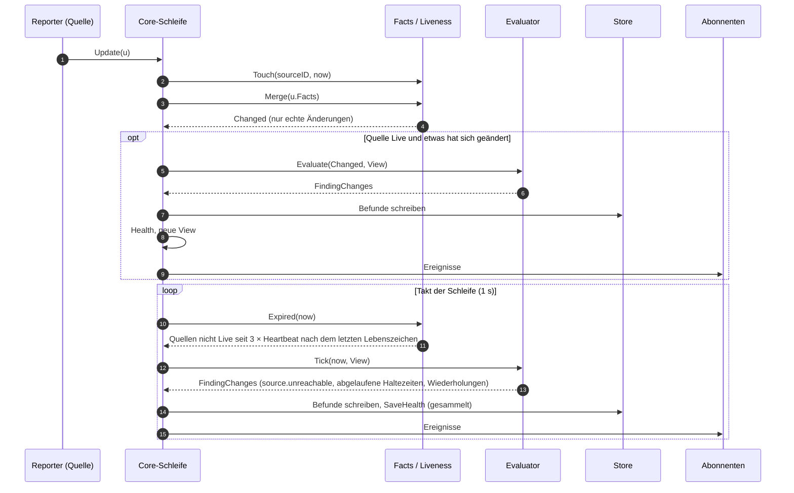
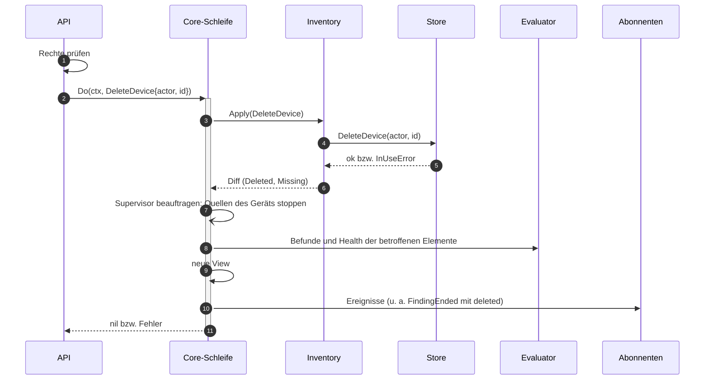
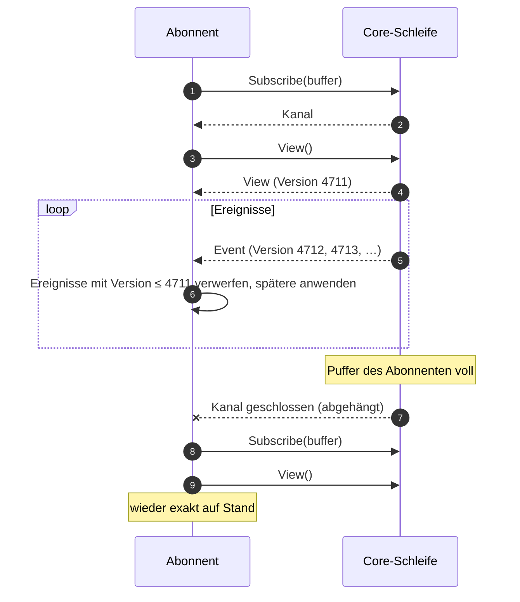
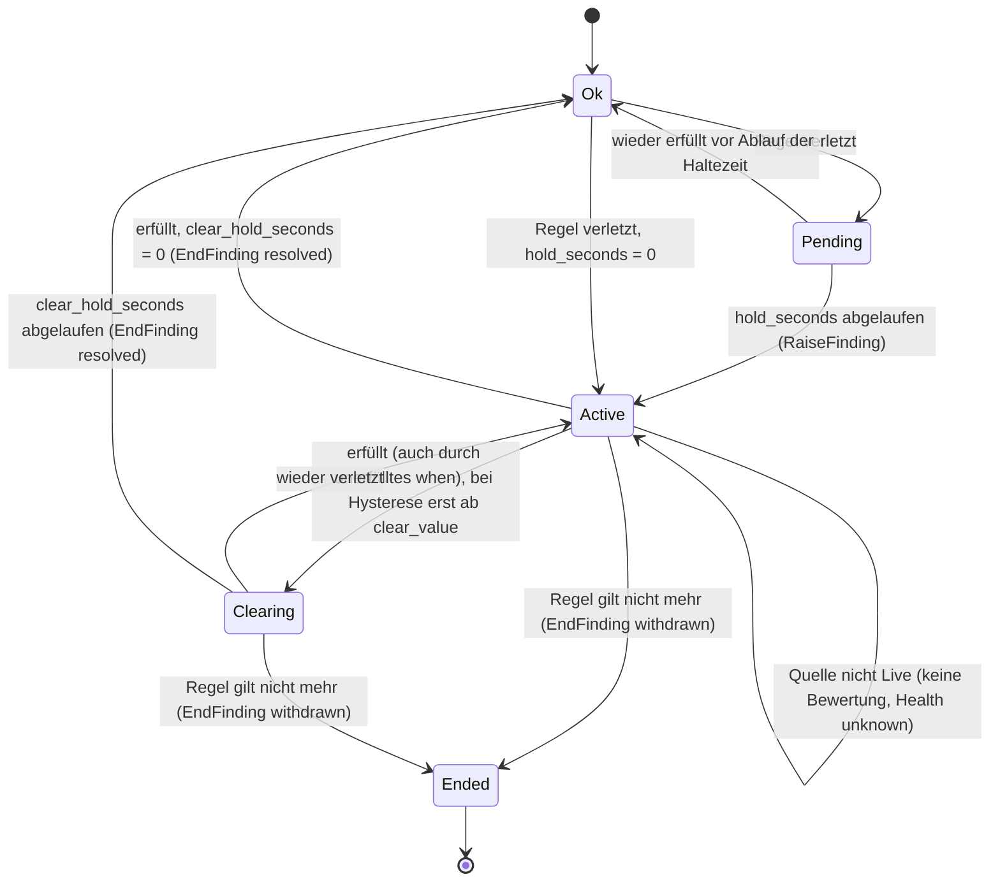

# Vertrag: Core-Komponenten

**Status:** abgestimmt am 2026-10-09, überarbeitet am 2026-10-10 (Architektur-Audit) und 2026-10-11 (Vokabular, Kennzahlen). **Pakete:** `internal/core` mit `inventory/`, `state/`, `evaluation/`. **Hintergrund:** `docs/ARCHITECTURE.md`, Abschnitt 3 (Datenfluss), 5, 6, 8 und 14; Treiberseite: [`sdk.md`](sdk.md).

Der Core hält Inventar, Fakten, Regeln, aktive Befunde und Health im Speicher und bewertet dort. Er ist der einzige, der über die Store-Interfaces schreibt (siehe `CLAUDE.md`).

## Grundsätze

- **Eine Schleife besitzt den Zustand.** Alle Eingaben (Meldungen der Treiber, Befehle der API, Timer) laufen als Nachrichten in **eine** Goroutine, die sie nacheinander verarbeitet. Kein Zustand im Speicher wird von zwei Goroutinen gleichzeitig angefasst; es braucht keine Locks, und jede Verarbeitung sieht einen in sich stimmigen Stand.
- **Die Komponenten sind Logik, keine Dienste.** `inventory`, `state` und `evaluation` haben keine eigenen Goroutinen. Die Schleife ruft sie in fester Reihenfolge auf und reicht die Änderungen der einen an die nächste weiter.
- **Dienste laufen nebenher.** Supervisor (Quellen), Executor, Preset-Runner, Weiterleitung und Influx-Schreiber haben eigene Goroutinen und eigenen Zustand, aber nie Zugriff auf den Zustand der Schleife. Sie sprechen mit ihr nur über Nachrichten (`Do`, `Post`, `Reporter`, Aufträge an den Supervisor), Ereignisse und die `View` (siehe [`flows.md`](flows.md), [`services.md`](services.md)).
- **Lesen ohne Schleife.** Nach jeder Verarbeitung veröffentlicht die Schleife eine unveränderliche Ansicht (`View`). API, Influx-Schreiber und Aktions-Executor lesen sie ohne Wartezeit.
- **Reagieren über Ereignisse, abtasten über die `View`.** Wer auf eine Änderung reagiert (UI-Push, Weiterleitung, Prüfbedingung des Executors), abonniert Ereignisse und fragt nicht ab. Wer im festen Takt einen Stand abtastet (Influx-Schreiber), liest die `View` im Takt. Einmal lesen nach dem Anmelden gehört zum Abonnieren (siehe Abonnenten).
- **Änderungen werden als Ereignisse verteilt.** Wer reagieren muss (UI-Push, Weiterleitung, Aktions-Executor), abonniert sie.
- **Erst die Datenbank, dann der Speicher.** Inventar und Befunde werden geschrieben, bevor der Speicher sie übernimmt. Scheitert das Schreiben, bleibt der Speicher unverändert.
- **Die Datenbank hält die Schleife nie an.** Jedes Schreiben in der Schleife hat ein Timeout (2 s). Ein gescheiterter Befehl liefert seinen Fehler an `Do`; ein gescheitertes Entstehen oder Enden eines Befunds bleibt im Evaluator offen und wird im Takt wiederholt; ein gescheiterter `Snapshot` wird gemerkt und wiederholt (siehe unten). Fakten im Speicher, `View`, Ereignisse und InfluxDB laufen weiter. Den Zustand der Datenbank führt die `View` (`DB`).

## Typen und Interfaces

```mermaid
classDiagram
    direction TB

    class Core {
        <<struct>>
        +Run(ctx) error
        +View() *View
        +Subscribe(buffer int) (<-chan Event, func())
        +Reporter(sourceID) sdk.Reporter
        +Do(ctx, cmd Command) error
        +Post(m Message)
    }
    class View {
        <<struct, unveränderlich>>
        +Version uint64
        +Elements map~ID, Element~
        +Links Links
        +Facts map~ID, Facts~
        +Health map~ID, ElementHealth~
        +Findings map~ID, Finding~
        +Rules map~ID, Rule~
        +Runs map~ID, Run~
        +Sources map~ID, SourceStatus~
        +DB DBStatus
        +History InfluxStatus
        +Stats Stats
        +InScope(scope, element ID) bool
        +EffectiveRules(element ID) []RuleSet
    }
    class SourceStatus {
        <<struct>>
        +State SourceState
        +Heartbeat time.Duration
        +LastSeen time.Time
        +Error string
    }
    class Message {
        <<interface>>
        SourceStarted, SourceStopped
        SourceFailed, SourceStuck
        RunChanged
        InfluxStatus
    }
    class Event {
        <<interface>>
        +Version() uint64
        ElementsChanged
        FactsChanged
        FindingRaised
        FindingEnded
        FindingAcked
        FindingCauseChanged
        HealthChanged
        RunChanged
        SourceStatusChanged
    }
    class Command {
        <<interface>>
        CreateDevice, DeleteDevice
        CreateSource, UpdateSource, DeleteSource
        CreateGroup, DeleteGroup
        UpdateUserFields
        AddGroupMember, UpdateGroupMember, RemoveGroupMember
        CreateRule, UpdateRule, DeleteRule
        AckFinding
        ReplaceSecret
    }

    class Inventory {
        <<inventory>>
        +Load(snap inventory.Snapshot)
        +ApplySnapshot(ctx, sourceID, s sdk.Snapshot) (Diff, error)
        +Apply(ctx, cmd Command) (Diff, error)
        +Element(id) (Element, bool)
        +ByExternalID(sourceID, extID) (ID, bool)
    }
    class Diff {
        <<struct>>
        +Added []ID
        +Changed []ID
        +Missing []ID
        +Returned []ID
        +Deleted []ID
        +LinksChanged bool
    }
    class Facts {
        <<state>>
        +Replace(sourceID, facts map~ID, sdk.Facts~) Changed
        +Merge(facts map~ID, sdk.Facts~) Changed
        +Drop(ids []ID)
        +Get(id, key) (any, bool)
    }
    class Liveness {
        <<state>>
        +Touch(sourceID, at)
        +SetConnected(sourceID, bool, err)
        +Expired(now) []ID
    }
    class Changed {
        <<struct>>
        +Elements map~ID, []string~
    }
    class Evaluator {
        <<evaluation>>
        +Load(rules []Rule, active []Finding)
        +Evaluate(ctx, now, elements []ID, v *View) ([]FindingChange, error)
        +Tick(ctx, now, v *View) ([]FindingChange, error)
        +Health(v *View, elements []ID) []ElementHealth
    }
    class FindingChange {
        <<struct>>
        +Raised *Finding
        +Ended ID
        +Reason ClearReason
        +CauseSet ID
    }

    Core *-- Inventory
    Core *-- Facts
    Core *-- Liveness
    Core *-- Evaluator
    Core ..> View : veröffentlicht
    Core ..> Event : verteilt
    Core ..> Command : nimmt an
    Core ..> Message : nimmt an
    View *-- SourceStatus
    Inventory ..> Diff
    Facts ..> Changed
    Evaluator ..> FindingChange
```

| Typ | Bedeutung |
|---|---|
| `Core.Reporter(sourceID)` | die Umsetzung von `sdk.Reporter` für eine Quelle: verpackt jede Meldung als Nachricht an die Schleife |
| `Core.Do(ctx, cmd)` | Befehl der API; wartet, bis die Schleife ihn verarbeitet hat, und liefert den Fehler. Die Rechteprüfung liegt **vor** `Do`, in der API |
| `Core.Post(m)` | Nachricht eines Dienstes ohne Warten auf die Verarbeitung; blockiert höchstens kurz beim Einreihen. Supervisor: `SourceStarted`, `SourceStopped`, `SourceFailed{err, panic}`, `SourceStuck`; Executor: `RunChanged{run}`; Influx-Schreiber: `InfluxStatus` |
| `View.Links` | alle Links mit Index pro Element (ausgehend und eingehend, nach Typ); für `GET /state`, Ursache/Symptom und die Anzeige von Verbindungen über `represents` |
| `View.Rules`, `View.Runs` | alle Regeln; laufende Läufe (ein Lauf fällt mit seinem Endzustand heraus) |
| `View.InScope(scope, element)` | **die** Auflösung von Geltungsbereichen für Regeln, Rechte, Weiterleitung, Verlauf und Watch: NULL = alles; Element = es selbst und alle Nachfahren über `parent_id`; Gruppe = Mitglieder rekursiv, jeweils mit Nachfahren |
| `View.EffectiveRules(element)` | pro Fakt und Richtung die geltenden und die überschriebenen Regeln (für die UI) |
| `SourceStatus.State` | `starting`, `connecting`, `live`, `backoff`, `unreachable`, `stopping`, `stuck`, `disabled`; aus `Reporter` und Nachrichten des Supervisors. `Heartbeat` ist `Source.Heartbeat()` der laufenden Instanz |
| `View.DB` | ob die letzten Schreibvorgänge gelangen; die API meldet sonst `503` an `GET /healthz`, die UI zeigt ein Banner |
| `View.History` | Zustand des Influx-Schreibers (`influx.md`); nur Anzeige, ohne Wirkung auf `/healthz` |
| `View.Stats` | Kennzahlen der Schleife, bei jeder Veröffentlichung gesetzt: `LoopLag` (Wartezeit der ältesten Nachricht), `LoopQueue`, `Subscribers`, `SubscribersDropped` und `Events` (beide Zähler seit dem Start). Der Influx-Schreiber schreibt sie mit seinen eigenen und dem Zähler der SSE-Ströme der API in das Measurement `monika` (`docs/OPERATIONS.md`) |
| `Evaluator.Health` | Health von Elementen; bei Gerät und Gruppe über die verschiedenen Elemente in ihrem Geltungsbereich (`InScope`, ohne Gerät- und Gruppen-Elemente), jedes genau einmal |
| `View` | unveränderlich; jede Verarbeitung erzeugt eine neue (`Version` steigt). Wer sie hält, sieht einen stimmigen Stand, auch wenn die Schleife weiterläuft |
| `Diff` | was die Discovery bzw. ein Befehl am Inventar geändert hat; `Missing`/`Returned` sind Wechsel von `present` |
| `Changed` | pro Element die Schlüssel der Fakten, die sich wirklich geändert haben |
| `Evaluator.Tick` | regelmäßig: Haltezeiten (`hold_seconds`, `clear_hold_seconds`) laufen ab, Lebenszeichen fehlen, offene Schreibvorgänge werden wiederholt |
| `FindingChange.CauseSet` | neue Zuordnung von Ursache und Symptom (auch auf „keine Ursache“), siehe unten |

## Ablauf: Meldungen eines Treibers

### Vollständiger Stand (`Snapshot`)

- `ApplySnapshot` setzt für `ParentID ""` das Zugangs-Element der Quelle als Eltern und `Snapshot.GlobalRef` an den Zugang.
- **Struktur unverändert:** Der Core vergleicht den `Snapshot` im Speicher mit dem vorigen. Ohne Strukturänderung schreibt er nur `last_seen_at`, höchstens alle 5 min, und übernimmt nur die Fakten.
- `Replace` ersetzt alle Fakten der Quelle: Was im `Snapshot` fehlt, ist weg. `Update` dagegen ergänzt (`Merge`).
- Mit dem ersten übernommenen `Snapshot` nach `Connected` ist die Quelle `Live`; erst dann wird bewertet.
- Bewertet werden nur betroffene Elemente: geänderte Fakten, neue, verschwundene und zurückgekehrte Elemente, sowie Elemente, deren Links sich geändert haben (Ursache und Symptom).
- **Schlägt `ApplyDiscovery` fehl** (Datenbank, Konflikt der `global_ref`), merkt sich die Schleife den `Snapshot` pro Quelle. Folgende `Update`s mischt sie in den gemerkten Stand, ein neuerer `Snapshot` ersetzt ihn. Sie wiederholt mit steigender Wartezeit (höchstens 1 min) und erzeugt `source.discovery_failed` am Zugang (`system`, `error`, Fehlertext in `details`), der mit dem ersten Erfolg als behoben endet. Bis dahin ist die Quelle nicht `Live`. Das Gerät wird dafür nicht erneut abgefragt.

### Änderung (`Update`) und Lebenszeichen

- Ein `Update` einer Quelle, die nicht `Live` ist, wird übernommen (Fakten „zuletzt gemeldet“), aber nicht bewertet; vor dem ersten `Snapshot` nach `Connected` wird es verworfen. Fakten an einer unbekannten `external_id` verwirft die Schleife mit `Warn`-Log einmal pro Quelle und `external_id` bis zum nächsten `Snapshot`.
- Ist die Quelle nicht `Live`, sind ihre Elemente außer dem Zugang `unknown`; ihre aktiven Befunde bleiben unverändert.

**Zusagen bei Last.** Läuft die Schleife hinterher, fasst der Reporter aufeinanderfolgende `Update`s einer Quelle zusammen. Wie er das tut, ist Sache der Implementierung; zugesagt ist:

- **Es gilt immer der neueste Wert** pro Element und Fakt, bei Alarmen die neueste Liste pro Element.
- **Zwischenwerte können entfallen.** Ein kurzer Wechsel (`state.signal_present` false und gleich wieder true) ist für die Bewertung dann womöglich nicht sichtbar. Regeln mit `hold_seconds` sollen so kurze Wechsel ohnehin nicht melden.
- **Die Reihenfolge bleibt erhalten:** Ein `Update` wird nie mit einem `Snapshot` zusammengefasst oder an ihm vorbei verarbeitet; `Connected` und `Disconnected` bleiben einzeln.
- **Treiber blockieren nicht**, auch wenn die Schleife hinterherhängt.

## Ablauf: Befehle der API

- Jeder Befehl ist eine Transaktion im Store **und** ein Schritt der Schleife. Die API sieht nach `Do` die neue `View`.
- Befehle, die Quellen betreffen (Gerät löschen, Quelle anlegen, ändern oder löschen, Secret ersetzen), beauftragen den Supervisor mit Start bzw. Stopp der Quelle (`sdk.md`, Stoppen). Die Schleife wartet nicht darauf; Start, Stopp, Fehler, Panics und hängende Quellen meldet der Supervisor per `Post` zurück.
- `ReplaceSecret` schreibt über `secret.Service` und startet danach alle Quellen neu, die das Secret verwenden (aus der `View`). Anlegen und Löschen von Secrets betreffen keine laufende Quelle und gehen direkt an `secret.Service`.

Prüfungen im Core, zusätzlich zur Datenbank:

| Befehl | Prüfung |
|---|---|
| `CreateSource`, `UpdateSource` | Gerät existiert; Treiber registriert; Neustart beim Supervisor |
| `DeleteDevice`, `DeleteSource`, `DeleteGroup` | kein Preset-Schritt zielt darauf (bei Gerät und Quelle: auf eines ihrer Elemente); aktive Befunde werden vorher zurückgezogen (`deleted`) |
| `AddGroupMember`, `UpdateGroupMember` | Ziel hat `kind = group`; Zyklusprüfung im Store |
| `CreateRule`, `UpdateRule` | Operator und Werttyp gegen den Fakt-Katalog |

## Abonnenten

Abonnenten (Verteiler der API für alle Browserfenster, Weiterleitung, Aktions-Executor, Preset-Runner) bekommen Ereignisse über einen gepufferten Kanal. Die Schleife wartet nie auf einen Abonnenten und verwirft nie still ein Ereignis: Ist ein Puffer voll, **hängt sie den Abonnenten ab** und schließt seinen Kanal. Er merkt das, meldet sich neu an und liest die vollständige `View`.

- Erst anmelden, dann die `View` lesen; über `Version` geht dazwischen nichts verloren.
- **UI-Push:** Die API hält **ein** Abo und verteilt an die Browser-Ströme (`api.md`); ein abgehängter Verteiler schickt allen Strömen `resync`.
- **Aktions-Executor:** prüft Bedingungen ohnehin gegen die `View`; nach dem Neuanmelden prüft er erneut.
- **Weiterleitung:** bekommt einen großen Puffer, weil jedes Ereignis zählt. Wird sie doch abgehängt, gehen die Ereignisse dazwischen verloren (best effort, `docs/ARCHITECTURE.md` Abschnitt 13); das wird geloggt.

## Lebenszyklus eines Regel-Befunds

- **Regel gilt** am Element: Geltungsbereich und Filter passen, Element überwacht, `fact` (bei `when` auch `when_fact`) vorhanden, und sie gehört zur gewinnenden Stufe für Fakt und Richtung (`docs/ARCHITECTURE.md` Abschnitt 8). Gründe für das Zurückziehen: `rule_deleted`, `rule_disabled`, `rule_changed`, `unmonitored`, `element_missing`, `fact_missing`, `source_disabled`, `deleted`.
- `Pending` und `Clearing` existieren nur im Speicher. Nach einem Neustart beginnen Haltezeiten neu; ein aktiver Befund bleibt so lange aktiv.
- Befunde aus Gerätealarmen entstehen ohne Haltezeit, sobald der Alarm in der Liste steht, und enden (behoben), sobald er fehlt.

## Ursache und Symptom

Die Zuordnung ist eine Ableitung über den Link-Graphen der `View`, kein Zustand vom Entstehen.

- **Auslöser:** Ein Befund entsteht oder endet, oder Links ändern sich. Der Evaluator ordnet dann alle aktiven Befunde neu zu, die von dort flussabwärts erreichbar sind (Breitensuche: `feeds` A→B wirkt auf B, `uses` A→B auf A, `parent` auf die Kinder).
- **Regel:** Ein aktiver Befund ist Symptom, wenn flussaufwärts ein aktiver Befund mit `warning` oder `error` liegt; `caused_by_id` zeigt auf die Wurzel. Bei mehreren Wurzeln gewinnt die schwerere, dann die ältere. Kreise sind abgefangen, dort ist der älteste Befund die Wurzel.
- Jede Änderung wird als `FindingChange.CauseSet` geschrieben (`SetFindingCause`) und als `FindingCauseChanged` verteilt; die Weiterleitung verwendet es nicht.

## Entscheidungen

| # | Frage | Entscheidung |
|---|---|---|
| C1 | Nebenläufigkeit | eine Schleife besitzt den gesamten Zustand im Speicher; `inventory`, `state`, `evaluation` sind Logik ohne eigene Goroutinen; Dienste (Supervisor, Executor …) laufen nebenher und sprechen nur über Nachrichten, Ereignisse und die `View` |
| C2 | Lesen | unveränderliche `View` nach jeder Verarbeitung, ohne Locks lesbar |
| C3 | Schreiben in die Datenbank | Inventar und Befunde sofort und synchron in der Schleife, mit Timeout; Befunde werden bei Fehlern im Takt wiederholt; Health gesammelt im Takt; `last_seen_at` ohne Strukturänderung höchstens alle 5 min |
| C4 | Rückstau bei Last | Reporter fasst `Update`s zusammen (neuester Wert gilt, Zwischenwerte können entfallen, Reihenfolge bleibt); das Verfahren ist Sache der Implementierung |
| C5 | Takt der Schleife | 1 s für Lebenszeichen, Haltezeiten und `SaveHealth`; InfluxDB über einen eigenen Schreiber aus der `View` |
| C6 | Langsame Abonnenten | werden abgehängt, melden sich neu an und lesen die `View` (über `Version` lückenlos); Weiterleitung mit großem Puffer |
| C7 | Größe der `View` | strukturell geteilt: unveränderte Teile werden übernommen, nicht kopiert |
| C8 | Ursache und Symptom | bei jeder Befund- und Link-Änderung neu abgeleitet; `caused_by_id` zeigt auf die Wurzel und wird persistiert |
| C9 | Gescheiterter `Snapshot` | gemerkt und mit steigender Wartezeit wiederholt, ohne das Gerät; `source.discovery_failed` am Zugang |
| C10 | Datenbank nicht erreichbar | Monika läuft weiter, Zustandswechsel warten; sichtbar über `View.DB`, Banner und `GET /healthz` |
| C11 | Nachrichten der Dienste | `Post` ohne Warten; `Do` nur für Befehle mit Fehlerrückgabe |
