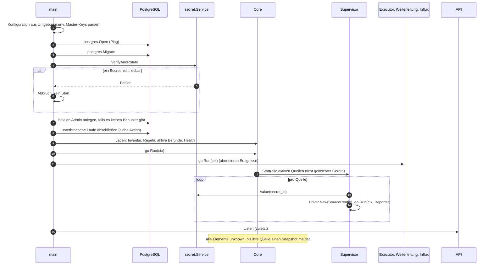
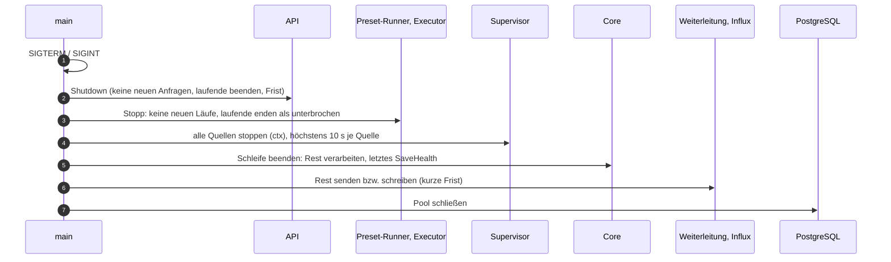
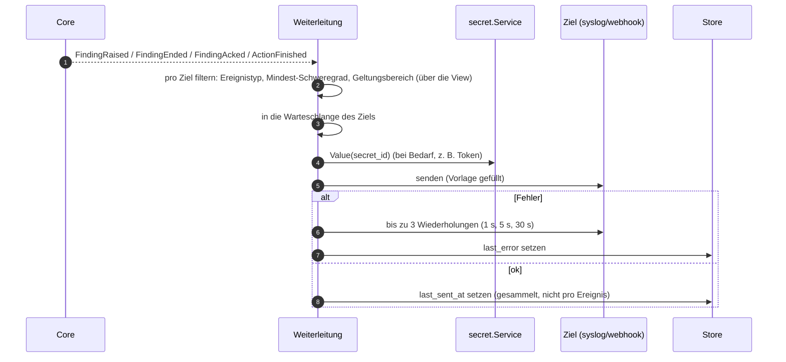
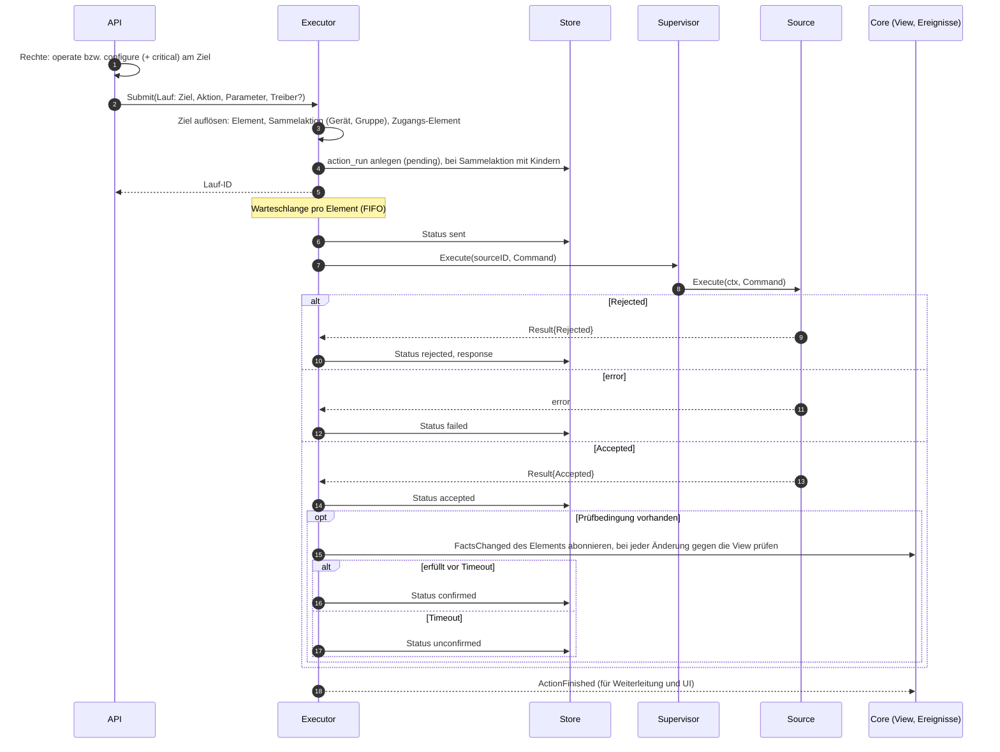
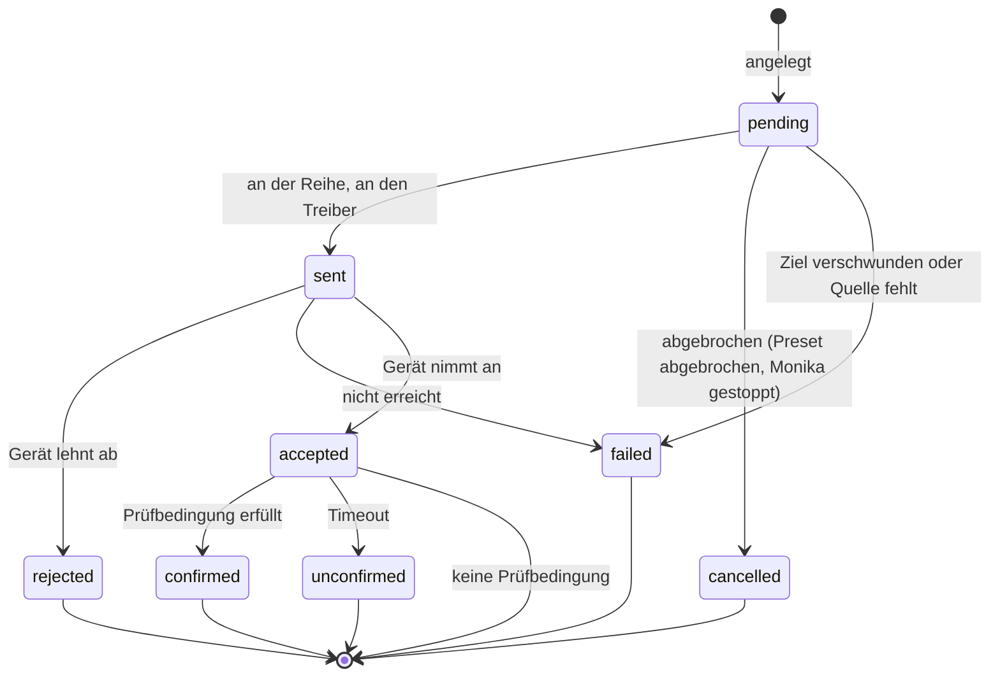
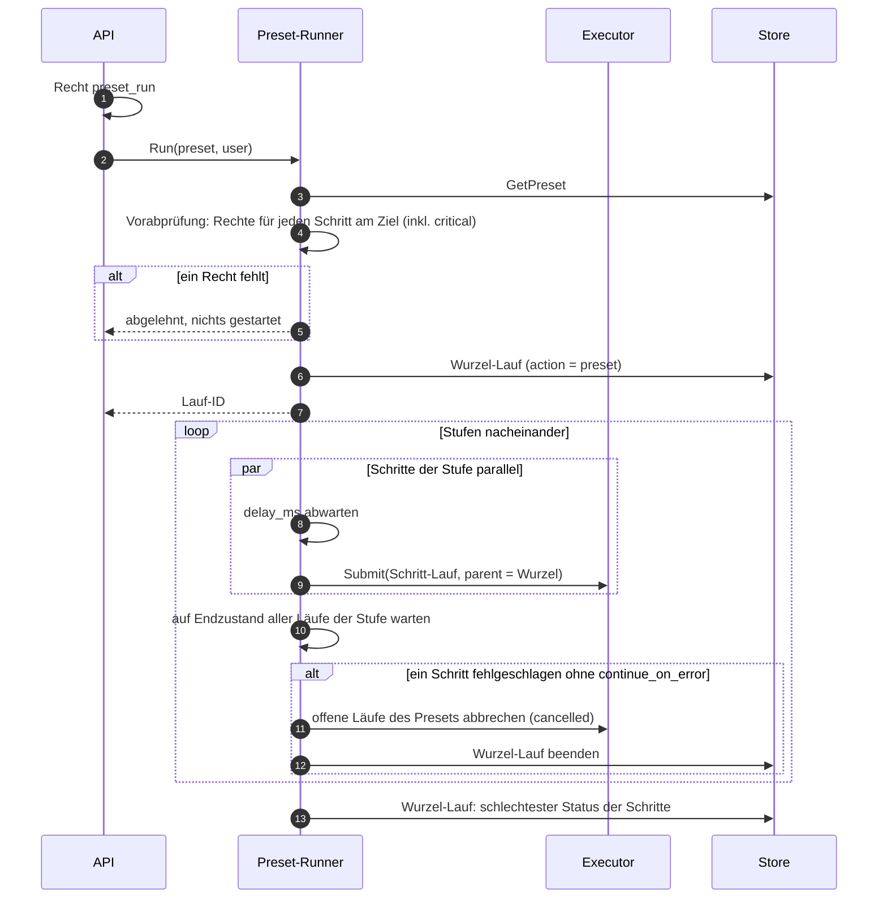

# Vertrag: Abläufe

**Status:** abgestimmt am 2026-10-09. **Hintergrund:** `docs/ARCHITECTURE.md`, Abschnitt 9, 10, 12, 13 und 14; Bausteine aus [`sdk.md`](sdk.md) und [`core.md`](core.md).

Discovery-Lauf und „Fakt → Befund“ stehen in `core.md` (Abläufe: Meldungen eines Treibers). Hier stehen die Abläufe, die mehrere Komponenten verbinden.

## Beteiligte

| Komponente | Paket | Aufgabe in den Abläufen |
|---|---|---|
| Bootstrap | `cmd/monika`, `internal/config` | Konfiguration lesen, alles erzeugen und verdrahten, Start- und Stoppreihenfolge |
| Core | `internal/core` | Schleife, `View`, Ereignisse, Befehle (`core.md`) |
| Supervisor | `internal/core/supervisor` | eigener Dienst: startet und stoppt die `Source`s im Auftrag der Schleife, fängt Panics, meldet `Stuck`, führt `Execute` aus |
| Executor | `internal/action` | Läufe: Warteschlange pro Element, Ausführung, Prüfbedingung |
| Preset-Runner | `internal/preset` | Stufen, Verzögerungen, Rechte-Vorabprüfung |
| Weiterleitung | `internal/forward` | Ereignisse filtern und an syslog/webhook senden |
| Influx-Schreiber | `internal/history/influx` | Fakten und Health im festen Takt aus der `View` |
| Rechte | `internal/auth` | `Allowed(view, user, permission, element)` für API und Preset-Runner |
| API | `internal/api` | Anmeldung, Rechte, Befehle an Core/Executor/Preset-Runner, Live-Push |

## Start

- **Abbruch statt Warten:** Ist die Konfiguration ungültig, die Datenbank nicht erreichbar, eine Migration fehlerhaft oder ein Secret nicht lesbar, beendet sich Monika mit Fehler. Neustarts übernimmt die Umgebung (Docker, systemd).
- Die API öffnet zuletzt, damit keine Anfrage einen halb gestarteten Core sieht.

## Herunterfahren

## Weiterleitung

- Eine Warteschlange **pro Ziel**: ein langsames Ziel hält die anderen nicht auf. Ist sie voll, werden die ältesten Ereignisse verworfen und geloggt (best effort).
- `FindingEnded` wird je nach `cleared_reason` als `finding.cleared` (behoben) oder `finding.withdrawn` gesendet.

## Aktion

- **Sammelaktion:** ein übergeordneter Lauf mit einem Kind pro Element; er endet, wenn alle Kinder enden, mit dem schlechtesten Status (`failed` > `rejected` > `unconfirmed` > `accepted` > `confirmed`, `docs/ARCHITECTURE.md` Abschnitt 9).
- **Kritisch:** `action_run.critical` friert ein, ob die Aktion (Definition oder `critical_actions`) oder ein gesetzter Schlüssel kritisch war.
- **Unterbrochen durch Neustart:** Nach einem Neustart wird nichts erneut an Geräte gesendet. Monika schließt offene Läufe nur ab: `pending` und `sent` als `failed`, `accepted` als `unconfirmed`, jeweils mit Grund „Monika neu gestartet“. Wer die Aktion wiederholen will, löst sie neu aus.
- **Endzustände sind endgültig.** Ein Lauf ist Verlauf, kein Zustand: Er hält fest, was bei dieser einen Ausführung passiert ist. Nichts setzt `unconfirmed` (oder einen anderen Endzustand) später zurück oder auf `confirmed`; ob eine spätere Wirkung von diesem Befehl kam, ist nicht feststellbar. Den aktuellen Zustand eines Elements zeigen immer die Fakten.
- **Prüfbedingung:** Der Executor abonniert `FactsChanged` und prüft bei jeder Änderung des Elements gegen die `View`; nach dem Neuanmelden (`core.md`, Abonnenten) prüft er einmal direkt.
- **Rechte** prüft nur die API beim Absenden (bzw. der Preset-Runner vorab); der Executor prüft nicht erneut. Zwischen Absenden und Senden liegen nur Warteschlange und Preset-Stufen, keine zeitgesteuerte Ausführung.

## Preset-Lauf

- „Fehlgeschlagen“ heißt für die Stufe: `failed` oder `rejected`. `unconfirmed` bricht nicht ab (das Gerät hat angenommen, die Wirkung ist nur nicht beobachtet).

## Neue Store-Methoden, die diese Abläufe brauchen

| Interface | Methoden |
|---|---|
| `action.Store` | `CreateRun(ctx, run)` (mit Kindern), `UpdateRunStatus(ctx, id, status, response)`, `FinishInterruptedRuns(ctx, reason)` |
| `forward.Store` | `ListTargets(ctx)`, `SetTargetResult(ctx, id, sentAt, lastError)`; Ziele anlegen/ändern/löschen mit Audit |
| `auth.Store` | Benutzer, Rollen, Rechte laden; initialen Admin anlegen (eigener Vertrag mit der API) |

## Entscheidungen

| # | Frage | Entscheidung |
|---|---|---|
| F1 | Datenbank beim Start nicht erreichbar | Abbruch; Neustart durch die Umgebung |
| F2 | Läufe, die ein Neustart unterbrochen hat | nichts erneut senden; `pending`/`sent` → `failed`, `accepted` → `unconfirmed`, mit Grund |
| F3 | Wer verwaltet die laufenden `Source`s? | eigener Dienst **Supervisor**; die Schleife beauftragt ihn per Nachricht, der Executor ruft über ihn `Execute` |
| F4 | Wo werden Rechte geprüft? | in der API (und im Preset-Runner vorab) über `auth.Allowed` gegen die `View`; Core und Executor prüfen nicht erneut |
| F5 | Wiederholungen der Weiterleitung | 3 Wiederholungen (1 s, 5 s, 30 s), Warteschlange pro Ziel, bei Überlauf die ältesten verwerfen |
| F6 | Wie wartet der Executor auf die Prüfbedingung? | Ereignisse (`FactsChanged`) abonnieren; wer auf Änderungen reagiert, abonniert (`core.md`) |
| F7 | Was bricht eine Preset-Stufe ab? | `failed` und `rejected`, nicht `unconfirmed`; Endzustände von Läufen sind endgültig |
