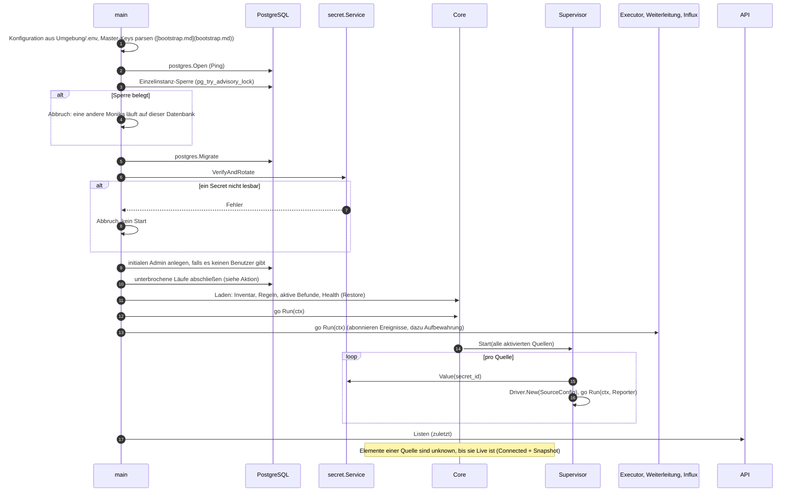
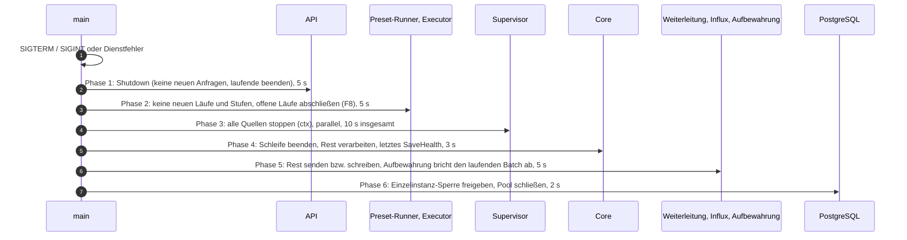
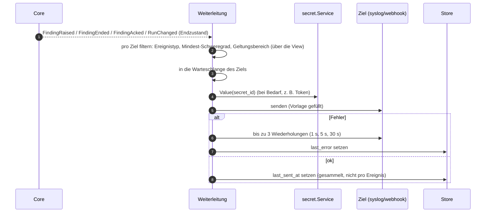
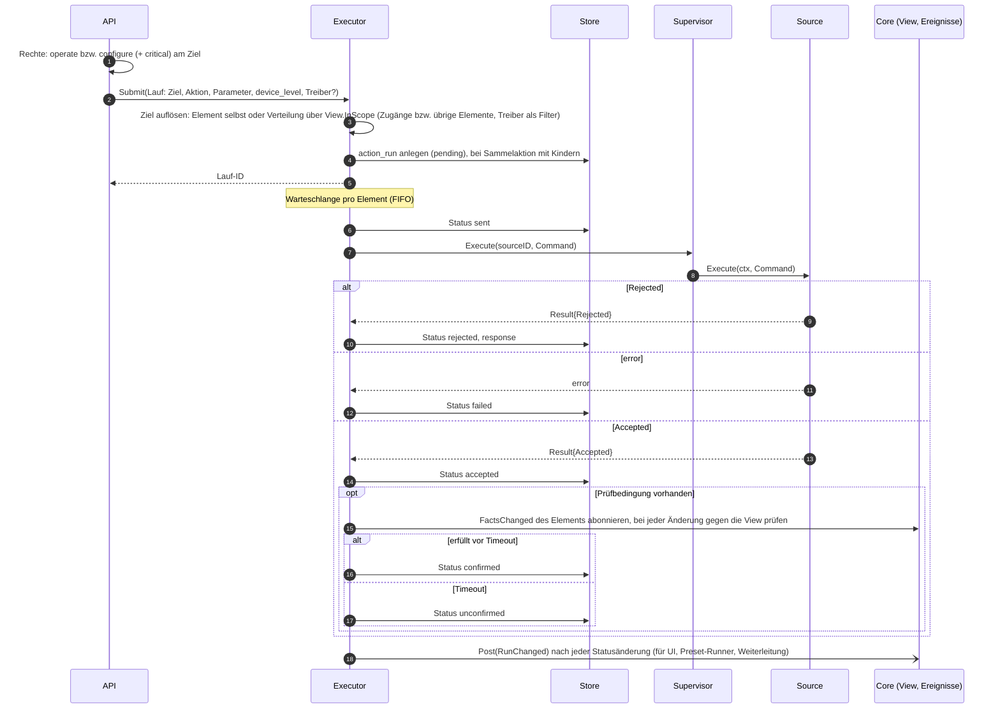
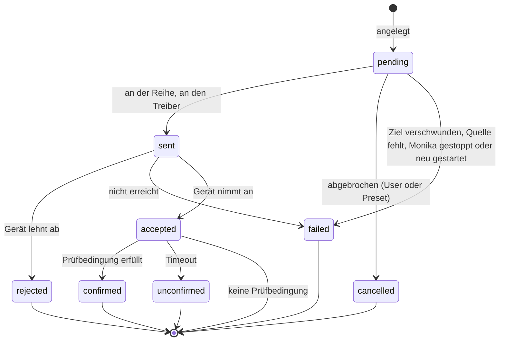
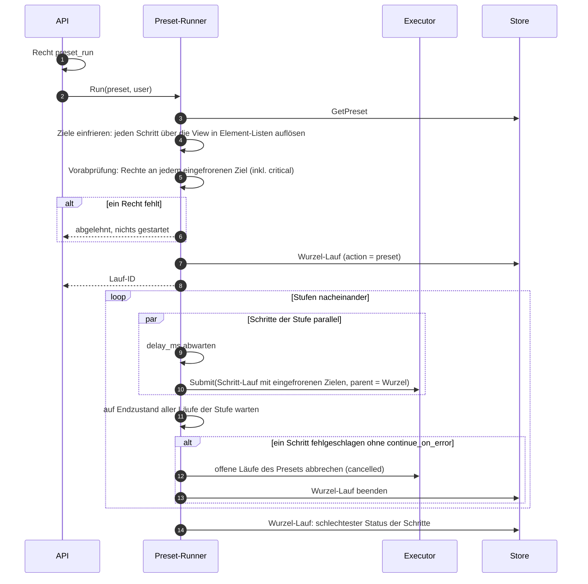

# Vertrag: Abläufe

**Status:** abgestimmt am 2026-10-09, überarbeitet am 2026-10-10 (Architektur-Audit) und 2026-10-11 (Einzelinstanz, Aufbewahrung). **Hintergrund:** `docs/ARCHITECTURE.md`, Abschnitt 9, 10, 12, 13 und 14; Bausteine aus [`sdk.md`](sdk.md) und [`core.md`](core.md).

Discovery-Lauf und „Fakt → Befund“ stehen in `core.md` (Abläufe: Meldungen eines Treibers). Hier stehen die Abläufe, die mehrere Komponenten verbinden.

## Beteiligte

| Komponente | Paket | Aufgabe in den Abläufen |
|---|---|---|
| Bootstrap | `cmd/monika`, `internal/config` | Konfiguration lesen, alles erzeugen und verdrahten, Start- und Stoppreihenfolge |
| Core | `internal/core` | Schleife, `View`, Ereignisse, Befehle (`core.md`) |
| Supervisor | `internal/core/supervisor` | eigener Dienst: startet und stoppt die `Source`s im Auftrag der Schleife, fängt Panics, meldet `Stuck`, führt `Execute` aus |
| Executor | `internal/action` | Läufe: Warteschlange pro Element, Ausführung, Prüfbedingung |
| Preset-Runner | `internal/preset` | Stufen, Verzögerungen, Rechte-Vorabprüfung |
| Weiterleitung | `internal/forward` | Ereignisse filtern und an syslog/webhook senden |
| Influx-Schreiber | `internal/history/influx` | Fakten und Health im festen Takt aus der `View` ([`influx.md`](influx.md)) |
| Aufbewahrung | `internal/retention` | löscht nachts alten Verlauf ([`services.md`](services.md)) |
| Rechte | `internal/auth` | `Allowed(view, user, permission, element)` für API und Preset-Runner |
| API | `internal/api` | Anmeldung, Rechte, Befehle an Core/Executor/Preset-Runner, Live-Push über einen Verteiler mit einem Abo am Core |

## Start

- **Abbruch statt Warten:** Ist die Konfiguration ungültig, die Datenbank nicht erreichbar, eine Migration fehlerhaft oder ein Secret nicht lesbar, beendet sich Monika mit Fehler. Neustarts übernimmt die Umgebung (Docker, systemd).
- Die API öffnet zuletzt, damit keine Anfrage einen halb gestarteten Core sieht.
- **Einzelinstanz:** Die Sperre ist ein Advisory Lock auf Sitzungsebene und hängt an einer eigenen Verbindung, die Monika bis zum Ende hält. Zwei Instanzen auf derselben Datenbank würden alle Geräte doppelt abfragen und Aktionen doppelt ausführen. Reißt die Verbindung ab, beendet sich Monika (die Sperre wäre sonst frei für eine zweite Instanz).

## Herunterfahren

Jede Phase beginnt erst, wenn die vorige fertig ist oder ihre Frist abgelaufen ist (`bootstrap.md`, K4); zusammen höchstens 30 s. Eine Quelle, die nach den 10 s von Phase 3 noch läuft, gilt als `Stuck` (`sdk.md`).

**Offene Läufe beim geordneten Stopp (F8)** enden mit Grund „Monika gestoppt“. Anders als beim harten Abbruch (F2, nachträglich beim nächsten Start) wartet `sent` noch auf die Antwort; `cancelled` bleibt dem Abbrechen durch User oder Preset vorbehalten:

| Status beim Stopp | Ende |
|---|---|
| `pending` (nie gesendet) | `failed` |
| `sent` | auf die Antwort des Treibers warten, gemeinsam höchstens 5 s; dann der echte Status (`accepted`, `rejected`, `failed`), ohne Antwort `failed`. Ein abgebrochenes `Execute` ließe offen, ob das Gerät den Befehl ausgeführt hat |
| `accepted` (Prüfbedingung läuft) | `unconfirmed` |

Der Preset-Runner startet keine weiteren Stufen; der Wurzellauf endet mit dem schlechtesten Status seiner Kinder.

## Weiterleitung

- Eine Warteschlange **pro Ziel**: ein langsames Ziel hält die anderen nicht auf. Ist sie voll, werden die ältesten Ereignisse verworfen und geloggt (best effort).
- `FindingEnded` wird je nach `cleared_reason` als `finding.cleared` (behoben) oder `finding.withdrawn` gesendet; `RunChanged` mit Endzustand als `action.finished`. `FindingCauseChanged` wird nicht weitergeleitet.
- Der Geltungsbereich eines Ziels wird über `View.InScope` aufgelöst, wie bei Regeln und Rechten.

## Aktion

- **Sammelaktion:** ein übergeordneter Lauf mit einem Kind pro Element; er endet, wenn alle Kinder enden, mit dem schlechtesten Status (`failed` > `rejected` > `unconfirmed` > `accepted` > `confirmed`, `docs/ARCHITECTURE.md` Abschnitt 9). Wurde er selbst abgebrochen, endet er als `cancelled`.
- **Ziel:** Ein Element, das die Aktion selbst unterstützt, bekommt sie selbst. Geräte und Gruppen verteilen: `device_level = true` an die Zugangs-Elemente (Treiber Pflicht), sonst an alle übrigen Elemente; `driver` filtert nach Quelle. Bei `set` bekommt nur ein Element einen Kind-Lauf, das **alle** gesetzten Schlüssel hat; übersprungene Mitglieder nennt die Zusammenfassung im übergeordneten Lauf.
- **`WriteOnly`-Einstellungen** erzeugen keine Prüfbedingung; der Lauf endet mit `accepted`.
- **Kritisch:** `action_run.critical` friert ein, ob die Aktion (Definition oder `critical_actions`) oder ein gesetzter Schlüssel kritisch war.
- **Unterbrochen durch einen harten Abbruch (F2):** Ist Monika abgestürzt oder hart beendet worden, findet der nächste Start offene Läufe vor. Es wird nichts erneut an Geräte gesendet; Monika schließt sie nur ab: `pending` und `sent` als `failed`, `accepted` als `unconfirmed`, jeweils mit Grund „Monika neu gestartet“. Wer die Aktion wiederholen will, löst sie neu aus. Beim **geordneten** Stopp gilt stattdessen F8 (siehe Herunterfahren): Dort wartet `sent` noch bis zu 5 s auf die Antwort.
- **Abbrechen** (`POST /runs/{id}/cancel`): Die API leitet nach Art des Laufs weiter:

| Lauf | Weg | Wirkung |
|---|---|---|
| Wurzel eines Presets (`action = preset`) | `Runner.Cancel(root)` | keine weiteren Stufen, laufende Wartezeiten (`delay_ms`) enden; danach `Executor.Cancel` für die offenen Kinder |
| übergeordneter Lauf einer Sammelaktion | `Executor.Cancel` | alle Kinder, die noch `pending` sind, werden `cancelled` |
| einzelner Lauf, auch innerhalb eines Presets | `Executor.Cancel` | nur dieser Lauf; ein Preset läuft weiter |
| Lauf im Endzustand | – | `409` mit `code = run_finished` |
- **Endzustände sind endgültig.** Ein Lauf ist Verlauf, kein Zustand: Er hält fest, was bei dieser einen Ausführung passiert ist. Nichts setzt `unconfirmed` (oder einen anderen Endzustand) später zurück oder auf `confirmed`; ob eine spätere Wirkung von diesem Befehl kam, ist nicht feststellbar. Den aktuellen Zustand eines Elements zeigen immer die Fakten.
- **Prüfbedingung:** Der Executor abonniert `FactsChanged` und prüft bei jeder Änderung des Elements gegen die `View`; nach dem Neuanmelden (`core.md`, Abonnenten) prüft er einmal direkt.
- **Rechte** prüft nur die API beim Absenden (bzw. der Preset-Runner vorab); der Executor prüft nicht erneut. Zwischen Absenden und Senden liegen nur Warteschlange und Preset-Stufen, keine zeitgesteuerte Ausführung.

## Preset-Lauf

- „Fehlgeschlagen“ heißt für die Stufe: `failed` oder `rejected`. `unconfirmed` bricht nicht ab (das Gerät hat angenommen, die Wirkung ist nur nicht beobachtet).
- **Eingefrorene Ziele:** Was ein Preset tut, steht beim Start fest. Wer während des Laufs in eine Zielgruppe kommt, wird nicht bedient; ein eingefrorenes Element, das beim Einreichen verschwunden ist, bekommt einen Lauf, der als `failed` endet. Die Listen liegen nur im Speicher des Runners; ein unterbrochenes Preset wird nicht fortgesetzt (F2).

## Neue Store-Methoden, die diese Abläufe brauchen

| Interface | Methoden |
|---|---|
| `action.Store` | `CreateRuns(ctx, runs)` (mit Kindern), `UpdateRun(ctx, run)`, `FinishInterruptedRuns(ctx, reason)` |
| `forward.Store` | `ListTargets(ctx)`, `SetTargetResults(ctx, results)`; Ziele anlegen/ändern/löschen mit Audit |
| `auth.Store` | Benutzer, Rollen, Rechte laden; initialen Admin anlegen (eigener Vertrag mit der API) |

## Entscheidungen

| # | Frage | Entscheidung |
|---|---|---|
| F1 | Datenbank beim Start nicht erreichbar | Abbruch; Neustart durch die Umgebung |
| F2 | Läufe, die ein harter Abbruch hinterlassen hat (beim nächsten Start) | nichts erneut senden; `pending`/`sent` → `failed`, `accepted` → `unconfirmed`, mit Grund „Monika neu gestartet“ |
| F3 | Wer verwaltet die laufenden `Source`s? | eigener Dienst **Supervisor**; die Schleife beauftragt ihn per Nachricht, der Executor ruft über ihn `Execute` |
| F4 | Wo werden Rechte geprüft? | in der API (und im Preset-Runner vorab) über `auth.Allowed` gegen die `View`; Core und Executor prüfen nicht erneut |
| F5 | Wiederholungen der Weiterleitung | 3 Wiederholungen (1 s, 5 s, 30 s), Warteschlange pro Ziel, bei Überlauf die ältesten verwerfen |
| F6 | Wie wartet der Executor auf die Prüfbedingung? | Ereignisse (`FactsChanged`) abonnieren; wer auf Änderungen reagiert, abonniert (`core.md`) |
| F7 | Was bricht eine Preset-Stufe ab? | `failed` und `rejected`, nicht `unconfirmed`; Endzustände von Läufen sind endgültig |
| F8 | Offene Läufe beim geordneten Stopp | `pending` → `failed`, `sent` wartet höchstens 5 s auf die Antwort (dann echter Status oder `failed`), `accepted` → `unconfirmed`, Grund „Monika gestoppt“; `cancelled` nur bei echtem Abbrechen |
| F9 | Wann werden Preset-Ziele aufgelöst? | beim Start, eingefroren; die Vorabprüfung gilt genau diesen Zielen |
| F10 | Preset abbrechen | Wurzellauf über `Runner.Cancel`, alles andere über `Executor.Cancel`; ein abgebrochener übergeordneter Lauf endet als `cancelled` |
| F11 | Zweite Instanz auf derselben Datenbank | Advisory Lock beim Start; belegt → Abbruch; Verbindung der Sperre verloren → Monika beendet sich |
