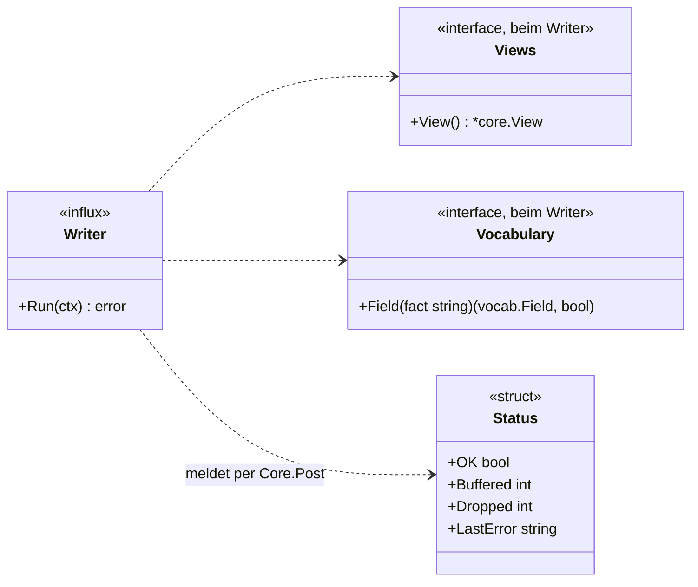
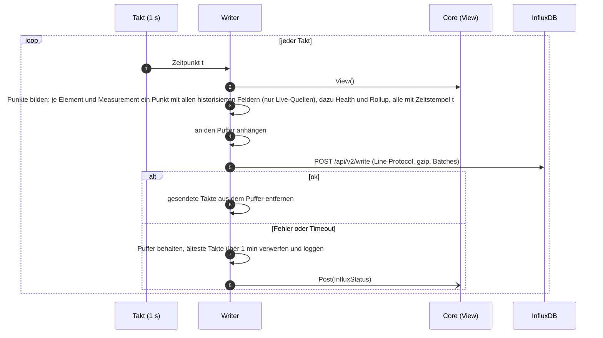

# Vertrag: Influx-Schreiber

**Status:** abgestimmt am 2026-10-11. **Paket:** `internal/history/influx`. **Hintergrund:** `docs/ARCHITECTURE.md`, Abschnitt 4 (Vokabular) und 14 (InfluxDB); Measurements: [`vocabulary.md`](vocabulary.md).

Der Influx-Schreiber ist ein Dienst neben der Schleife. Er tastet im festen Takt die `View` ab und schreibt Fakten und Health als Zeitreihen; Ereignisse abonniert er nicht („abtasten über die `View`“, `core.md`).

## Typen und Ablauf





## Schema

Das Schema ist das Vokabular ([`vocabulary.md`](vocabulary.md)): Ein Fakt `<measurement>.<feld>` wird zu Measurement `<measurement>`, Feld `<feld>`. Pro Element, Measurement und Takt entsteht **ein** Punkt mit allen Feldern dieses Measurements, die das Element meldet.

| Measurement | Felder | Tags | Wann |
|---|---|---|---|
| Measurements des Vokabulars (`state`, `system`, `ptp`, `stream`, …) | die historisierten Felder, Typ laut Vokabular (`int` mit `i`) | `element_id`, `device_id`, `source_id`, `driver`, `kind`, `transport` | pro Element, nur wenn seine Quelle Live ist |
| `health` | `level` (0 `ok`, 1 `warning`, 2 `error`, 3 `unknown`) | `element_id`, `device_id`, `kind` | pro Element mit Health |
| `rollup` | `ok`, `warning`, `error`, `unknown`, `unchecked`, `unmonitored`, `missing` | `element_id`, `kind` | pro Gerät und Gruppe mit Rollup |
| `monika` | eigene Kennzahlen (`docs/OPERATIONS.md`) | – | ein Punkt pro Takt |

```
ptp,element_id=…,device_id=…,source_id=…,driver=videoxlink,kind=clock,transport=ptp state="slave",offset_ns=-12i,path_delay_ns=830i,domain=0i 1760097600000
sdi,element_id=…,device_id=…,source_id=…,driver=videoxlink,kind=port,transport=sdi level="3G-A",crc_errors=4i 1760097600000
health,element_id=…,device_id=…,kind=port level=0i 1760097600000
```

- **Historisiert** wird, was das Vokabular so kennzeichnet: alle bekannten und Kern-Felder außer den ausdrücklich ausgenommenen (`call.called_at`); Zähler roh, ihre Rate `_per_s` nur, wenn das Element den Zähler nicht meldet. Rohe Fakten nie.
- **Zeitstempel:** der Zeitpunkt des Takts, für alle Punkte eines Takts gleich, in Millisekunden (`precision=ms`).
- **Leere Tags** werden weggelassen (z. B. `transport` bei einem Zugang).
- **Nie Labels, Gruppen oder Namen als Tags:** Sie ändern sich und würden Zeitreihen zerreißen. Namen löst ein Werkzeug über das Schema `reporting` in PostgreSQL auf (`docs/ARCHITECTURE.md`, Abschnitt 14). Messpunkte und Pfade sind Elemente, keine Tags.

## Verhalten

- **Nur Line Protocol über HTTP** (`POST /api/v2/write`, von InfluxDB v2 und v3 verstanden), gzip-komprimiert, in Batches von höchstens 5 000 Zeilen. Abfragen sind Sache der Werkzeuge, nicht von Monika.
- **Takt** `MONIKA_INFLUX_INTERVAL`, Standard 1 s. Läuft ein Schreiben länger als ein Takt, wird der nächste Takt trotzdem gebildet und gepuffert, nicht ausgelassen; geschrieben wird, sobald die Verbindung frei ist.
- **Puffer** höchstens 1 min an Takten im Speicher; darüber werden die ältesten verworfen und mit Anzahl geloggt. Gepuffert wird **komprimiert**: Jeder Takt wird beim Bilden in Stücken von höchstens 5 000 Zeilen mit gzip (schnellste Stufe) komprimiert, jedes Stück ist eine Anfrage. Bei 1000 Geräten sind das etwa 3 MB pro Takt, rund 190 MB für die Minute (unkomprimiert wären es 4,5 GB). Ein Takt, der nur zum Teil angekommen ist, wird ganz wiederholt; gleiche Serie und Zeit überschreiben sich in InfluxDB.
- **Zustand** meldet der Writer per `Core.Post(InfluxStatus)`; die `View` führt ihn, die UI zeigt bei Fehlern „Historie wird nicht geschrieben“. `/healthz` bleibt davon unberührt, weil das Monitoring weiterläuft.
- **Aufbewahrung** stellt der Betreiber in InfluxDB ein (z. B. 30 Tage bei 1 s Takt), nicht Monika.
- **Ohne `MONIKA_INFLUX_URL`** startet der Writer nicht.

## Entscheidungen

| # | Frage | Entscheidung |
|---|---|---|
| I1 | Version von InfluxDB | egal: nur Line Protocol über HTTP (`/api/v2/write`) |
| I2 | Schema | das Vokabular: Fakt `<measurement>.<feld>` = Measurement und Feld, ein Punkt pro Element und Measurement; Hersteller im Tag `driver`, Messpunkte als Elemente |
| I3 | Takt | 1 s, einstellbar; gzip und Batches |
| I4 | InfluxDB nicht erreichbar | 1 min Puffer im Speicher, dann die ältesten verwerfen; Monitoring läuft weiter |
| I5 | Namen für externe Werkzeuge | Schema `reporting` in PostgreSQL, Rolle `monika_reporting`; nicht Grafana-spezifisch |
