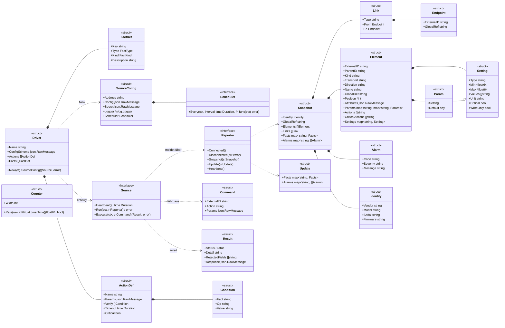
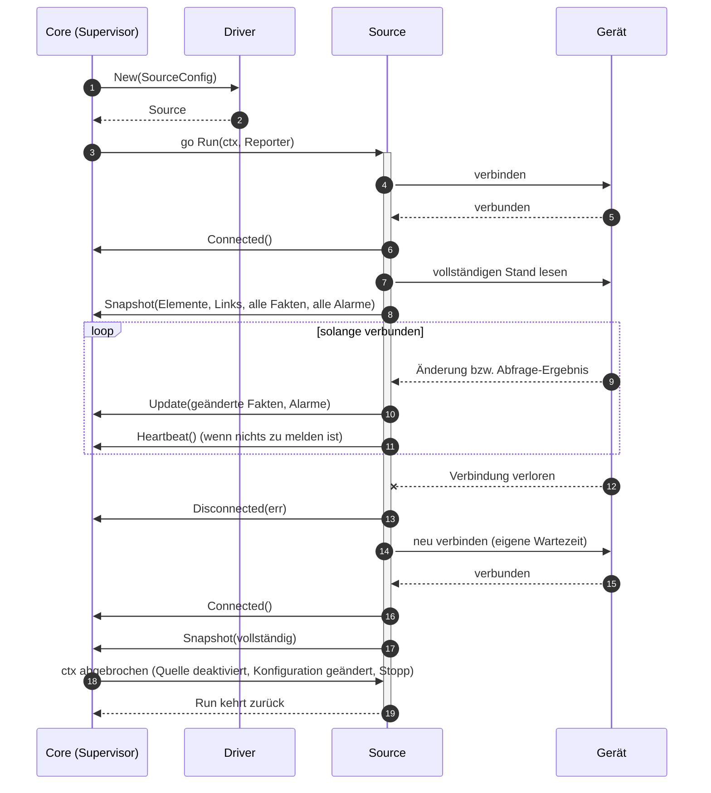
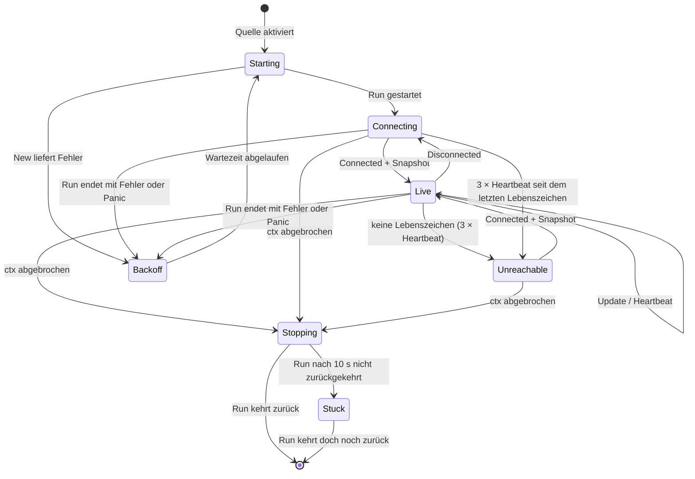
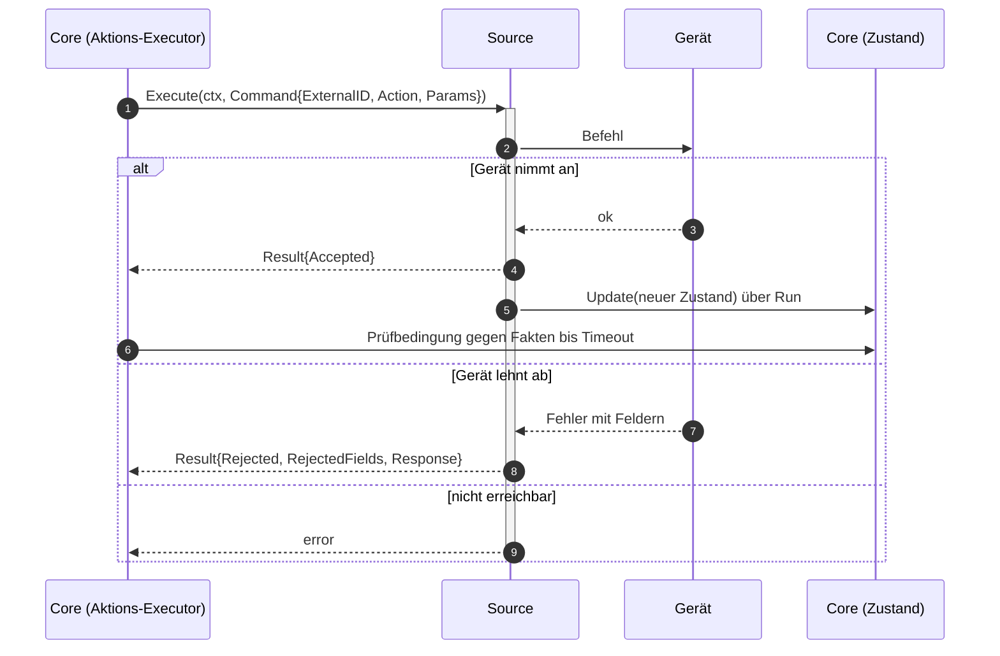
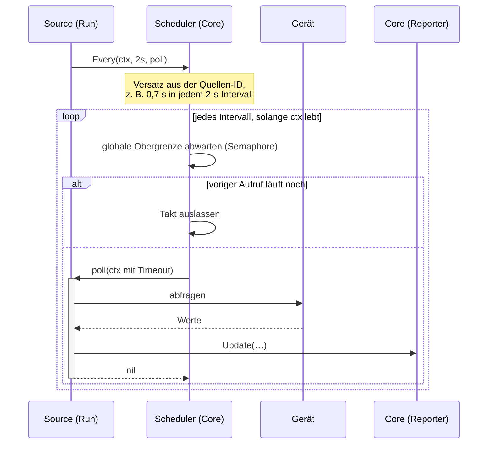
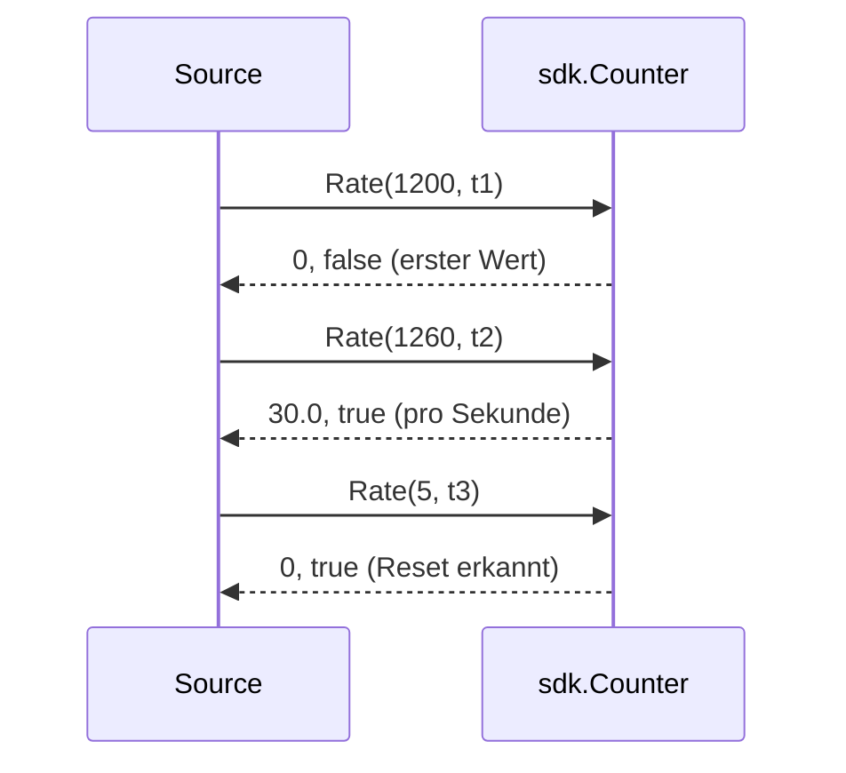
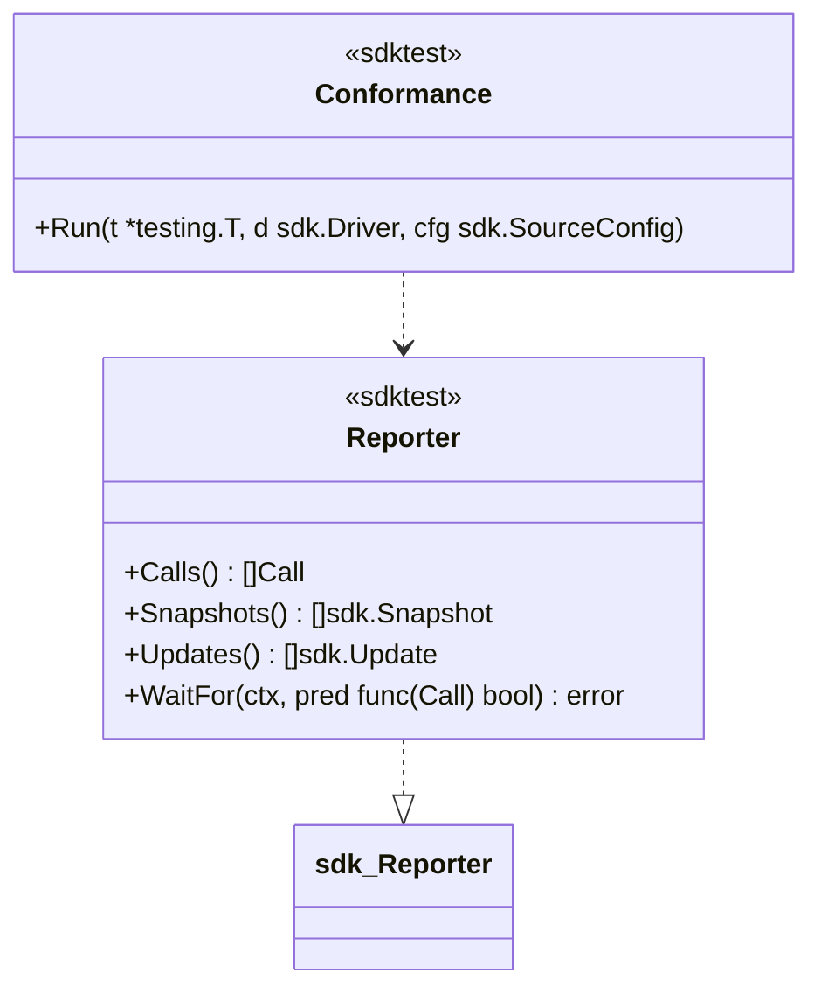

# Vertrag: Treiber-SDK

**Status:** abgestimmt am 2026-10-09, nach dem Architektur-Audit überarbeitet am 2026-10-10, Vokabular und Testbaukasten am 2026-10-11. **Vokabular:** [`vocabulary.md`](vocabulary.md). **Paket:** `sdk/` (öffentlich). **Hintergrund:** `docs/ARCHITECTURE.md`, Abschnitt 4, 5, 8, 9 und 11.

Das SDK ist die einzige Schnittstelle zwischen Core und Treibern. Treiber importieren nur `sdk/` und ihre Gerätelibrary, nie `internal/`. Alles, was ein Treiber vom Core braucht, kommt über die Typen und Interfaces dieses Vertrags.

## Grundsätze

- **Ein Treiber pro Gerätetyp, eine Instanz pro Quelle.** Der Treiber registriert sich einmal (`init()`); der Core erzeugt für jede Quelle (`device_source`) eine eigene `Source`.
- **Der Treiber treibt, der Core hört zu.** Jede `Source` läuft in einer eigenen Goroutine (`Run`) und meldet über den `Reporter`, was sie sieht. Ob sie dafür abfragt oder einen Event-Stream liest, entscheidet der Treiber. Wer abfragt, nutzt den `Scheduler` des Core, damit nicht alle Treiber gleichzeitig senden.
- **Treiber sprechen in `external_id`s.** UUIDs, Labels, Gruppen und Health kennt der Treiber nicht. Das Zugangs-Element der Quelle hat die leere `external_id` `""`.
- **Treiber melden Fakten, keine Bewertung.**

## Typen und Interfaces

| Typ | Bedeutung |
|---|---|
| `sdk.Register(Driver)` | Registrierung in `init()`. Ein Programmierfehler (`panic`) sind: doppelte Namen; ein Name außer `[a-z0-9]+` (Treibername = Paketname) oder gleich einem Measurement des Vokabulars; ein roher Fakt ohne den Treibernamen als Präfix; ein Fakt doppelt im Katalog; ein Zähler, der nicht `Int` ist; eine Einstellung, deren `Type` nicht zum Typ ihres Fakts passt; eine `WriteOnly`-Einstellung mit Fakt im Katalog |
| `Driver.Actions` | **Katalog**: wie jede Aktion funktioniert, die der Treiber irgendwo anbietet (Parameter, Prüfbedingung, Timeout, `critical`). *Welches* Element sie unterstützt, steht in `Element.Actions`; `reboot` kann z. B. am Zugangs-Element (Gerät) und an einzelnen Modulen stehen |
| `Driver.Facts` | **Fakt-Katalog** der Rohwerte (Präfix = Treibername, z. B. `videoxlink.needs_reboot`): Typ, Art, Beschreibung, Einheit im Namen wie im Vokabular. Kern- und bekannte Fakten (`<measurement>.<feld>`) stehen im Vokabular und werden nicht wiederholt. Der Regel-Editor bietet daraus Fakten und passende Operatoren an. Rohe Fakten gehen nie nach InfluxDB |
| `FactType` | `Bool` (`bool`), `Int` (`int64`), `Float` (`float64`) oder `String` (`string`) |
| `FactKind` | `Status`, `Gauge` oder `Counter` (`vocabulary.md`, Typen und Arten) |
| `Source.Heartbeat()` | erwarteter Abstand der Lebenszeichen **dieser Quelle**, vom Core einmal nach `New` gelesen und für die Lebensdauer der Instanz fest. Die meisten Treiber geben eine Konstante zurück, der HTTP-Treiber das Intervall seines Health-Checks aus der Konfiguration. Ohne Lebenszeichen für das **Dreifache** gilt die Quelle als nicht erreichbar. `0` = keine Überwachung der Lebenszeichen (Sende-Ziel ohne Health-Check) |
| `SourceConfig.Logger` | vom Core pro Quelle erzeugt, mit den Attributen `driver`, `source_id` und `device_id` (siehe Logging) |
| `SourceConfig.Secret` | entschlüsselter Klartext des Secrets der Quelle (JSON, Format legt der Treiber fest); leer ohne Secret. Nie loggen |
| `Facts` | `map[string]any`; Werte nur `bool`, `int64`, `float64` oder `string`, keine Listen oder Objekte. Schlüssel `<measurement>.<feld>` aus dem Vokabular oder `<treiber>.<name>` aus dem Fakt-Katalog, Wert **genau** vom deklarierten Go-Typ (ein `int`-Feld als `int64`, ein `float`-Feld als `float64`). Andere Schlüssel und Werte verwirft der Core, mit `Warn`-Log einmal pro Quelle und Schlüssel. Zu einem Zähler meldet der Treiber auch `<feld>_per_s` (`float64`); liefert das Gerät nur die Rate, nur diese |
| `Snapshot.GlobalRef` | globale ID des Geräts aus Sicht dieser Quelle, im Namensraum des Treibers (`xlink:X8A9001`); der Core setzt sie am Zugangs-Element. Leer, wenn die Quelle keine kennt |
| `Snapshot.Facts`, `.Alarms` | Schlüssel ist die `external_id` (`""` = Zugangs-Element) |
| `Update.Alarms` | pro Element die **vollständige** Liste der aktuellen Alarme; sie ersetzt die vorige. Ein Element ohne Eintrag bleibt unverändert |
| `Element.ParentID` | `external_id` des Elternelements; `""` = direkt unter dem Zugangs-Element der Quelle |
| `Element.GlobalRef` | global eindeutige ID mit Namensraum (`xlink:X8A9001-E1`, `nmos:<uuid>`); nur am Element im eigenen Baum, nie an Stellvertretern. Jeder Namensraum gehört einem Treiber; andere verwenden ihn nur in `Endpoint` |
| `Endpoint` | entweder `ExternalID` (Element dieser Quelle) oder `GlobalRef` (Element einer anderen Quelle, ggf. noch unbekannt). `represents` zeigt immer per `GlobalRef` auf das Original: Stellvertreter-Unit → Original-Unit, Peer → Zugang des Remote-Geräts |
| `Result.Status` | `Accepted` oder `Rejected`; ein `error` aus `Execute` bedeutet `failed` (nicht erreicht, Transportfehler) |
| `Setting` | schreibbarer Fakt-Schlüssel: `Type` (`int`, `float`, `bool`, `string`, `enum`, `ipv4` …), Grenzen bzw. `Values` bei `enum`, `Critical`. `WriteOnly`: Das Gerät meldet den Wert nicht zurück; es gibt keinen Fakt dazu und keine Prüfung, `accepted` ist der Endzustand |
| `Element.Attributes` | statische Attribute, nur zur Anzeige |
| `Element.Params` | Parameter-Schemas von Aktionen, die an diesem Element ein eigenes Schema haben: Aktion → Parameter → `Param` (bei Sende-Zielen `trigger`). Die UI baut daraus das Formular, der Treiber prüft die Werte bei `Execute` selbst. Gespeichert in `element.params` |
| `Param` | wie `Setting`, zusätzlich `Default` (`bool`, `int64`, `float64` oder `string`) |
| `Condition.Value` | JSON-Wert als Text, darf Platzhalter enthalten |
| `ActionDef.Verify` | Prüfbedingung mit Platzhaltern aus den Parametern (z. B. `codec.bitrate_mbps eq {{codec.bitrate_mbps}}`); bei `set` erzeugt der Core sie selbst aus den gesetzten Werten |

**Vokabular** (`sdk/vocab`, vollständig in [`vocabulary.md`](vocabulary.md)): Konstanten für `kind`, `transport`, Kern- und bekannte Fakten **mit Typ, Einheit und Measurement**, die Measurements, Kern- und bekannte Aktionen und die Namensräume von `global_ref` (`xlink`, `nmos` …) mit dem Treiber, dem sie gehören. Reserviert und für Treiber verboten: `kind` `device`, `group`, `access`; Fakt `present`; Measurements `health`, `rollup`.

**Verbote für Einstellungen:** **Nie** eine Einstellung, die die Management-Adresse ändert, und nie geheime Werte (Passwörter, Schlüssel): Nach dem Setzen der Adresse wäre die Quelle unerreichbar, und Parameter eines Laufs stehen im Klartext in `action_run.params`. Monika bietet dafür auch später keinen Weg; ein Treiber, der es trotzdem anbietet, verstößt gegen diesen Vertrag.

## Pflichten im Ablauf

### Start, Verbindung und vollständiger Stand

- Nach **jedem** `Connected()` folgt ein **vollständiger** `Snapshot`, bevor `Update`s kommen. Der Core kennt nach einem Neustart nichts und verlässt sich darauf. `Update`s zwischen `Connected` und dem ersten `Snapshot` verwirft er.
- **Live** ist die Quelle nach `Connected` und vollständigem `Snapshot`, solange ihre Lebenszeichen aktuell sind. Nur dann bewertet der Core ihre Fakten; in jedem anderen Zustand sind ihre Elemente `unknown`.
- Ein Fakt wird gemeldet, solange das Element ihn grundsätzlich hat. Der Treiber lässt ihn nicht weg, um „kein Signal“ auszudrücken; dafür gibt es `false`. Fehlt ein Fakt im vollständigen `Snapshot`, zieht der Core Befunde dazu zurück (`fact_missing`).
- Ein `Update` für eine unbekannte `external_id` ist ein Fehler des Treibers: Der Core verwirft es, mit `Warn`-Log einmal pro Quelle und `external_id` bis zum nächsten `Snapshot`.
- Ändert sich die **Struktur** (Element neu oder weg, Link neu oder weg, Aktionen, Einstellungen), meldet der Treiber erneut einen vollständigen `Snapshot`. Der Core vergleicht selbst; der Treiber muss keine Differenzen bilden.
- Jeder Aufruf am `Reporter` zählt als Lebenszeichen. `Heartbeat()` braucht nur, wer längere Zeit nichts zu melden hat (Event-Streams).
- Reporter-Aufrufe kommen aus einer Goroutine nacheinander; der `Reporter` blockiert nicht lange.

### Fehler, Panic und Neustart

- **Nur `Live` wird bewertet.** In `Starting`, `Connecting`, `Backoff`, `Unreachable`, `Stopping` und `Stuck` sind alle Elemente der Quelle außer dem Zugang sofort `unknown`.
- **`source.unreachable`** entsteht am Zugangs-Element, wenn seit dem letzten Lebenszeichen 3 × `Heartbeat()` vergangen sind, ohne dass die Quelle wieder `Live` ist; beim Start zählt die Zeit ab dem Start der Quelle. Er gilt für jeden Anlass gleich (Stille, Verbindungsabbruch, `Backoff`, `Stuck`) und endet, sobald die Quelle wieder `Live` ist. Bei `Heartbeat() = 0` entsteht er nur aus `Backoff` und `Stuck`, dann sofort.
- **Panic** in `Run` oder `Execute` fängt der Core (`recover`), geht nach `Backoff` (Fehlertext in `source.unreachable`) und startet die Quelle nach einer Wartezeit neu.
- **Stoppen:** Der Core bricht den `ctx` von `Run` ab (Quelle deaktiviert, Gerät gelöscht, Konfiguration oder Secret geändert, Monika beendet). `Run` muss danach zügig zurückkehren und alle Verbindungen schließen.
- **Hängender Treiber (`Stuck`):** Kehrt `Run` nach 10 s nicht zurück, geht die Quelle nach `Stuck` (Grund in `source.unreachable`: „Treiber reagiert nicht“). Go kann die Goroutine nicht beenden; der Core startet deshalb **keine zweite Instanz**, solange die alte läuft. Sonst hätte das Gerät zwei gleichzeitige Sitzungen.
- **Konfiguration oder Secret geändert:** Stoppen wie oben, danach Neustart mit der neuen `SourceConfig`. Kein Live-Update im Treiber.
- **Wiederverbinden** ist Sache des Treibers (bzw. seiner Gerätelibrary). Der Core startet eine Quelle nur neu, wenn `Run` mit Fehler endet oder eine Panic auftritt.

### Ausführung

- `Execute` kann gleichzeitig zu `Run` und für verschiedene Elemente parallel aufgerufen werden; der Treiber muss das aushalten. Für **ein** Element ruft der Core nacheinander auf (FIFO).
- `Execute` prüft Parameter gegen die Grenzen aus `settings` bzw. das Parameter-Schema und lehnt ungültige mit `Rejected` ab.
- **Sammelaktionen auf ein Gerät oder eine Gruppe:** Mit `device_level` geht die Aktion an die Zugangs-Elemente (das Gerät selbst, Treiber Pflicht: „`reboot` über `videoxlink`“), ohne an alle übrigen Elemente, die sie unterstützen (z. B. alle Module); `driver` filtert in beiden Fällen nach Quelle. Der Treiber sieht davon nur einzelne `Execute`-Aufrufe.
- Erfolg ist der beobachtete Zustand, nicht die Antwort: Die Wirkung meldet der Treiber über `Update`, der Core prüft.

## Scheduler für abfragende Treiber

Ein Komfortangebot des Core: Der Treiber meldet seine periodische Arbeit an, der Scheduler bestimmt den Takt. Was der Treiber im Takt tut, ist seine Sache. Treiber mit Event-Stream brauchen ihn nicht.

| Mechanismus | Wirkung |
|---|---|
| **Phasenversatz** | Jede Aufgabe bekommt einen festen Versatz innerhalb ihres Intervalls, abgeleitet aus der ID der Quelle; viele Quellen verteilen sich gleichmäßig statt gleichzeitig zu senden |
| **Globale Obergrenze** | höchstens N Aufrufe gleichzeitig über alle Treiber (`MONIKA_SCHEDULER_CONCURRENCY`, Standard 32); weitere warten |
| **Keine Überlappung** | Läuft der vorige Aufruf einer Aufgabe noch, wird der nächste Takt ausgelassen, nicht gestapelt |
| **Timeout pro Aufruf** | Standard = Intervall. Kehrt `fn` trotzdem nicht zurück, gilt die Aufgabe als hängend: Der Scheduler startet für sie nichts mehr und meldet das. Die Zahl der Goroutinen wächst so nie unbegrenzt |

Ein Fehler aus `fn` wird geloggt; die Aufgabe läuft weiter. Ob die Quelle erreichbar ist, entscheiden allein die Lebenszeichen.

## Zähler-Helfer

- Ein `Counter` pro Zähler und Element; bei angegebener `Width` (32, 64) rechnet er Überläufe richtig, sonst gilt jeder kleinere Wert als Reset.
- **`at` ist der Messzeitpunkt** und kommt vom Treiber: der Zeitstempel des Geräts, wenn es einen liefert, sonst `time.Now()` zum Zeitpunkt der Abfrage. So bleibt die Rate richtig, auch wenn Werte verzögert ankommen.
- Raten gibt es nur für Zähler. `Rate` liefert `float64`; den Rohwert meldet der Treiber als `int64`, exakt (Differenz und Überlauf modulo 2³² bzw. 2⁶⁴ rechnet der `Counter` intern ganzzahlig ohne Vorzeichen). `bool`- und `string`-Fakten meldet er direkt.
- Der Treiber meldet den Rohwert (`sdi.crc_errors`) und, sobald `ok`, die Rate (`sdi.crc_errors_per_s`). Liefert das Gerät nur eine Rate, meldet der Treiber nur sie und braucht keinen `Counter`.
- Zähler, die ein Gerät als Dezimalzahl liefert, deckt der `Counter` nicht ab; ein Helfer dafür kommt, wenn ein Treiber ihn braucht.

## Testbaukasten (`sdk/sdktest`)

Wer einen Treiber schreibt, kennt Monika oft nicht. Die Regeln dieses Vertrags gibt es deshalb als Test, nicht nur als Text.

| Baustein | Wirkung |
|---|---|
| `sdktest.Reporter` | zeichnet alle Meldungen einer `Source` auf; Tests prüfen damit, was der Treiber gemeldet hat |
| `sdktest.Conformance(t, driver, cfg)` | prüft die Regeln automatisch: Katalog gültig (wie `Register`); nach `Connected` zuerst ein vollständiger `Snapshot`; nur deklarierte Fakten mit genau dem richtigen Go-Typ; zu jedem Zähler auch die Rate; keine reservierten `kind`s und Fakten; `external_id`s stabil über zwei `Snapshot`s; `Heartbeat()` wird eingehalten; `Run` kehrt nach Abbruch des `ctx` binnen 10 s zurück; `Execute` verträgt parallele Aufrufe |
| Attrappe des Geräts | jeder Treiber testet gegen eine Attrappe seines Geräts (z. B. `httptest.Server`), nie gegen echte Hardware in `make test`; die Attrappe liefert `cfg` für `Conformance` |

## Logging

- Treiber loggen **ausschließlich** über `SourceConfig.Logger`, nie über `slog.Default()`, das Paket `log` oder `fmt.Print*`. Jede Zeile ist so ihrer Quelle zugeordnet.
- Stufen: `Debug` für Protokolldetails, `Info` für Verbinden und Trennen, `Warn` für Fehler, die der Treiber selbst behebt, `Error` für Fehler, die er nicht behebt.
- Werte aus `SourceConfig.Secret` werden nie geloggt.
- **Gerätelibraries** nehmen einen `*slog.Logger` (oder `slog.Handler`) als Option an; ohne Angabe geben sie nichts aus bzw. nutzen `slog.Default()`. Für eigene Libraries wie `goxlinkclient` ist das Pflicht.

Fremde Libraries mit eigenem Logging:

| Library | Vorgehen | Zuordnung zur Quelle |
|---|---|---|
| nimmt `*slog.Logger` bzw. `slog.Handler` | `cfg.Logger` durchreichen | ja |
| eigenes Logger-Interface (`Printf`, logrus, zap …) | Adapter im Treiberpaket, der nach `slog` schreibt | ja |
| Standard-Paket `log` | Monika setzt beim Start `slog.SetDefault`; seit Go 1.21 landet damit auch `log.Printf` strukturiert im selben Handler | nein (global) |
| schreibt direkt auf `os.Stdout` | nicht abzufangen; Library anpassen oder forken | nein |

Eine Isolation pro Library gibt es in einem Prozess nicht (keine Goroutine-lokalen Variablen, `os.Stdout` ist global); sie wäre nur mit eigenen Treiber-Prozessen möglich, die `docs/ARCHITECTURE.md` (Abschnitt 4) verwirft.

## Entscheidungen

| # | Frage | Entscheidung |
|---|---|---|
| S1 | Wer treibt? | Der Treiber (`Run` + `Reporter`); für abfragende Treiber gibt es den `Scheduler` des Core |
| S2 | Struktur als vollständiger `Snapshot` oder als Differenz? | vollständiger `Snapshot`; der Core vergleicht |
| S3 | Wo steht der erwartete Abstand der Lebenszeichen? | pro Quelle (`Source.Heartbeat()`), vom Treiber bestimmt, ggf. aus seiner Konfiguration; keine eigene Einstellung des Users; nicht erreichbar nach dem Dreifachen, `0` = keine Überwachung |
| S4 | Wie kommen Secret- und Konfigurationsänderungen an? | Neustart der Quelle mit neuer `SourceConfig` |
| S5 | `Execute` an der `Source` oder eigenes Interface? | an der `Source` |
| S6 | Typ der Fakt-Werte | `bool`, `int64`, `float64` oder `string`, genau wie im Vokabular bzw. Katalog deklariert; Regeln vergleichen Zahlen über beide Typen hinweg; andere Werte verwirft der Core |
| S7 | Wer verbindet neu? | der Treiber bzw. seine Gerätelibrary |
| S8 | Hängender Treiber | 10 s nach dem Stopp `Stuck`; keine zweite Instanz, solange die alte läuft |
| S9 | Sammelaktion auf ein Gerät | `device_level` wählt Zugangs-Elemente (Treiber Pflicht) oder übrige Elemente; `driver` ist ein Filter |
| S10 | Logging | nur über `SourceConfig.Logger` (mit `driver`, `source_id`, `device_id`); Gerätelibraries nehmen einen `*slog.Logger` an; `log`-Ausgaben fremder Libraries landen global über `slog.SetDefault` |
| S11 | Typen der Fakten | fester Typ pro Schlüssel: Vokabular für Kern und bekannt, `Driver.Facts` für Rohwerte; der Core verwirft alles andere |
| S12 | Eltern ohne `ParentID` | das Zugangs-Element der Quelle (echte Wurzel) |
| S13 | Identität des Geräts für Links | `Snapshot.GlobalRef` am Zugangs-Element; `global_ref` immer mit Namensraum |
| S14 | Wann wird bewertet? | nur, wenn die Quelle `Live` ist; sonst sind ihre Elemente `unknown` |
| S15 | Präfix roher Fakten und Aktionen | der Treibername (`videoxlink.cpu_temp`); kein zweites Kürzel |
| S16 | Zeitreihen | Fakt-Schlüssel `<measurement>.<feld>` ist zugleich Measurement und Feld in InfluxDB; rohe Fakten nie; Messpunkte als Elemente |
| S17 | Parameter-Schemas pro Element | eigene Spalte `element.params` (`Element.Params`), nicht in `attributes` |
| S18 | Tests | `sdk/sdktest` mit aufzeichnendem `Reporter` und `Conformance`; jeder Treiber gegen eine Attrappe seines Geräts |
