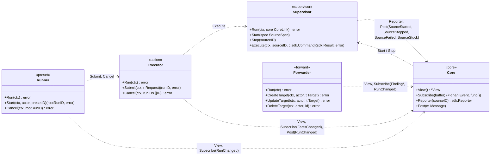
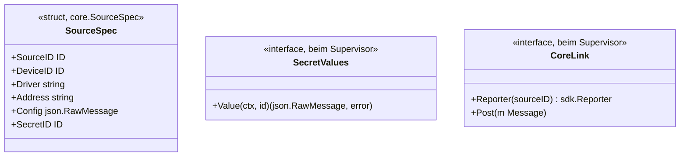
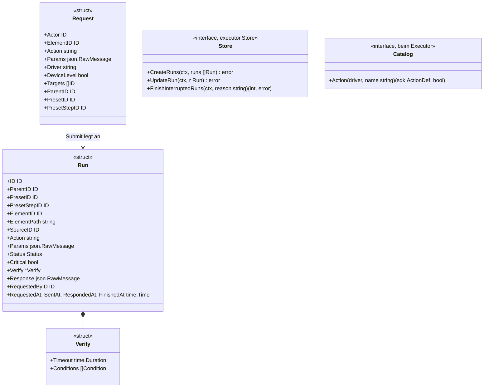
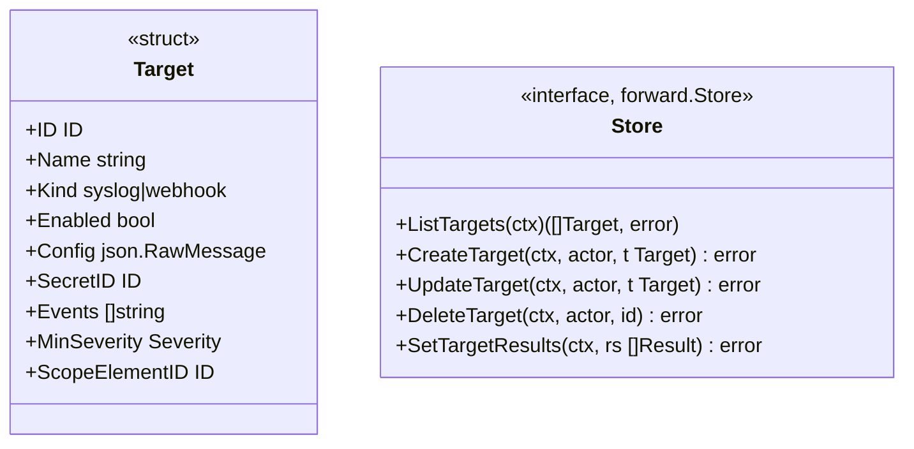
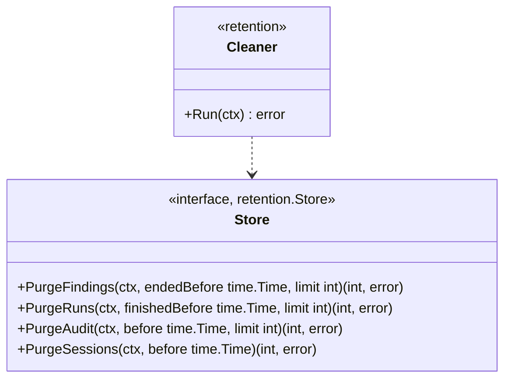
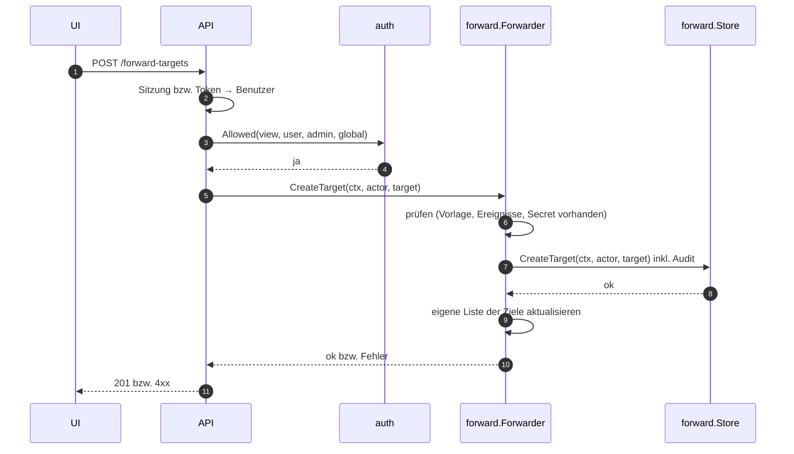

# Vertrag: Dienste

**Status:** abgestimmt am 2026-10-09, nach dem Architektur-Audit überarbeitet am 2026-10-10. **Hintergrund:** [`core.md`](core.md) (Schleife, `View`, Ereignisse), [`flows.md`](flows.md) (Abläufe), [`sdk.md`](sdk.md).

Dienste laufen neben der Schleife des Core, mit eigenen Goroutinen und eigenem Zustand. Mit dem Core sprechen sie nur über Nachrichten, Ereignisse und die `View`. Abhängigkeiten bekommen sie als kleine Interfaces, definiert beim Verwender.

## Überblick

`Core.Post(m)` stellt eine Nachricht in die Schleife, ohne auf ihre Verarbeitung zu warten (im Gegensatz zu `Do`).

## Supervisor (`internal/core/supervisor`)

- **Paketgrenze:** Dienste importieren den Core, nie umgekehrt. Der Supervisor nutzt den Core über `CoreLink`, den er erst in `Run` bekommt (der Core braucht den Supervisor schon beim Erzeugen; Aufträge vor `Run` warten); der Core nutzt den Supervisor über sein eigenes Interface `core.Supervisor{Start(spec), Stop(id)}`, deshalb liegt `SourceSpec` im Core.
- `Start` und `Stop` kommen aus der Schleife und kehren sofort zurück; der Supervisor arbeitet sie in eigener Goroutine ab. Für dieselbe Quelle gilt die Reihenfolge der Aufträge.
- **Reihenfolge pro Start:** erst `Reporter(sourceID)` holen, dann `Post(SourceStarted)`, dann `Run` starten. Nachrichten zu einer Quelle stellt der Core in das Postfach ihrer aktuellen Instanz, damit sie in Reihenfolge mit den Meldungen des Treibers verarbeitet werden (sonst könnte ein spätes `SourceStarted` ein schon gemeldetes `Connected` zurücksetzen).
- `Start` holt den Klartext des Secrets (`secret.Service` erfüllt `SecretValues`), erzeugt `SourceConfig` mit Logger (`driver`, `source_id`, `device_id`) und Scheduler, liest `Source.Heartbeat()` und startet `Run` hinter einer `recover`-Grenze.
- Er meldet der Schleife per `Post` `SourceStarted{sourceID, heartbeat}`, `SourceStopped{sourceID}`, `SourceFailed{sourceID, err, panic}` (Fehler, Panic, führt zu `Backoff`) und `SourceStuck{sourceID}` (`sdk.md`, Stoppen) und startet nach `Backoff` neu, nie zwei Instanzen derselben Quelle.
- `Execute` ruft `Source.Execute` hinter einer `recover`-Grenze; läuft die Quelle nicht: `ErrSourceNotRunning` (der Lauf endet als `failed`). Eine **Panic in `Execute`** liefert einen Fehler (der Lauf endet als `failed`); der Supervisor stoppt die Instanz, meldet `SourceFailed{panic}` und startet nach der Wartezeit neu, denn der Zustand des Treibers ist unklar.
- **Wartezeit im `Backoff`:** 1 s, jeweils verdoppelt bis höchstens 1 min; lief die Instanz 1 min ohne Fehler, beginnt sie wieder bei 1 s.
- **`Run` endet mit `nil`, ohne gestoppt zu sein:** ein Fehler des Treibers; der Supervisor meldet `SourceFailed` („Run returned without being stopped“) und startet nach der Wartezeit neu.
- **Aufbau:** eine Goroutine pro Quelle verarbeitet deren Aufträge in Reihenfolge (Start, Stopp, Ende von `Run`, Ablauf von Wartezeit und 10-s-Frist); Secret holen und `New` blockieren so keine andere Quelle. `Start` und `Stop` blockieren nie. `Start` auf eine laufende Quelle ist ein Neustart; ist die alte Instanz `Stuck`, wartet der Start, bis sie zurückkehrt.
- **Herunterfahren (Phase 3):** Endet der `ctx` von `Run`, stoppt der Supervisor alle Quellen parallel, wartet höchstens 10 s, meldet die übrigen als `Stuck` und kehrt zurück.
- **Scheduler:** gehört zum Supervisor; jede Quelle bekommt in `SourceConfig.Scheduler` ein eigenes Handle (`sdk.md`, Scheduler). Eine Panic in einer Aufgabe behandelt der Supervisor wie eine Panic in `Run`.

## Executor (`internal/action/executor`)

Der Core führt laufende Läufe in `View.Runs` und verteilt `RunChanged` mit dem Typ `action.Run`. Damit bleibt `internal/action` ein Paket nur mit Typen (`Run`, Status); der Executor liegt in einem eigenen Paket mit eigenem `Store`-Interface, weil er den Core importiert.

- `Submit` löst das Ziel über die `View` auf (`docs/ARCHITECTURE.md` Abschnitt 9): ein Element, das die Aktion selbst unterstützt; sonst Verteilung über `View.InScope` an die Zugangs-Elemente (`DeviceLevel`, `Driver` Pflicht) bzw. an alle übrigen Elemente, `Driver` als Filter; bei `set` nur an Elemente mit **allen** Schlüsseln. Vorgegebene `Targets` (eingefroren vom Preset-Runner) ersetzen die Auflösung. Er legt den Lauf mit allen Kindern in **einer** Transaktion an (`CreateRuns`, mit `ElementPath` als Namens-Snapshot) und reiht die Element-Läufe in die Warteschlange ihres Elements ein. Übersprungene Mitglieder stehen in der Zusammenfassung des übergeordneten Laufs. Der Aufrufer bekommt sofort die ID.
- `Critical` und `Verify` friert `Submit` ein: aus der Aktionsdefinition (`Catalog`, aus der Treiber-Registry), `critical_actions` des Elements bzw. bei `set` aus den gesetzten Schlüsseln; `WriteOnly`-Schlüssel bekommen keine Prüfbedingung.
- Jede Statusänderung: erst `UpdateRun`, dann `Core.Post(RunChanged)`. Die Schleife nimmt laufende Läufe in die `View` auf und verteilt `RunChanged` (Endzustand = `action.finished` für die Weiterleitung).
- Übergeordnete Läufe (Sammelaktion, Preset-Schritt) aktualisiert der Executor, sobald alle Kinder enden: schlechtester Status, bzw. `cancelled`, wenn der übergeordnete Lauf selbst abgebrochen wurde.
- `Cancel` beendet Läufe, die noch `pending` sind, als `cancelled`; bereits gesendete laufen zu Ende. Für einen übergeordneten Lauf betrifft das alle seine offenen Kinder.
- **Stopp:** keine neuen Läufe; `pending` → `failed`, `sent` wartet gemeinsam höchstens 5 s auf die Antwort, `accepted` → `unconfirmed`, Grund „Monika gestoppt“ (`flows.md`, F8).
- `FinishInterruptedRuns` ruft der Bootstrap beim Start (F2).
- **Paket:** `internal/action` enthält nur die Typen (`Run`, `Status`, `Verify`); der Executor und sein `Store`-Interface liegen in `internal/action/executor`, denn nur das Paket, das ein Store-Interface definiert, ruft es.
- **Timeouts:** `Execute` bekommt fest 30 s, danach endet der Lauf als `failed` („timeout“). `ActionDef.Timeout` ist das Fenster der Prüfbedingung; ohne Angabe gilt 10 s.
- **Platzhalter** `{{param}}` in `ActionDef.Verify` ersetzt `Submit` durch den JSON-Wert des gleichnamigen Parameters; fehlt er, lehnt `Submit` mit `ErrInvalidParams` ab. Bei `set` entsteht pro gesetztem Schlüssel `<schlüssel> eq <wert>`, außer für `WriteOnly`-Schlüssel.
- **Prüfung** der Bedingungen mit demselben Vergleich wie bei Regeln (`evaluation.Condition.Check`); fehlt der Fakt, ist die Bedingung nicht erfüllt.
- **Zusammenfassung** im `response` des übergeordneten Laufs: `{"targets": n, "unsupported": n, "skipped": [{"element_id", "element_path", "reason"}], "statuses": {"confirmed": n, …}}`. `skipped` nennt Elemente, die die Aktion zwar haben, aber nicht bekommen können (fehlender Schlüssel bei `set`), `unsupported` zählt die übrigen ohne die Aktion; beides beim Anlegen, `statuses` beim Ende.
- **Lebenszyklus:** `Run(ctx)` besitzt das Abo auf `FactsChanged` und die Goroutinen pro Element; vor `Run` und nach dem Stopp liefert `Submit` `ErrStopped`.
- **Ausführung:** pro Element eine Goroutine mit Warteschlange; ein Lauf ist erst fertig (einschließlich Prüfbedingung), bevor der nächste dasselbe Element anspricht. Der Übergang `pending` → `sent` geschieht unter Sperre, damit `Cancel` nur wirklich wartende Läufe trifft. Beendet ist ein Lauf, wenn `FinishedAt` gesetzt ist (`Run.Finished()`). Scheitert `UpdateRun`, wird das geloggt und der Lauf trotzdem gemeldet; offene Läufe schließt der nächste Start ab (F2). Eine Antwort, die nach der 5-s-Frist des Stopps noch eintrifft, wird verworfen; ihre Goroutine endet spätestens mit dem 30-s-Timeout von `Execute`.
- `Cancel` auf einen beendeten oder unbekannten Lauf: `ErrFinished` (API: `409 run_finished`).

## Preset-Runner (`internal/preset`)

- `Start` prüft das Recht `preset_run` nicht selbst (das tut die API). Er **friert die Ziele ein** (jeder Schritt über die `View` in eine Element-Liste aufgelöst) und macht gegen genau diese die **Vorabprüfung** (`auth.Allowed`, inkl. `critical`). Fehlt ein Recht: Fehler, nichts gestartet.
- Danach legt er den Wurzel-Lauf an (`Submit` mit `Action = "preset"`) und arbeitet die Stufen in eigener Goroutine ab (`flows.md`, Preset-Lauf), jeden Schritt mit seinen eingefrorenen `Targets`. Auf das Ende der Läufe einer Stufe wartet er über `RunChanged`-Ereignisse.
- `Cancel(rootRunID)` startet keine weiteren Stufen, beendet laufende Wartezeiten und ruft `Executor.Cancel` für die offenen Kinder; der Wurzellauf endet als `cancelled`.
- Presets anlegen, ändern und löschen laufen ebenfalls über den Preset-Runner (er besitzt `preset.Store`); dorthin gehört die Prüfung, dass `device_level = true` einen `driver` hat.

## Weiterleitung (`internal/forward`)

- Die Weiterleitung besitzt `forward.Store`; die API ändert Ziele über sie, nie direkt. Nach jeder Änderung arbeitet sie mit der neuen Liste weiter.
- **Format:** ein JSON-Objekt pro Ereignis (`event`, `at`, `finding` bzw. `run`, `element` mit `path` und `url`); Syslog nach RFC 5424 mit dem JSON in `MSG`, Webhook mit dem JSON als Body oder mit Vorlage (`docs/ARCHITECTURE.md` Abschnitt 13). Beim Anlegen prüft sie, dass `{{secret.…}}` nur in `url` und `headers` steht.
- `SetTargetResults` schreibt `last_sent_at` und `last_error` gesammelt im Takt, nicht pro Ereignis.

## Aufbewahrung (`internal/retention`)

- Läuft einmal pro Nacht (und einmal kurz nach dem Start) und löscht in Batches (`limit`), bis nichts mehr übrig ist; zwischen den Batches gibt er der Datenbank Luft.
- Löscht nur Verlauf: beendete Befunde, abgeschlossene Lauf-Bäume über ihre Wurzel, Audit, abgelaufene Sitzungen und benutzte Wiederherstellungscodes. Aktive Befunde und laufende Läufe nie; sie liegen auch im Speicher des Core, der davon nichts merkt.
- Grenzen aus `MONIKA_RETENTION_*` (`0` = nie). Die Zahl der gelöschten Zeilen wird geloggt, nicht ins Audit geschrieben.
- `retention.Store` ist die einzige Ausnahme von „ein Fachpaket pro Tabelle“: Aufräumen ist eine eigene fachliche Operation über mehrere Verlaufstabellen, und sie berührt keinen Zustand im Speicher.

## Zusammenspiel mit der API

Die API ruft das zuständige Fachpaket auf, das Fachpaket schreibt über seinen Store. Die API kennt keinen Store und importiert nie `postgres`. Beispiel: Weiterleitungsziel anlegen.

Die API ist eine dünne Schicht: Anmeldung prüfen, Rechte prüfen, Fachpaket aufrufen, Fehler in HTTP-Antworten übersetzen. Inhaltliche Prüfungen liegen im Fachpaket. Pro Bereich definiert die API ein kleines Interface mit genau den Methoden, die sie braucht:

| Bereich | Die API ruft auf |
|---|---|
| Inventar, Regeln, Befunde quittieren | `Core.Do` |
| Aktionen | `Executor.Submit`; Abbrechen über `Executor.Cancel`, beim Preset-Wurzellauf über `preset.Runner.Cancel` |
| Presets (bearbeiten, starten) | `preset.Runner` |
| Weiterleitungsziele | `forward.Forwarder` |
| Secrets | anlegen, auflisten, löschen: `secret.Service`; **ersetzen: `Core.Do(ReplaceSecret)`**, weil Quellen mit diesem Secret neu starten |
| Benutzer, Rollen, Rechte, Tokens, Sitzungen | `auth` |

Lesen: aktueller Stand aus der `View` bzw. vom Fachpaket; Verlauf (Audit, vergangene Läufe und Befunde) über eigene, rein lesende Queries.

## Entscheidungen

| # | Frage | Entscheidung |
|---|---|---|
| D1 | Wie erfahren UI, Weiterleitung und Preset-Runner von Läufen? | Executor meldet per `Core.Post(RunChanged)`; die Schleife führt laufende Läufe in der `View` und verteilt `RunChanged` – ein Ereignisstrom, ein Protokoll (C6) |
| D2 | Wer besitzt die Konfiguration der Dienste? | der jeweilige Dienst über seinen Store; die API ruft den Dienst auf, nie den Store |
| D3 | Woher kennt der Executor die Aktionsdefinitionen? | aus der Treiber-Registry über das Interface `Catalog` |
| D4 | `Cancel` bei gesendeten Läufen | nur `pending` wird `cancelled`; Gesendetes läuft zu Ende |
| D5 | Secret ersetzen | als Core-Befehl `ReplaceSecret`: Die Schleife schreibt über `secret.Service` und startet die betroffenen Quellen neu; Quellen startet nur die Schleife |
| D6 | Preset-Ziele | beim Start eingefroren (`Request.Targets`); die Vorabprüfung gilt genau diesen |
| D7 | Aufbewahrung | eigener Dienst `retention.Cleaner` mit eigenem Store; löscht nachts in Batches nur Verlauf |
