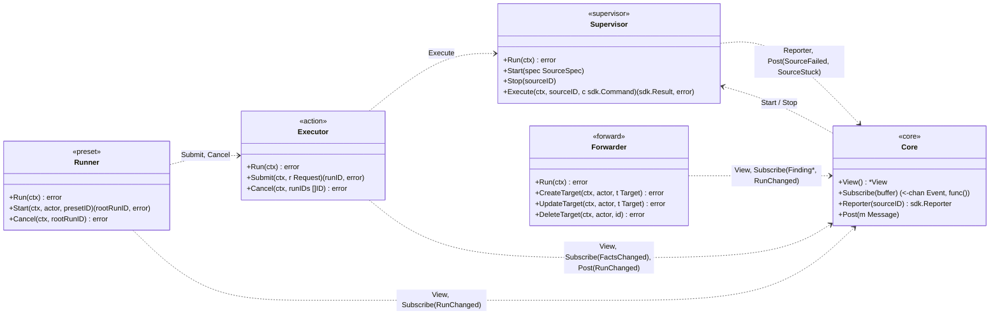
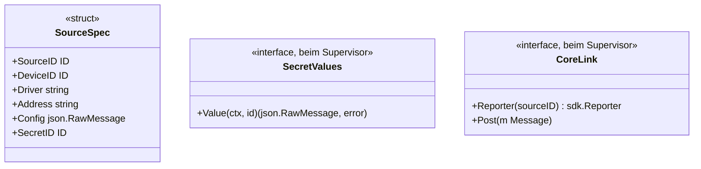
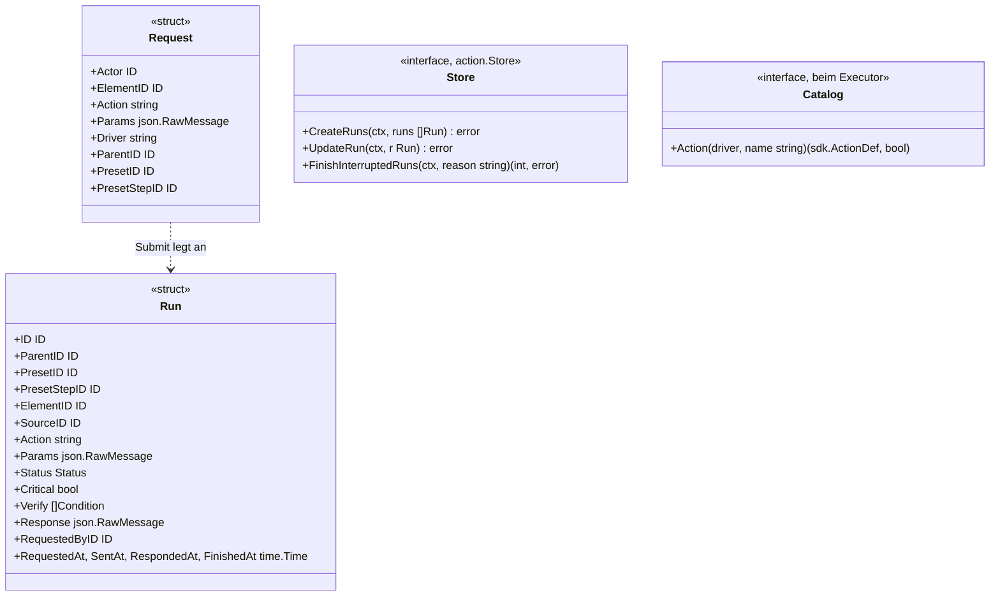
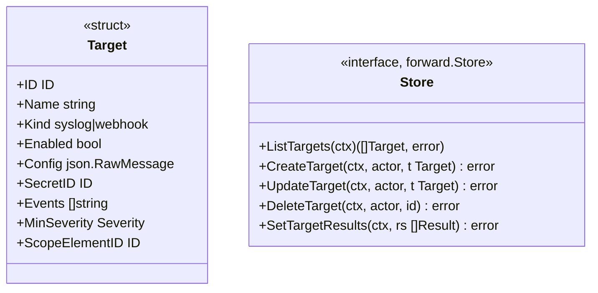
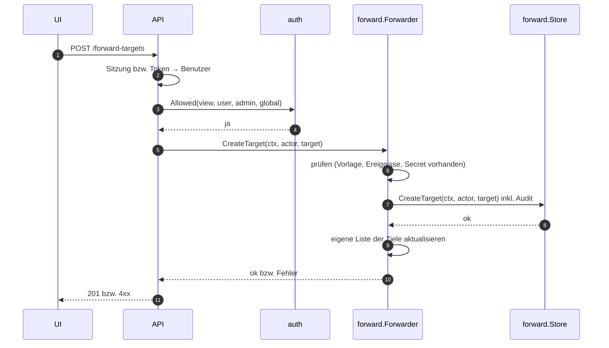

# Vertrag: Dienste

**Status:** abgestimmt am 2026-10-09. **Hintergrund:** [`core.md`](core.md) (Schleife, `View`, Ereignisse), [`flows.md`](flows.md) (Abläufe), [`sdk.md`](sdk.md).

Dienste laufen neben der Schleife des Core, mit eigenen Goroutinen und eigenem Zustand. Mit dem Core sprechen sie nur über Nachrichten, Ereignisse und die `View`. Abhängigkeiten bekommen sie als kleine Interfaces, definiert beim Verwender.

## Überblick

`Core.Post(m)` stellt eine Nachricht in die Schleife, ohne auf ihre Verarbeitung zu warten (im Gegensatz zu `Do`).

## Supervisor (`internal/core/supervisor`)

- `Start` und `Stop` kommen aus der Schleife und kehren sofort zurück; der Supervisor arbeitet sie in eigener Goroutine ab. Für dieselbe Quelle gilt die Reihenfolge der Aufträge.
- `Start` holt den Klartext des Secrets (`secret.Service` erfüllt `SecretValues`), erzeugt `SourceConfig` mit Logger (`driver`, `source_id`, `device_id`) und Scheduler und startet `Run` hinter einer `recover`-Grenze.
- Er meldet der Schleife `SourceFailed{sourceID, err}` (Fehler, Panic) und `SourceStuck{sourceID}` (`sdk.md`, Stoppen) und startet nach `Backoff` neu, nie zwei Instanzen derselben Quelle.
- `Execute` ruft `Source.Execute` hinter einer `recover`-Grenze; läuft die Quelle nicht: `ErrSourceNotRunning` (der Lauf endet als `failed`).

## Executor (`internal/action`)

- `Submit` löst das Ziel über die `View` auf (Element; Sammelaktion auf Gerät oder Gruppe mit bzw. ohne Treiber, `docs/ARCHITECTURE.md` Abschnitt 9), legt den Lauf mit allen Kindern in **einer** Transaktion an (`CreateRuns`) und reiht die Element-Läufe in die Warteschlange ihres Elements ein. Der Aufrufer bekommt sofort die ID.
- `Critical` und `Verify` friert `Submit` ein: aus der Aktionsdefinition (`Catalog`, aus der Treiber-Registry), `critical_actions` des Elements bzw. bei `set` aus den gesetzten Schlüsseln.
- Jede Statusänderung: erst `UpdateRun`, dann `Core.Post(RunChanged)`. Die Schleife nimmt laufende Läufe in die `View` auf und verteilt `RunChanged` (Endzustand = `action.finished` für die Weiterleitung).
- Übergeordnete Läufe (Sammelaktion, Preset-Schritt) aktualisiert der Executor, sobald alle Kinder enden: schlechtester Status.
- `Cancel` beendet Läufe, die noch `pending` sind, als `cancelled`; bereits gesendete laufen zu Ende.
- `FinishInterruptedRuns` ruft der Bootstrap beim Start (F2).

## Preset-Runner (`internal/preset`)

- `Start` prüft das Recht `preset_run` nicht selbst (das tut die API), wohl aber die **Vorabprüfung** aller Schritte (`auth.Allowed` gegen die `View`, inkl. `critical`). Fehlt ein Recht: Fehler, nichts gestartet.
- Danach legt er den Wurzel-Lauf an (`Submit` mit `Action = "preset"`) und arbeitet die Stufen in eigener Goroutine ab (`flows.md`, Preset-Lauf). Auf das Ende der Läufe einer Stufe wartet er über `RunChanged`-Ereignisse.
- Presets anlegen, ändern und löschen laufen ebenfalls über den Preset-Runner (er besitzt `preset.Store`); die Prüfung, ob `driver` bei Aktionen für das ganze Gerät angegeben ist, gehört dorthin.

## Weiterleitung (`internal/forward`)

- Die Weiterleitung besitzt `forward.Store`; die API ändert Ziele über sie, nie direkt. Nach jeder Änderung arbeitet sie mit der neuen Liste weiter.
- `SetTargetResults` schreibt `last_sent_at` und `last_error` gesammelt im Takt, nicht pro Ereignis.

## Zusammenspiel mit der API

Die API ruft das zuständige Fachpaket auf, das Fachpaket schreibt über seinen Store. Die API kennt keinen Store und importiert nie `postgres`. Beispiel: Weiterleitungsziel anlegen.

Die API ist eine dünne Schicht: Anmeldung prüfen, Rechte prüfen, Fachpaket aufrufen, Fehler in HTTP-Antworten übersetzen. Inhaltliche Prüfungen liegen im Fachpaket. Pro Bereich definiert die API ein kleines Interface mit genau den Methoden, die sie braucht:

| Bereich | Die API ruft auf |
|---|---|
| Inventar, Regeln, Befunde quittieren | `Core.Do` |
| Aktionen | `Executor.Submit` |
| Presets (bearbeiten, starten) | `preset.Runner` |
| Weiterleitungsziele | `forward.Forwarder` |
| Secrets | `secret.Service` |
| Benutzer, Rollen, Rechte, Tokens, Sitzungen | `auth` |

Lesen: aktueller Stand aus der `View` bzw. vom Fachpaket; Verlauf (Audit, vergangene Läufe und Befunde) über eigene, rein lesende Queries.

## Entscheidungen

| # | Frage | Entscheidung |
|---|---|---|
| D1 | Wie erfahren UI, Weiterleitung und Preset-Runner von Läufen? | Executor meldet per `Core.Post(RunChanged)`; die Schleife führt laufende Läufe in der `View` und verteilt `RunChanged` – ein Ereignisstrom, ein Protokoll (C6) |
| D2 | Wer besitzt die Konfiguration der Dienste? | der jeweilige Dienst über seinen Store; die API ruft den Dienst auf, nie den Store |
| D3 | Woher kennt der Executor die Aktionsdefinitionen? | aus der Treiber-Registry über das Interface `Catalog` |
| D4 | `Cancel` bei gesendeten Läufen | nur `pending` wird `cancelled`; Gesendetes läuft zu Ende |
